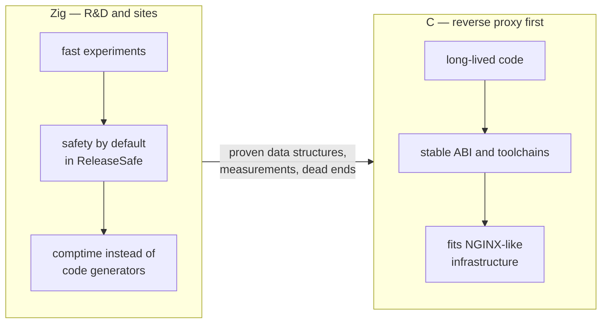
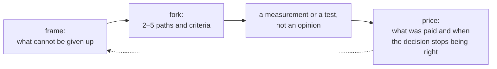

# Backend: what Clipper shows

This document is about me as a backend developer and about what I can do, using Clipper as the
example. I build sites like this one and choose solutions for them when the goals are
maintainability, reuse and solving a specific problem, and the language and technologies are chosen
for performance.

Yury Slinkin · [github.com/slnknrr-dev](https://github.com/slnknrr-dev)

Русская версия: [BACKEND_RU_CV.md](BACKEND_RU_CV.md).

## In short

- Clipper is **my first large-scale project in Zig**: about 35k lines of Zig (83 files, including
  tests and build tools), developed since November 2, 2026 as R&D.
- In parallel I am **studying C — data structures and storage** — to write highly optimized reverse
  proxies. Clipper is R&D in Zig, not a move away from C: Zig is more convenient here, and C remains
  my language for proxies.
- Every decision in the project is recorded with the rejected paths, dead ends and measurements — in
  the `*_RND.md` documents and in three books compiled into the server itself.

## Why Zig

The task dictated the language. The server has to hand the kernel bytes that already sit in memory,
allocating nothing on the request path; parse hostile files (PDF, DjVu, EPUB, MP3, WebP); and build
without a single external library — down to Windows XP.

| what is needed | C | Zig |
|---|---|---|
| no hidden allocations or calls | yes | yes |
| bounds checks in the production build (ReleaseSafe) | by hand | yes |
| compile-time computation in the same language | preprocessor | `comptime` |
| errors as values, `errdefer` | by hand | yes |
| cross-compilation without an external toolchain | no | yes, including Windows XP |
| working without libc | loses the point | the normal mode |
| language stability | decades | changes until 1.0 (hence pinned to 0.14.1) |

For R&D, where a storage engine, a codec and a protocol have to be tested within a week, Zig is
clearly more convenient than C: the same pointers and the same predictability, but bounds are
checked, generics are written in the language itself, and the allocator is passed explicitly and
replaced in tests with a counting one — a leak shows up immediately.

Details: [0x17-choice-language.md](src/books/0x17-choice-language.md) and the book
"Zig for the backend" ([1x00-title-intro.md](src/books/1x00-title-intro.md)).

## Why C — for reverse proxies

A proxy lives for years next to system code and modules of other servers — there a stable language
and ABI matter, and that is C. Clipper is a proving ground where structures and storage approaches
are tested faster and more safely, and the results (what is fast, what is a dead end) are carried
over to C.

## What I built in the project

| area | solution | evidence |
|---|---|---|
| network | own HTTP/1.1, event loop, worker processes, IPv4+IPv6 on one socket | ~70k requests/s on one thread, ~195k/s with 8 workers; 44 hostile-network cases |
| TLS | own TLS 1.3: ECDSA P-256, Ed25519, AES-GCM, ChaCha20-Poly1305 | curl and openssl |
| storage | in-memory catalog snapshot (read-only) + a journal or a copy-on-write B+ tree | the same history through both stores gives the same result |
| cache | guest page cache, 16 KB book frames | p99 < 1.5 ms on cached pages |
| compression | own zstd per RFC 8878 + dictionary training | 82–94 % of deflate — [COMPRESSION_RND.md](COMPRESSION_RND.md) |
| formats | parsing FB2, EPUB, PDF, DjVu; PNG, JPEG, GIF, WebP, SVG; MP3, Vorbis, AAC and an MP3 encoder | checked against WIC, Chromium, ffmpeg — [EBOOKS_RND.md](EBOOKS_RND.md) |
| security | Argon2id, CSRF, hashed sessions, strict parsing, hostile input | 60k corrupted requests, 50k forms — no panics, no 500s, no leaks |
| product | 4 themes, 7 site archetypes via flags, federation of sites | 7 × 4 × 2 variants crawled in tests — [DIGITALLIBRARY_RND.md](DIGITALLIBRARY_RND.md) |
| compatibility | HTML 4.01, no JS application, Windows XP builds | [Y2K_RND.md](Y2K_RND.md) |
| DevOps | cross-compiling five targets (Windows XP+, Windows 10+, Linux) on one runner, releases from tags | GitHub Actions — [DEVOPS_RND.md](DEVOPS_RND.md) |

## How I choose solutions

- **Maintainability.** Data is split into what is read (prepared in advance) and what is written (in
  the simplest way that survives a crash). Server complexity is defined not by volume but by what the
  site can do — so I judge every feature by how much "smarter" it makes the server.
- **Reuse.** One page function serves the site, embedding and the cache; one palette serves all
  themes; one canonical book representation serves every download format.
- **Solving the problem, not using the technology.** Where deflate is enough — deflate; zstd with a
  dictionary is an option when a measurement shows a gain. A negative result is recorded too: our own
  order-3 compression model turned out 30 times slower — a dead end, and it is documented.
- **Optimization with proof.** A claim counts as proven only if a test, a measurement or a found bug
  stands behind it.

## What I can do for you

- A storage site, a library, a knowledge base or a community — fast, on modest hardware, without
  unnecessary dependencies.
- Choosing a storage and caching architecture for the load and the budget: from "dumb" serving of
  ready bytes to writing with moderation.
- High-performance network components: reverse proxies in C, protocols, format parsing.
- R&D: compare options, measure, honestly describe the price of each.

Contact: via [GitHub](https://github.com/slnknrr-dev).

If you find the project interesting and want it to grow — [support it with a donation](https://slnknrr-dev.github.io/funding#?github=clipper-site-in-zig&locale=EN&source=BACKEND_CV.md).
