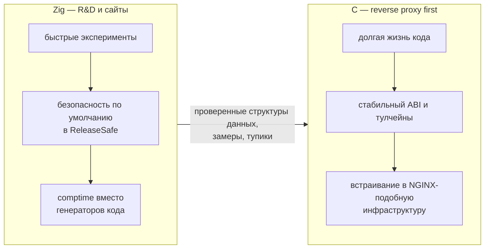

# Backend: что показывает Клиппер

Этот документ — обо мне как о backend-разработчике и о том, что я умею на примере Клиппера. Я
делаю такие сайты и подбираю для них решения, когда цель — поддерживаемость, переиспользование,
решение конкретной задачи, а язык и технологии выбираются ради производительности.

English version: [BACKEND_CV.md](BACKEND_CV.md).

Yury Slinkin · [github.com/slnknrr-dev](https://github.com/slnknrr-dev)

## Коротко

- Клиппер — **мой первый масштабный проект на Zig**: около 35 тыс. строк на Zig (83 файла, с тестами и инструментами сборки),
  сделан с 2 ноября 2026 года как R&D.
- Параллельно я **изучаю C — структуры данных и хранение**, чтобы писать высокооптимизированные
  reverse proxy. Клиппер — R&D на Zig, а не уход от C: Zig здесь удобнее, C остаётся моим языком
  для прокси.
- Каждое решение в проекте записано вместе с отвергнутыми путями, тупиками и замерами — в
  `*_RU_RND.md` и в трёх книгах, вшитых в сам сервер.

## Почему Zig

Задача диктовала язык. Сервер должен отдавать ядру байты, которые уже лежат в памяти, ничего не
выделяя на пути запроса; разбирать враждебные файлы (PDF, DjVu, EPUB, MP3, WebP); собираться без
единой внешней библиотеки — вплоть до Windows XP.

| что нужно | C | Zig |
|---|---|---|
| нет скрытых выделений и вызовов | да | да |
| проверка границ в боевой сборке (ReleaseSafe) | вручную | да |
| вычисления при компиляции на том же языке | препроцессор | `comptime` |
| ошибки как значения, `errdefer` | вручную | да |
| кросс-сборка без внешнего тулчейна | нет | да, включая Windows XP |
| работа без libc | теряет смысл | обычный режим |
| стабильность языка | десятилетия | до 1.0 меняется (поэтому закреплён 0.14.1) |

Для R&D, где за неделю нужно проверить хранилище, кодек и протокол, Zig явно удобнее C: те же
указатели и та же предсказуемость, но границы проверяются, шаблоны пишутся на самом языке, а
распределитель памяти передаётся явно и подменяется в тестах на считающий — утечка видна сразу.

Подробно — [0x17-choice-language.md](src/books/ru/0x17-choice-language.md) и книга
«Zig для backend» ([1x00-title-intro.md](src/books/ru/1x00-title-intro.md)).

## Почему C — для reverse proxy

Прокси живёт годами, рядом с системным кодом и модулями чужих серверов — там важны стабильный язык и
ABI, и это C. Клиппер — полигон, на котором структуры и способы хранения проверяются быстрее и
безопаснее, а результаты (что быстро, что тупик) переносятся в C.

## Что я сделал в проекте

| область | решение | чем подтверждено |
|---|---|---|
| сеть | свой HTTP/1.1, цикл событий, процессы-воркеры, IPv4+IPv6 одним сокетом | ~70 тыс. запросов/с на одном потоке, ~195 тыс./с с 8 воркерами; 44 случая враждебной сети |
| TLS | свой TLS 1.3: ECDSA P-256, Ed25519, AES-GCM, ChaCha20-Poly1305 | curl и openssl |
| хранение | снимок каталога в памяти (только чтение) + журнал или B+ дерево copy-on-write | одна история через оба хранилища даёт одинаковый результат |
| кэш | кэш гостевых страниц, кадры книг по 16 КБ | p99 < 1,5 мс на страницах из кэша |
| сжатие | свой zstd по RFC 8878 + обучение словарей | 82–94 % от deflate — [COMPRESSION_RU_RND.md](COMPRESSION_RU_RND.md) |
| форматы | разбор FB2, EPUB, PDF, DjVu; PNG, JPEG, GIF, WebP, SVG; MP3, Vorbis, AAC и кодер MP3 | сверка с WIC, Chromium, ffmpeg — [EBOOKS_RU_RND.md](EBOOKS_RU_RND.md) |
| безопасность | Argon2id, CSRF, сеансы-хеши, строгий разбор, враждебный ввод | 60 тыс. испорченных запросов, 50 тыс. форм — ни паник, ни 500, ни утечек |
| продукт | 4 темы, 7 архетипов сайта по флагам, федерация сайтов | обход 7 × 4 × 2 вариантов в тестах — [DIGITALLIBRARY_RU_RND.md](DIGITALLIBRARY_RU_RND.md) |
| совместимость | HTML 4.01, без JS-приложения, сборка под Windows XP | [Y2K_RU_RND.md](Y2K_RU_RND.md) |
| DevOps | кросс-сборка пяти целей (Windows XP+, Windows 10+, Linux) на одном раннере, релизы по тегу | GitHub Actions — [DEVOPS_RU_RND.md](DEVOPS_RU_RND.md) |

## Как я выбираю решения

- **Поддерживаемость.** Данные делятся на читаемые (готовятся заранее) и записываемые (самым простым
  способом, который переживает сбой). Сложность сервера определяют не объёмы, а возможности сайта —
  поэтому каждую возможность я оцениваю по тому, насколько «умнее» она делает сервер.
- **Переиспользование.** Одна страница-функция обслуживает сайт, встраивание и кэш; одна палитра —
  все темы; одно каноническое представление книги — все форматы выгрузки.
- **Решение задачи, а не технологии.** Где хватает deflate — deflate; zstd со словарём — опция, когда
  замер показывает выигрыш. Отрицательный результат тоже записывается: своя модель сжатия порядка 3
  оказалась в 30 раз медленнее — это тупик, и он задокументирован.
- **Оптимизация с доказательством.** Утверждение считается доказанным, только если за ним стоит тест,
  замер или найденная ошибка.

## Что я могу сделать для вас

- Сайт-хранилище, библиотеку, базу знаний или сообщество — быстрые, на скромном железе, без лишних
  зависимостей.
- Подбор архитектуры хранения и кэширования под нагрузку и бюджет: от «тупой» раздачи готовых байтов
  до записи с модерацией.
- Высокопроизводительные сетевые компоненты: reverse proxy на C, протоколы, разбор форматов.
- R&D: сравнить варианты, измерить, честно описать цену каждого.

Связаться: через [GitHub](https://github.com/slnknrr-dev).

Если проект вам интересен и хочется, чтобы он развивался, — [поддержите его донатом](https://slnknrr-dev.github.io/funding#?github=clipper-site-in-zig&locale=RU&source=BACKEND_CV.md).
