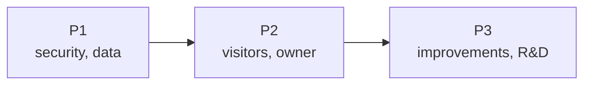
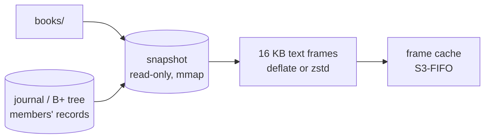
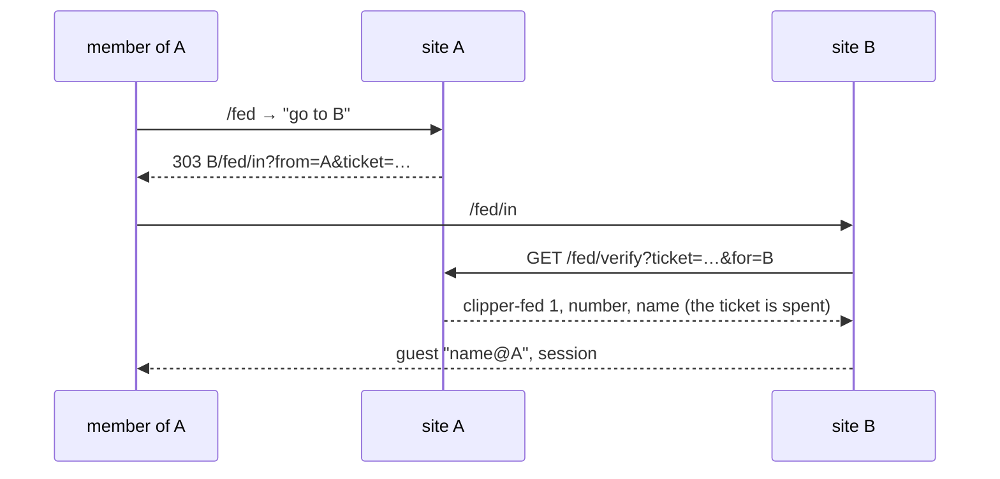

# Clipper backlog and engineering log

Two documents in one. **Part I** is the backlog: what is not done and what is not verified, by
priority. **Part II** is a reference on how things work and where they stand: sections §1–§23 (code
comments refer to these numbers, in the Russian version [BACKLOG_RU.md](BACKLOG_RU.md)). Project
overview — [README.md](README.md), research — `*_RND.md`, building and releases —
[DEVOPS_RND.md](DEVOPS_RND.md).

Русская версия: [BACKLOG_RU.md](BACKLOG_RU.md).

State as of November 21, 2026.

---

# Part I. Backlog

Priority: **P1** — affects security or data loss; **P2** — noticeable to visitors or the site owner;
**P3** — improvement and research.



## Not done

| # | priority | what | where | § |
|---|---|---|---|---|
| 1 | P1 | Journal compaction: the record file only grows | `journal.zig` | §3 |
| 2 | P1 | Reclaiming space in the B+ tree without a restart | `btree.zig` | §3 |
| 3 | P2 | An address binding flag (`-bind 127.0.0.1`): the server currently listens on all interfaces, and behind NGINX the port has to be closed with a firewall | `net/net.zig`, `cli.zig` | §1 |
| 4 | P2 | Heavy work off the event loop: parsing large PDFs (seconds), re-encoding sound (~35 s per hour of audiobook), the federation ticket question (up to 8 s) — they currently hold the process, and with `-w` also the write lock | `import.zig`, `audio/`, `fed.zig` | §11, §12, §22 |
| 5 | P2 | A "hidden" flag for posts — minimal moderation without deletion | `pages/forum.zig` | — |
| 6 | P2 | A notice that full-text search is off because of the library size | `pages/main.zig` | — |
| 7 | P2 | An OPDS catalog for e-readers | new section | — |
| 8 | P2 | A source for `/d` articles (books, poems and recordings have one) | `pages/drafts.zig` | §23 |
| 9 | P2 | Uploading a book from a recording's page keeps it under the uploader: the book form has no author choice | `pages/books.zig` | §23 |
| 10 | P2 | A `clipper user` command (members are currently managed only from `/panel`) | `cli.zig` | §10 |
| 11 | P3 | zstd by default: the snapshot is still compressed with deflate | `library.zig` | §15 |
| 12 | P3 | Faster zstd compression: the dictionary window is re-hashed for every frame | `zstd.zig` | §15 |
| 13 | P3 | MP3 encoder: psychoacoustics and short blocks (17–26 dB per block on loud music; enough for speech) | `audio/mp3enc.zig` | §22 |
| 14 | P3 | DjVu: the outline (NAVM) and books split into separate files (indirect) | `import/djvu.zig` | §3 |
| 15 | P3 | Images: CMYK and 12-bit JPEG, arithmetic coding, GIF/WebP animation | `img/` | §17, §19 |
| 16 | P3 | Sound: full HE-AAC (SBR/PS), AAC Main/SSR/LTP, CCE, Vorbis floor 0, free-format MP3 | `audio/` | §22 |
| 17 | P3 | Separate types for raw and escaped strings (catching double or missing escaping at compile time) | `out.zig` | — |
| 18 | P3 | Translation: strings joined with `++` and console messages; `tpl/marks.js` is one key per file | `t9n.zig` | §13 |
| 19 | P3 | Signing release archives (SHA-256 checksums only for now) | CI | — |

## Not verified

| # | what | how to close it | § |
|---|---|---|---|
| 1 | Linux in production: epoll, `fork` of workers — it builds, but the probe, load test and races ran only on Windows 11 | run `test/hostile`, `test/workers`, `zig build load` on Linux | §10, §11 |
| 2 | Real Windows XP and Windows 7, including workers and IPv4-only | run in a virtual machine | §10, §11 |
| 3 | Federation over https between two sites; recording a new site that arrived with a guest | two servers with certificates | §12 |
| 4 | A crash in the middle of a B+ tree write — resilience only by construction | a test that cuts a write | §3 |
| 5 | TLS: no third-party audit; key checks against references, curl and openssl are done | an audit, testssl.sh | §6 |
| 6 | Compatibility of dictionary zstd frames with the reference `zstd -D` | run the reference `zstd` | §15 |
| 7 | PDFs from Word, LaTeX, InDesign and scanners with an OCR layer; EPUBs from other programs; DjVu with an outline and line zones | a set of files | §3, §18 |
| 8 | Progressive JPEG 4:2:0 and 4:2:2; AAC with short windows, TNS, PNS, IS; MP3 MPEG-2/2.5, intensity stereo, mixed blocks | sample files | §17, §22 |
| 9 | Load over a network (the load client ran on the same machine) | measure from another machine | §11 |
| 10 | The S3-FIFO frame cache versus a simpler one — chosen from a paper, not a measurement | a measurement | §3 |
| 11 | 45 minutes of federation guest inactivity — only a unit test with substituted time | a manual check | §12 |
| 12 | Screenshots of the home pages of 56 section combinations (links and texts are checked, not the look) | an eyeball comparison | §21 |
| 13 | The first CI run on GitHub | push a tag | — |
| 14 | The mobile version at 390 px width: in a headless Edge screenshot the home page section tiles (flibusta theme) overflow the edge | a phone or device emulation in a browser | §21 |

---

# Part II. Reference

## 1. Running

```
clipper -p PORT [-r ROOTDIR] [-t flibusta|samlib|proza|nepomn] [-btree] [-w N]
        [--tls-cert FILE --tls-key FILE] [-fed [FILE.csv|-|site,site]]
```

| flag | meaning | default |
|---|---|---|
| `-p PORT` | port, **required**; without it — an error and a non-zero exit code | — |
| `-r ROOTDIR` | library folder (§3) | current folder |
| `-t THEME` | default theme for visitors without `?t=` | `flibusta` |
| `-d MODE` | mode: `auto` — by device, `false` — light, `true` — dark, `time` — by the clock | `auto`; with `-c` or `-b` — `false` |
| `-c COLOR`, `-b COLOR` | main and brand color `#rrggbb` (§14) | the theme's own |
| `-M`, `-R`, `-G`, `-N` + letters `pbdfqv` | sections: moderators write only, read-only, open to guests, off (§21) | all open |
| `-ico FILE`, `-png FILE` | own icon and logo (up to 1 MB) | built-in |
| `-img FOLDER` | image folder (§19) | `ROOTDIR/img` |
| `-btree` | records in a B+ tree instead of the journal | journal |
| `-w N` | worker processes, 1–64 (§10) | 1 |
| `-s ADDRESS`, `-n NAME` | site address and name in the design | `clipper.localhost`, `Клиппер` |
| `--tls-cert`, `--tls-key` | https (own TLS 1.3, §6); only as a pair | http |
| `-l LOGIN` | login of `/u/0` | `admin` |
| `-pwd PASSWORD` / `-phc STRING` | the `/u/0` password or an argon2id PHC string (`clipper hash`); not both | none — `/u/0` cannot sign in |
| `-zstd [N\|FILE]` | book frames with our zstd and a dictionary (§16) | deflate |
| `-pdf`, `-djvu` | accept PDF and DjVu (§18) | no |
| `-fed [WHAT]` | federation (§12) | off |

Commands: `clipper build` (snapshot), `clipper hash` (PHC string), `clipper convert FILE` (canonical
form of a book), `clipper zstd N [FOLDER…]` (dictionary, §16), `clipper fedcheck SITE` (§12).

The `/u/0` sign-in is set only by flags, is never written to storage and works only from this
machine (127.0.0.0/8 and ::1) and not through a reverse proxy: a request with an `X-Forwarded-For`, `X-Real-IP`,
`Forwarded` or `Via` header counts as external ([TLS_RND.md](TLS_RND.md)). It is a setup mechanism, not an administration one: sign in, create
your own administrator — a member with rights — and work as them. A password in `-pwd` is visible in
the process list — that is what `-phc` is for. A flag parsing error, a bad PHC string or an unsuitable
TLS key — the server does not start, prints one clear line and exits with a non-zero code.

## 2. Addresses and behavior

Addresses: `/` `/help` `/s` `/theme?url=` `/bookmarks` · `/p/{±N}` · `/b/{±N}` `/b/0` `/b/N/K` `/b/N/-a`
`/b/N/-a-b` `/b/N/{txt,fb2,epub}` `/b/upload` · `/q/N` · `/c/{±N}` · `/d/{±N}` · `/f/N` `/f/{board}` ·
`/v/{±N}` `/v/N.mp3` · `/u/{±N}` `/u/0` · `/signin` `/signup` `/logout` `/panel` · `/e/…` · `/x/…` ·
`/fed/…` · `/files/…`.

- The `t` (theme) and `m` (mobile version) parameters are carried through every link and form.
- 4 themes × `auto|light|dark|time` modes; a mobile version.
- Rights are bits: forum, upload, comment, write, quote, staff. Staff have the powers of `/u/0`, except
  granting staff rights.
- CSRF on every POST; sessions with a list and "sign out everywhere"; comments two levels deep, false
  links → 404.
- Boards with TTL auto-deletion; drafts → poems / → book.
- **Quotes and bookmarks** — from a book, poem, song or article: our own context menu
  (`oncontextmenu`, IE5+) or a form under the text without JavaScript. A quote is attributed to an
  author or a **character** (author → books).

Parity with the mockup is checked by `node test/contract/run.mjs MOCKUP CLIPPER` (§11): status codes,
redirects and page text must match; features beyond the mockup are cut out.

## 3. Data and the library folder

```
ROOTDIR/
  FEDIVERSE.csv          federation site list (§12)
  books/                 source books (fb2, epub, txt; canonical text of uploaded pdf, djvu)
  library.N.snap         catalog snapshots; library.current — the one in use
  clipper.journal        record journal (default)
  clipper.tree           B+ tree (with -btree)
  files/                 files under /files/…
  img/                   book images (img/b), boards and profiles
  voice/                 recordings N.mp3 (§22)
```



1. **The catalog snapshot** — books, series, poems, people and quotes in the form the server serves
   them: ready fragments in windows-1251, lists, indexes. Immutable, memory-mapped. Built by
   `clipper build` from `books/` and storage records; a new generation is picked up without a restart.
2. **Book text in frames** of ~16 KB, each compressed separately (deflate; with `-zstd` — our zstd
   with a dictionary). A reading page or a `Range` decompresses 1–2 frames. The decompressed frame
   cache is S3-FIFO.
3. **Records** — one `ledger` interface over two stores:
   - **journal** (default): lines with a checksum, under a file lock; read in full at startup; a torn
     line is cut off;
   - **B+ tree** (`-btree`): copy-on-write, two meta pages with checksums, one writer, lock-free readers.
   A test runs the same history through both and compares.

Passwords — Argon2id; a session is a random cookie, storage keeps its hash.

### Book formats

Whatever is uploaded, the book is reduced to one form: a description and chapters of paragraphs in windows-1251.

| format | how it is accepted |
|---|---|
| txt | chapters are "## Title" lines |
| fb2 | put into `books/` as is, parsed when the snapshot is built |
| epub | put as is (for the images, §17); ZIP → OPF → XHTML; a chapter is a document and h1–h3 headings; DRM is not opened |
| pdf | text layer only: objects by scanning the file, Flate/LZW/ASCII85/ASCIIHex/RunLength streams, glyphs by ToUnicode or names, paragraphs by coordinates, running heads removed, chapters from the outline |
| djvu | text layer only: own BZZ, lines from zones or the text breakdown, scan skew handled; the outline is not read; indirect is not accepted |

Poetry in PDF and DjVu: if 60 % of a page's lines do not reach the right margin, lines are not
joined. Uploaded pdf and djvu go into `books/` as canonical text (`#clipper-book`). Rejections with a
reason: a scan without text, a password-protected PDF, a font without a character map, an EPUB with
DRM, more than 384 MB after decompression. Details — [EBOOKS_RND.md](EBOOKS_RND.md).

## 4. The server

- One event loop, non-blocking sockets: Linux — epoll, Windows XP+ — `select`. Connection slots are
  allocated once; the request path allocates nothing.
- A response is a list of slices sent in one call (scatter-gather): into the snapshot, into templates
  in the binary and into a small per-request buffer.
- **Templates** — `@embedFile`, split at `{{name}}` and converted to windows-1251 at compile time. All 4
  themes in one binary.
- **Colors separate from markup**: CSS variables, `/css/{theme}-{mode}.css` with a long cache.
- **A ready page cache** for guests: the key is path + `t` + `m`; reset by the snapshot generation and
  the journal change counter.
- Limits: headers ≤ 8 KB, form body ≤ 64 KB, book upload ≤ 50 MB, recordings ≤ 200 MB (in a temporary
  file); read timeouts.
- `HEAD`, `If-Modified-Since`/`ETag`, `Range`.

## 5. Generated on the fly

txt/fb2/epub (own ZIP), SVG and PNG badges (own PNG encoder, a pixel font), BMP theme gradients,
embeddable `/e/…`, panel and session pages.

## 6. TLS 1.3

A server built on std primitives: X25519, AES-128-GCM and ChaCha20-Poly1305, HKDF-SHA256, ECDSA P-256 /
Ed25519. RSA keys are not supported (std has no RSA signing) — the server refuses to start and says
so. No resumption or 0-RTT; ALPN `http/1.1`. Checked with curl and openssl.

## 7. Modules

```
src/main.zig, cli.zig      startup, flags, commands
src/net/                   event loop, connections, TLS, outgoing client
src/http.zig               request parsing, slice responses, cookies, forms, multipart
src/route.zig              addresses → handlers
src/out.zig                page writer: escaping, {U}…{E}, translation
src/cp1251.zig, t9n.zig    encoding; interface translation at compile time (§13)
src/tpl/, theme.zig        theme templates, palettes, CSS, BMP gradients (§14)
src/pages/                 pages by section
src/sections.zig           sections and the -M -R -G -N flags (§21)
src/snapshot.zig, library.zig   the snapshot and its build; cache.zig — S3-FIFO
src/ledger.zig, journal.zig, btree.zig, db.zig   records and the data model
src/auth.zig               accounts, sessions, rights, CSRF
src/fed.zig                federation (§12)
src/import.zig, import/    book parsing (§3, §18); fb2.zig
src/img/, imgstore.zig     images (§17, §19)
src/audio/                 sound (§22)
src/zstd.zig, zdict.zig, zfile.zig   own zstd, dictionary training and file (§15, §16)
src/export.zig, badge.zig  exports, badges
src/workers.zig            workers (§10)
src/books/[ru/]            built-in books (§13)
tools/                     books.zig, t9n.zig — build steps; load.zig — load test; fixture.zig — fixture
test/                      unit, end-to-end, hostile input, contract, workers, federation
```

## 8. Stages of the main version

| # | what | done when |
|---|---|---|
| 0 | skeleton: `build.zig`, flags, `-p` required | `clipper -p 3000` answers |
| 1 | HTTP, router, cp1251, templates, 4 themes × modes | home and `/help` in every theme |
| 2 | snapshot, reading pages, search, `/b/0` | contract cases for reading |
| 3 | journal, accounts, sessions, rights, CSRF, `/u/0` | rights scenarios; the journal survives a crash |
| 4 | books: reading, comments, upload, frames, exports | `Range`, epub in an e-reader |
| 5 | forums, boards with TTL, drafts → poems/book | as in the mockup |
| 6 | embedding, badges, `/files/…` | all iframes and badges |
| 7 | B+ tree | identical answers from both stores |
| 8 | TLS 1.3 | curl and a browser |
| 9 | load and robustness | measurements, hostile input, no leaks |

All stages were done by November 16, 2026; further work — §12–§23.

## 9. Differences from the first version

- the theme is chosen at launch and with `?t=`, not at build time; the `proza` theme was added;
- compression: deflate by default, our zstd with a dictionary is an option (§15–§16);
- Windows XP remains a target; TLS on XP is our own, not the system's;
- not carried over: duplicate search (BLAKE3/MinHash/FastCDC), "heat", easter-egg addresses (book 0 is what remains of them);
- federation is our own (§12): one-time tickets between Clipper sites.

## 10. Decisions

1. **The program has no demo data**: a fresh site holds the built-in books and `/u/0`. Test data —
   `zig build fixture -- FOLDER`.
2. **Members are managed by `/u/0` and staff via `/panel`**; there is no `clipper user` command.
3. **Workers are processes (`-w N`, 1–64)**: the build is single-threaded (Zig mutexes rely on SRW
   locks, which XP lacks). The main process does the one-time work (snapshot, password, TLS key,
   port), opens the socket and starts the workers, restarting any that crash.
   - **Linux**: `fork` after `listen`; `accept` is atomic in the kernel.
   - **Windows**: `CreateProcessW` with an inherited socket. The "non-blocking" flag lives in the
     process — the worker sets it itself (`net.adopt`). Non-blocking `accept` in two processes can
     hang — hence the **accept gate** (`net.Gate`): only the mutex owner accepts, in batches of 16.
   - **Data**: before reading, a worker catches up on others' records (`ledger.refresh`); a writing
     request runs under a file lock (`ledger.hold`). Each has its own caches; counters merge every 5 s.
   - Workers do not speed up writing: it goes one at a time and is bound by `fsync`.

## 11. Checks and measurements

| what | command | result |
|---|---|---|
| unit and end-to-end tests | `zig build test` | 98 tests (83 unit, 15 end-to-end); hostile input: 60k corrupted requests, 50k forms and ranges, ~9k requests through the application — no panics, no 500s, no leaks |
| parity with the mockup | `node test/contract/run.mjs MOCKUP CLIPPER` | 1198/1198 (both servers on fresh data; fill the clipper folder with `zig build fixture`) |
| hostile network | `node test/hostile/run.mjs localhost PORT [--slow]` | 42 cases (44 with `--slow`): garbage, limits, aborts, pipelining, 1500 connections at 1024 slots, timeouts |
| TLS 1.3 | `curl -k --tlsv1.3`, `openssl s_client -tls1_3` | ECDSA P-256 and Ed25519, AES-128-GCM and ChaCha20-Poly1305 |
| worker races | `node test/workers/run.mjs localhost PORT 16 10` | 16/16 with `-w 1/4/8` and `-btree` |
| federation | `node test/fed/run.mjs localhost 3931 3932 PASSWORD` | 42/42 |
| load | `zig build load -- localhost PORT -c 64 -n 200000 PATH...` | below |

Measurement (Windows 11, ReleaseSafe, client on the same machine, 64 keep-alive connections):

| `-w` | cached pages | cache misses | new connection per request |
|---|---|---|---|
| 1 | 72,200/s, p99 1.38 ms | 15,200/s, p99 6.58 ms | 19,600/s |
| 2 | 123,100/s, p99 0.95 ms | 29,900/s, p99 4.18 ms | 10,300/s |
| 4 | 170,900/s, p99 0.71 ms | 50,100/s, p99 2.74 ms | 11,000/s |
| 8 | 195,300/s, p99 0.90 ms | 68,000/s, p99 3.09 ms | 9,300/s |

With workers on Windows, new connections go through the gate and are therefore slower; long
connections and cache misses gain. Process memory before and after 300k requests — 100.6 and 100.7 MB.

Formats: PDFs from Edge and Chrome — verbatim (9826 words of 9826); our own EPUB comes back
verbatim; 200 real FB2s build and download; DjVu — two Wikimedia Commons books, 12–20 ms per book.

Network: one IPv6 socket with `IPV6_V6ONLY = 0` accepts both IPv4 and IPv6; where there is no dual
stack (XP), the server listens on IPv4 only.

## 12. Federation and panel settings

**The panel** (`/u/0` and staff): default design and what a visitor may choose; upload formats
separately for staff and others; the federation list.

**Federation** (`-fed`): a member of one site signs into another under their own name. The list is a
CSV `domain,authInsideService,authOutsideService`; the `localhost` line sets the defaults.

| launch | list | new sites |
|---|---|---|
| `-fed` | `ROOTDIR/FEDIVERSE.csv` | added automatically |
| `-fed FILE.csv` | this file | added automatically |
| `-fed -` | `ROOTDIR/FEDIVERSE.csv` | only the listed ones |
| `-fed a.ru,b.ru` | from the flag | only the listed ones |



A ticket lives 2 minutes and is single-use. A guest has no password; the session expires after 45
minutes of inactivity; a guest goes no further along the federation. https uses the std TLS client;
the XP build does not have it (http only).

## 13. Built-in books and the build language

| option | meaning | default |
|---|---|---|
| `-Dlang=ru\|en` | language of the interface and built-in books | `ru` |
| `-Dbook0` | book 0 "Inside Clipper" (`/b/0`) | `true` |
| `-Dbooks` | books 1 "Zig for the backend" and 2 "The 2003 Web for the backend" | `false` |

Only languages whose letters fit windows-1251. Books — `src/books/ru/<book>x<page>-<topic>.md`
(Russian) and `src/books/<book>x….md` (English); a book's description is at the start of its `Nx00`.
`tools/books.zig` turns them into the `books` module; a character outside windows-1251 is a build
error. Numbers 0–2 are never given to uploaded books. The author of the built-in books is `/u/0`. If
the books' fingerprint in storage does not match, the snapshot is rebuilt.

**Interface translation**: a string in the code is the key; the catalog is `src/t9n/LANG.t9n`.
`zig build t9n` collects keys into `ru.t9n` and appends new ones to other catalogs, keeping the
translations. Translation is substituted at compile time; for `ru` it costs nothing.

## 14. Colors: main (-c) and brand (-b)

Almost all of a theme's shades derive from the main color. `theme.setColors` recomputes palettes,
keeping each color's hue shift, saturation ratio and lightness position. Greys and semantic colors
are not recomputed.

| theme | default main | default brand |
|---|---|---|
| flibusta | `#5294c1` | — |
| samlib | `#0000ee` | — |
| proza | `#000080` | `#60b050` |
| nepomn | `#416679` | `#800000` |

If `-c` is given but not `-b`, the brand color is computed as a contrasting one. With `-c`, `-b`,
`-ico`, `-png` the addresses of styles and icons get a `?v=…` mark so the browser fetches the new ones.

## 15. Our own zstd

An encoder and decoder per RFC 8878 (`src/zstd.zig`): bit streams, FSE, literal Huffman, hash-chain
match finding in a "dictionary + frame" window. Without a dictionary std decompresses the frames too
(checked in tests). `-Dzstd=false` — no zstd in the program. The compression method and dictionary
fingerprint are in the snapshot header; if they do not match the launch, the snapshot is rebuilt.

Measurement, 16 KB frames, zstd relative to deflate: dictionary from books 1–2 → book 0 — 82 % ru,
85 % en; dictionary from the corpus → book 0 — 93–94 %, held-out prose — 87–89 %. Decompression
0.15–0.18 ms per frame, compression 2–3 ms. Details — [COMPRESSION_RND.md](COMPRESSION_RND.md),
[CORPUS_RND.md](CORPUS_RND.md).

## 16. The zstd dictionary as a file

| command | what it does |
|---|---|
| `clipper zstd N [-r ROOTDIR] [FOLDER…]` | trains a dictionary for N KB frames (4–32), writes `clipper<N>.zstd`; without folders — on your own library |
| `clipper -zstd N` | `clipper<N>.zstd` from the current folder or the program's folder |
| `clipper -zstd PATH` | this file |
| `clipper -zstd` | the current snapshot's dictionary, otherwise the largest `clipper<N>.zstd` |

The file: `CLIPZDIC`, version, frame size, dictionary length and fingerprint, the dictionary; all
checked. The corpus for experiments — `node corpus/fetch.mjs`, then `clipper zstd 16 corpus/ru`.

## 17. Images in books

From FB2 and EPUB. Our own PNG (all color types, Adam7; writing) and JPEG (baseline and progressive;
writing baseline 4:2:0). Fitting into 800×600 without upscaling: without transparency — JPEG q80, with
it — PNG. The `img/b/` store is shared across snapshot generations; whatever the current and previous
snapshots do not reference is cleaned up. Checked against WIC: PNG bit-exact, JPEG PSNR 50–68 dB.

## 18. PDF and DjVu — experimental

Build: `-Dpdf`, `-Ddjvu` (yes by default; false — no parser). Launch: `-pdf`, `-djvu` — without the
flag nobody can upload the format, including `/u/0`. The library neither stores nor serves PDF and
DjVu: only the text is taken.

## 19. GIF, WebP, SVG and the image folder

GIF (first frame), WebP (VP8, VP8L, ALPH, VP8X), SVG (own XML and rasterizer: paths, shapes, `use`,
transforms, gradients, strokes). SVG is stored as PNG. Checked: GIF and WebP against WIC bit-exact,
SVG against Chromium — PSNR 28–54 dB on 41 files. `-img FOLDER` — the whole image folder.

## 20. Poems and songs on behalf of an author

`/p/new` (the write right): a poem or song on behalf of any author (a new one is created by name) or
oneself. Genres: poems, free verse, bard song, song with chords (ChordPro, a negative number). Edited
and deleted by: the uploader, the author themself, a member bound to the author, staff, `/u/0`.
Binding a member to authors — on `/u/N` (staff and `/u/0`).

## 21. Sections, staff, profiles

**Sections** — letters `p b d f q v`; flags `-M` (moderators write), `-R` (read-only), `-G` (open to
guests, a list), `-N` (no section); flags are the ceiling for the panel. Archetypes: full library,
songbook, reading room, reading room with quotes, forum, quote book, workshop — see
[DIGITALLIBRARY_RND.md](DIGITALLIBRARY_RND.md). A crawl test: 7 combinations × 4 themes × 2 versions ×
(guest, member) — no links to or names of invisible sections.

**Staff** — the powers of `/u/0`, except granting staff rights. **Profiles** (`pages/profile.zig`): a
photo and pinned discussions; an author's page `/c/N` — profile, poems, books, characters, recordings.
Quotes from poems, songs and articles; drafts and articles can be deleted (author, staff, `/u/0`).

## 22. Recordings /v and sound

| level | what |
|---|---|
| build | `-Dvoice` (yes) — the section and all sound; `-Dogg` (yes), `-Dm4a` (no) |
| data | `V +N` recording, `V -N` reader, `v<member>` their readers, `r<name>` reader number; file `voice/N.mp3` |

Uploading needs the upload right (up to 200 MB). Any input is re-encoded to MP3 "as before 2003":
MPEG-1 Layer III, CBR 128 kbit/s, ID3v1 in cp1251. All our own: decoding MP3 (MPEG-1/2/2.5), Vorbis,
AAC LC in MP4; an MP3 encoder. Tables checked against ffmpeg byte for byte; decoding against the
browser's decoder: 126–132 dB. The encoder is ~100× faster than real time.

## 23. Links between works and the source

- A recording need not have a text: an audiobook without a book, a performance without a poem; it is
  linked later in any order — from the recording's page (link, or upload the book/text, `?voice=N`) or
  from the book's or poem's page (upload, or link a recording without a text, POST `/b/N/voice`,
  `/p/N/voice`).
- A reader is linked to an author ("read by the author"): their recordings are marked "(author)", and
  `/c/N` shows "Reads and performs their own work".
- **Source** (`pages/source.zig`, key `O<kind><number>`): an address or a name — mrakopedia, arxiv,
  habr; for books, poems and recordings. For an existing book — a form on its page.
