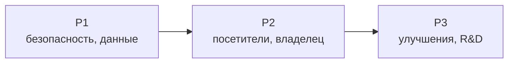
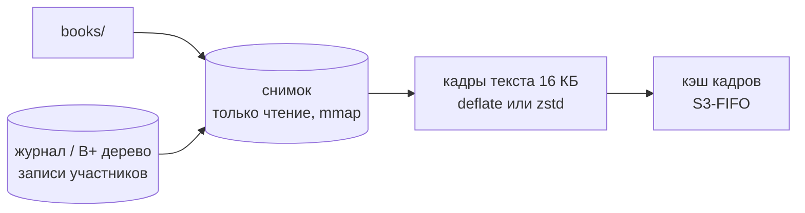
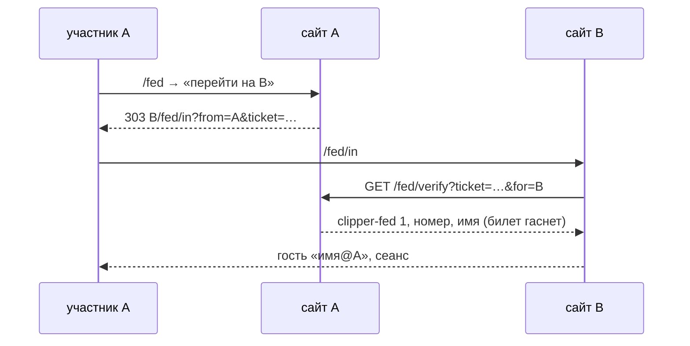

# Бэклог и инженерный журнал Клиппера

Два документа в одном. **Часть I** — бэклог: что не сделано и что не проверено, по приоритету.
**Часть II** — справочник по устройству и состоянию: разделы §1–§23 (на номера ссылаются комментарии
в коде). Обзор проекта — [README_RU.md](README_RU.md), исследования — `*_RU_RND.md`, сборка и
релизы — [DEVOPS_RU_RND.md](DEVOPS_RU_RND.md).

English version: [BACKLOG.md](BACKLOG.md).

Состояние на 21 ноября 2026 года.

---

# Часть I. Бэклог

Приоритет: **P1** — влияет на безопасность или потерю данных; **P2** — заметно для посетителей или
владельца сайта; **P3** — улучшение и исследование.



## Не сделано

| # | приоритет | что | где | § |
|---|---|---|---|---|
| 1 | P1 | Уплотнение журнала: файл записей только растёт | `journal.zig` | §3 |
| 2 | P1 | Возврат места в B+ дереве без перезапуска | `btree.zig` | §3 |
| 3 | P2 | Флаг привязки к адресу (`-bind 127.0.0.1`): сейчас сервер слушает все интерфейсы, и за NGINX порт приходится закрывать брандмауэром | `net/net.zig`, `cli.zig` | §1 |
| 4 | P2 | Тяжёлая работа вне цикла событий: разбор больших PDF (секунды), перекодирование звука (~35 с на час аудиокниги), вопрос о федеративном билете (до 8 с) — сейчас держат процесс, а с `-w` ещё и блокировку записи | `import.zig`, `audio/`, `fed.zig` | §11, §12, §22 |
| 5 | P2 | Флаг «скрыто» для сообщений — минимальная модерация без удаления | `pages/forum.zig` | — |
| 6 | P2 | Предупреждение, что поиск по тексту отключён из-за размера библиотеки | `pages/main.zig` | — |
| 7 | P2 | OPDS-каталог для читалок | новый раздел | — |
| 8 | P2 | Источник у статей `/d` (у книг, стихов и записей есть) | `pages/drafts.zig` | §23 |
| 9 | P2 | Выкладывание книги со страницы записи сохраняет её за выкладывающим: в форме книги нет выбора автора | `pages/books.zig` | §23 |
| 10 | P2 | Команда `clipper user` (участниками сейчас управляют только из `/panel`) | `cli.zig` | §10 |
| 11 | P3 | zstd по умолчанию: снимок по-прежнему сжимается deflate | `library.zig` | §15 |
| 12 | P3 | Ускорить сжатие zstd: окно словаря хешируется заново для каждого кадра | `zstd.zig` | §15 |
| 13 | P3 | Кодер MP3: психоакустика и короткие блоки (на громкой музыке 17–26 дБ на блок; для речи хватает) | `audio/mp3enc.zig` | §22 |
| 14 | P3 | DjVu: оглавление (NAVM) и книги из отдельных файлов (indirect) | `import/djvu.zig` | §3 |
| 15 | P3 | Картинки: CMYK и 12-битный JPEG, арифметическое кодирование, анимация GIF/WebP | `img/` | §17, §19 |
| 16 | P3 | Звук: HE-AAC (SBR/PS) полностью, AAC Main/SSR/LTP, CCE, пол 0 Vorbis, свободный битрейт MP3 | `audio/` | §22 |
| 17 | P3 | Разные типы для сырой и экранированной строки (защита от двойного и пропущенного экранирования при компиляции) | `out.zig` | — |
| 18 | P3 | Перевод: строки, склеенные через `++`, и сообщения в консоль; `tpl/marks.js` — один ключ на файл | `t9n.zig` | §13 |
| 19 | P3 | Подпись релизных архивов (сейчас только SHA-256) | CI | — |

## Не проверено

| # | что | чем закрыть | § |
|---|---|---|---|
| 1 | Linux в работе: epoll, `fork` воркеров — собирается, но зонд, замер и гонки шли только на Windows 11 | прогон `test/hostile`, `test/workers`, `zig build load` на Linux | §10, §11 |
| 2 | Настоящая Windows XP и Windows 7, в том числе воркеры и IPv4-only | запуск на виртуальной машине | §10, §11 |
| 3 | Федерация по https между двумя сайтами; запись нового сайта, пришедшего с гостем | два сервера с сертификатами | §12 |
| 4 | Сбой посреди записи в B+ дерево — устойчивость только по построению | тест с обрывом записи | §3 |
| 5 | TLS: стороннего аудита нет; проверены сверка ключей, curl и openssl | аудит, testssl.sh | §6 |
| 6 | Совместимость кадров zstd со словарём с эталонным `zstd -D` | прогон эталонного `zstd` | §15 |
| 7 | PDF из Word, LaTeX, InDesign и сканеров с OCR-слоем; EPUB сторонних программ; DjVu с оглавлением и с зонами строк | набор файлов | §3, §18 |
| 8 | JPEG progressive 4:2:0 и 4:2:2, AAC с короткими окнами, TNS, PNS, IS; MP3 MPEG-2/2.5, интенсивное стерео, смешанные блоки | файлы-образцы | §17, §22 |
| 9 | Нагрузка из сети (клиент замера работал на той же машине) | замер с другой машины | §11 |
| 10 | Кэш кадров S3-FIFO против более простого — выбор по статье, не по замеру | замер | §3 |
| 11 | 45 минут бездействия гостя федерации — только модульным тестом с подставленным временем | ручная проверка | §12 |
| 12 | Скриншоты главных страниц 56 сочетаний разделов (проверены ссылки и тексты, не вид) | сравнение глазами | §21 |
| 13 | Первый прогон CI на GitHub | пуш тега | — |
| 14 | Мобильная версия на ширине 390 px: на снимке headless Edge плитки разделов главной (тема flibusta) выходят за край | телефон или эмуляция устройства в браузере | §21 |

---

# Часть II. Справочник

## 1. Запуск

```
clipper -p PORT [-r ROOTDIR] [-t flibusta|samlib|proza|nepomn] [-btree] [-w N]
        [--tls-cert FILE --tls-key FILE] [-fed [ФАЙЛ.csv|-|сайт,сайт]]
```

| флаг | смысл | по умолчанию |
|---|---|---|
| `-p PORT` | порт, **обязателен**; без него — ошибка и код выхода ≠ 0 | — |
| `-r ROOTDIR` | папка библиотеки (§3) | текущая папка |
| `-t THEME` | тема по умолчанию для посетителей без `?t=` | `flibusta` |
| `-d РЕЖИМ` | режим: `auto` — по устройству, `false` — светлая, `true` — тёмная, `time` — по часам | `auto`; с `-c` или `-b` — `false` |
| `-c ЦВЕТ`, `-b ЦВЕТ` | главный и фирменный цвет `#rrggbb` (§14) | свои у темы |
| `-M`, `-R`, `-G`, `-N` + буквы `pbdfqv` | разделы: пишут только модераторы, только чтение, открыто гостям, выключено (§21) | всё открыто |
| `-ico ФАЙЛ`, `-png ФАЙЛ` | свой значок и логотип (до 1 МБ) | встроенные |
| `-img ПАПКА` | папка картинок (§19) | `ROOTDIR/img` |
| `-btree` | записи в B+ дереве вместо журнала | журнал |
| `-w N` | процессов-воркеров, 1–64 (§10) | 1 |
| `-s АДРЕС`, `-n НАЗВАНИЕ` | адрес и название сайта в оформлении | `clipper.localhost`, `Клиппер` |
| `--tls-cert`, `--tls-key` | https (свой TLS 1.3, §6); только парой | http |
| `-l ЛОГИН` | логин `/u/0` | `admin` |
| `-pwd ПАРОЛЬ` / `-phc СТРОКА` | пароль `/u/0` или строка PHC argon2id (`clipper hash`); вместе нельзя | нет — в `/u/0` не войти |
| `-zstd [N\|ФАЙЛ]` | кадры книг — своим zstd со словарём (§16) | deflate |
| `-pdf`, `-djvu` | принимать PDF и DjVu (§18) | нет |
| `-fed [ЧТО]` | федерация (§12) | выключена |

Команды: `clipper build` (снимок), `clipper hash` (строка PHC), `clipper convert ФАЙЛ` (канонический
вид книги), `clipper zstd N [ПАПКА…]` (словарь, §16), `clipper fedcheck САЙТ` (§12).

Вход `/u/0` задаётся только флагами, в хранилище не пишется и действует только с этой машины
(127.0.0.0/8 и ::1) и не через обратный прокси: запрос с заголовком `X-Forwarded-For`, `X-Real-IP`,
`Forwarded` или `Via` считается внешним ([TLS_RU_RND.md](TLS_RU_RND.md)). Это механизм настройки, а не администрирования: войти, завести своего
администратора — участника с правами — и работать от его имени. Пароль в `-pwd` виден в списке
процессов — для этого есть `-phc`. Ошибка разбора флагов, негодная строка PHC, неподходящий ключ TLS —
сервер не стартует, пишет одну понятную строку и выходит с ненулевым кодом.

## 2. Адреса и поведение

Адреса: `/` `/help` `/s` `/theme?url=` `/bookmarks` · `/p/{±N}` · `/b/{±N}` `/b/0` `/b/N/K` `/b/N/-a`
`/b/N/-a-b` `/b/N/{txt,fb2,epub}` `/b/upload` · `/q/N` · `/c/{±N}` · `/d/{±N}` · `/f/N` `/f/{доска}` ·
`/v/{±N}` `/v/N.mp3` · `/u/{±N}` `/u/0` · `/signin` `/signup` `/logout` `/panel` · `/e/…` · `/x/…` ·
`/fed/…` · `/files/…`.

- Параметры `t` (тема) и `m` (мобильная версия) протягиваются по всем ссылкам и формам.
- 4 темы × режимы `auto|light|dark|time`; мобильная версия.
- Права — биты: forum, upload, comment, write, quote, staff. Сотрудник (staff) имеет полномочия `/u/0`,
  кроме выдачи прав сотрудникам.
- CSRF на всех POST; сеансы со списком и «выйти везде»; комментарии глубиной 2, ложные связки → 404.
- Доски с автоудалением по TTL; черновики → стихи / → книга.
- **Цитаты и закладки** — из книги, стиха, песни и статьи: своё контекстное меню (`oncontextmenu`, IE5+)
  или форма под текстом без JavaScript. Цитата приписывается автору или **персонажу** (автор → книги).

Паритет с макетом проверяет `node test/contract/run.mjs МАКЕТ CLIPPER` (§11): совпадают коды ответов,
переадресации и текст страниц; возможности сверх макета вырезаются.

## 3. Данные и папка библиотеки

```
ROOTDIR/
  FEDIVERSE.csv          список сайтов федерации (§12)
  books/                 исходные книги (fb2, epub, txt; канонический текст выложенных pdf, djvu)
  library.N.snap         снимки каталога; library.current — какой в работе
  clipper.journal        журнал записей (по умолчанию)
  clipper.tree           B+ дерево (с -btree)
  files/                 файлы /files/…
  img/                   картинки книг (img/b), досок и профилей
  voice/                 записи N.mp3 (§22)
```



1. **Снимок каталога** — книги, серии, стихи, люди и цитаты в том виде, в каком их отдаёт сервер:
   готовые фрагменты в windows-1251, списки, индексы. Неизменяемый, отображается в память. Строится
   `clipper build` из `books/` и записей хранилища; новая генерация подхватывается без перезапуска.
2. **Текст книг кадрами** по ~16 КБ, каждый сжат отдельно (deflate, с `-zstd` — свой zstd со словарём).
   Страница чтения или `Range` распаковывает 1–2 кадра. Кэш распакованных кадров — S3-FIFO.
3. **Записи** — один интерфейс `ledger` над двумя хранилищами:
   - **журнал** (по умолчанию): строки с контрольной суммой, под файловой блокировкой; при старте
     читается целиком; оборванная строка обрезается;
   - **B+ дерево** (`-btree`): copy-on-write, две мета-страницы с контрольными суммами, один писатель,
     читатели без блокировок.
   Тест гоняет одинаковую историю через оба и сравнивает.

Пароли — Argon2id; сеанс — случайный cookie, в хранилище лежит его хеш.

### Форматы книг

Что бы ни прислали, книга приводится к одному виду: описание и главы из абзацев в windows-1251.

| формат | как принимается |
|---|---|
| txt | главы — строки «## Название» |
| fb2 | кладётся в `books/` как есть, разбирается при сборке снимка |
| epub | кладётся как есть (ради картинок, §17); ZIP → OPF → XHTML; глава — документ и заголовки h1–h3; DRM не открывается |
| pdf | только текстовый слой: объекты просмотром файла, потоки Flate/LZW/ASCII85/ASCIIHex/RunLength, знаки по ToUnicode или именам, абзацы по координатам, колонтитулы убираются, главы — оглавление |
| djvu | только текстовый слой: свой BZZ, строки из зон или разбивки, перекос скана учитывается; оглавление не читается; indirect не принимается |

Стихи в PDF и DjVu: если от 60 % строк страницы не доходят до правого поля, строки не склеиваются.
Выложенные pdf и djvu ложатся в `books/` каноническим текстом (`#clipper-book`). Отказы с причиной: скан
без текста, PDF с паролем, шрифт без таблицы знаков, EPUB с DRM, больше 384 МБ после распаковки.
Подробно — [EBOOKS_RU_RND.md](EBOOKS_RU_RND.md).

## 4. Сервер

- Один цикл событий, неблокирующие сокеты: Linux — epoll, Windows XP+ — `select`. Слоты соединений
  выделяются один раз; путь запроса ничего не выделяет.
- Ответ — список срезов одним вызовом (scatter-gather): в снимок, в шаблоны в бинарнике и в маленький
  буфер на запрос.
- **Шаблоны** — `@embedFile`, разрез по `{{имя}}` и перекодировка в windows-1251 при компиляции. Все 4
  темы в одном бинарнике.
- **Цвета отдельно от разметки**: CSS-переменные, `/css/{тема}-{режим}.css` с долгим кэшем.
- **Кэш готовых страниц** для гостей: ключ — путь + `t` + `m`; сброс по генерации снимка и счётчику
  изменений журнала.
- Ограничения: заголовки ≤ 8 КБ, тело формы ≤ 64 КБ, загрузка книги ≤ 50 МБ, записи ≤ 200 МБ (во
  временном файле); тайм-ауты чтения.
- `HEAD`, `If-Modified-Since`/`ETag`, `Range`.

## 5. Генерация на лету

txt/fb2/epub (свой ZIP), бейджи SVG и PNG (свой PNG-кодер, пиксельный шрифт), BMP-градиенты тем,
встраиваемые `/e/…`, страницы панели и сеансов.

## 6. TLS 1.3

Сервер на примитивах std: X25519, AES-128-GCM и ChaCha20-Poly1305, HKDF-SHA256, ECDSA P-256 / Ed25519.
Ключи RSA не поддерживаются (в std нет RSA-подписи) — сервер не стартует и говорит об этом. Без
resumption и 0-RTT; ALPN `http/1.1`. Проверено curl и openssl.

## 7. Модули

```
src/main.zig, cli.zig      запуск, флаги, команды
src/net/                   цикл событий, соединения, TLS, исходящий клиент
src/http.zig               разбор запроса, ответ-срезы, cookies, формы, multipart
src/route.zig              адреса → обработчики
src/out.zig                писатель страниц: экранирование, {U}…{E}, перевод
src/cp1251.zig, t9n.zig    кодировка; перевод интерфейса при компиляции (§13)
src/tpl/, theme.zig        шаблоны тем, палитры, CSS, BMP-градиенты (§14)
src/pages/                 страницы по разделам
src/sections.zig           разделы и флаги -M -R -G -N (§21)
src/snapshot.zig, library.zig   снимок и его сборка; cache.zig — S3-FIFO
src/ledger.zig, journal.zig, btree.zig, db.zig   записи и модель данных
src/auth.zig               аккаунты, сеансы, права, CSRF
src/fed.zig                федерация (§12)
src/import.zig, import/    разбор книг (§3, §18); fb2.zig
src/img/, imgstore.zig     картинки (§17, §19)
src/audio/                 звук (§22)
src/zstd.zig, zdict.zig, zfile.zig   свой zstd, обучение и файл словаря (§15, §16)
src/export.zig, badge.zig  выгрузки, бейджи
src/workers.zig            воркеры (§10)
src/books/[ru/]            встроенные книги (§13)
tools/                     books.zig, t9n.zig — шаги сборки; load.zig — замер; fixture.zig — заготовка
test/                      модульные, сквозные, враждебный ввод, контракт, воркеры, федерация
```

## 8. Этапы основной версии

| # | что | готово, когда |
|---|---|---|
| 0 | каркас: `build.zig`, флаги, `-p` обязателен | `clipper -p 3000` отвечает |
| 1 | HTTP, маршрутизатор, cp1251, шаблоны, 4 темы × режимы | главная и `/help` во всех темах |
| 2 | снимок, страницы чтения, поиск, `/b/0` | кейсы контракта для чтения |
| 3 | журнал, аккаунты, сеансы, права, CSRF, `/u/0` | сценарии прав; журнал переживает обрыв |
| 4 | книги: чтение, комментарии, загрузка, кадры, выгрузки | `Range`, epub в читалке |
| 5 | форумы, доски с TTL, черновики → стихи/книга | как в макете |
| 6 | встраивание, бейджи, `/files/…` | все iframe и бейджи |
| 7 | B+ дерево | одинаковые ответы в обоих хранилищах |
| 8 | TLS 1.3 | curl и браузер |
| 9 | нагрузка и стойкость | замер, враждебный ввод, без утечек |

Все этапы сделаны к 16 ноября 2026 года; дальнейшая работа — §12–§23.

## 9. Отличия от первой версии

- тема выбирается при запуске и `?t=`, а не при сборке; добавлена тема `proza`;
- сжатие: deflate по умолчанию, свой zstd со словарём — опция (§15–§16);
- Windows XP остаётся целью; TLS на XP — свой, не системный;
- не перенесены: поиск дублей (BLAKE3/MinHash/FastCDC), «heat», пасхальные адреса (от них осталась книга 0);
- федерация своя (§12): одноразовые билеты между сайтами Клиппера.

## 10. Решения

1. **Демо-данных в программе нет**: свежий сайт — встроенные книги и `/u/0`. Тестовые данные —
   `zig build fixture -- ПАПКА`.
2. **Участниками управляет `/u/0` и сотрудники через `/panel`**; команды `clipper user` нет.
3. **Воркеры — процессы (`-w N`, 1–64)**: сборка однопоточная (мьютексы Zig опираются на
   SRW-блокировки, которых нет в XP). Главный процесс делает разовое (снимок, пароль, ключ TLS, порт),
   открывает сокет и запускает воркеров, упавшего — заново.
   - **Linux**: `fork` после `listen`; `accept` в ядре неделим.
   - **Windows**: `CreateProcessW` с наследованием сокета. Признак «неблокирующий» живёт в процессе —
     воркер ставит его сам (`net.adopt`). Неблокирующий `accept` двух процессов может зависнуть —
     поэтому **шлюз приёма** (`net.Gate`): принимает только владелец мьютекса, пачками по 16.
   - **Данные**: перед чтением воркер дочитывает чужие записи (`ledger.refresh`); запрос записи — под
     блокировкой файла (`ledger.hold`). Кэши у каждого свои; счётчики сливаются раз в 5 с.
   - Запись воркеры не ускоряют: она идёт по очереди и упирается в `fsync`.

## 11. Проверки и замеры

| что | команда | итог |
|---|---|---|
| модульные и сквозные тесты | `zig build test` | 98 тестов (83 модульных, 15 сквозных); враждебный ввод: 60 тыс. испорченных запросов, 50 тыс. форм и диапазонов, ~9 тыс. запросов через приложение — ни паник, ни 500, ни утечек |
| паритет с макетом | `node test/contract/run.mjs МАКЕТ CLIPPER` | 1198/1198 (оба сервера на свежих данных; папку clipper заполнить `zig build fixture`) |
| враждебная сеть | `node test/hostile/run.mjs localhost PORT [--slow]` | 42 случая (44 с `--slow`): мусор, границы, обрывы, pipelining, 1500 соединений при 1024 слотах, тайм-ауты |
| TLS 1.3 | `curl -k --tlsv1.3`, `openssl s_client -tls1_3` | ECDSA P-256 и Ed25519, AES-128-GCM и ChaCha20-Poly1305 |
| гонки воркеров | `node test/workers/run.mjs localhost PORT 16 10` | 16/16 с `-w 1/4/8` и `-btree` |
| федерация | `node test/fed/run.mjs localhost 3931 3932 ПАРОЛЬ` | 42/42 |
| нагрузка | `zig build load -- localhost PORT -c 64 -n 200000 ПУТЬ...` | ниже |

Замер (Windows 11, ReleaseSafe, клиент на той же машине, 64 соединения keep-alive):

| `-w` | страницы из кэша | мимо кэша | новое соединение на запрос |
|---|---|---|---|
| 1 | 72 200/с, p99 1,38 мс | 15 200/с, p99 6,58 мс | 19 600/с |
| 2 | 123 100/с, p99 0,95 мс | 29 900/с, p99 4,18 мс | 10 300/с |
| 4 | 170 900/с, p99 0,71 мс | 50 100/с, p99 2,74 мс | 11 000/с |
| 8 | 195 300/с, p99 0,90 мс | 68 000/с, p99 3,09 мс | 9 300/с |

Приём новых соединений с воркерами на Windows идёт через шлюз и поэтому медленнее; выигрывают долгие
соединения и страницы мимо кэша. Память процесса до и после 300 тыс. запросов — 100,6 и 100,7 МБ.

Форматы: PDF из Edge и Chrome — дословно (9826 слов из 9826); свой EPUB возвращается дословно; 200
настоящих FB2 собираются и скачиваются; DjVu — две книги Викисклада, 12–20 мс на книгу.

Сеть: один сокет IPv6 с `IPV6_V6ONLY = 0` принимает IPv4 и IPv6; где двойного стека нет (XP), сервер
слушает только IPv4.

## 12. Федерация и настройки панели

**Панель** (`/u/0` и сотрудники): оформление по умолчанию и что посетитель вправе выбрать; форматы
загрузки отдельно для сотрудников и прочих; список федерации.

**Федерация** (`-fed`): участник одного сайта входит на другой под своим именем. Список — CSV
`domain,authInsideService,authOutsideService`; строка `localhost` задаёт умолчания.

| запуск | список | новые сайты |
|---|---|---|
| `-fed` | `ROOTDIR/FEDIVERSE.csv` | записываются сами |
| `-fed ФАЙЛ.csv` | этот файл | записываются сами |
| `-fed -` | `ROOTDIR/FEDIVERSE.csv` | только названные |
| `-fed a.ru,b.ru` | из флага | только названные |



Билет живёт 2 минуты и одноразов. Гость не имеет пароля; сеанс гаснет через 45 минут бездействия;
дальше по федерации не ходит. https — клиент TLS из std; в сборке под XP его нет (только http).

## 13. Встроенные книги и язык сборки

| параметр | смысл | по умолчанию |
|---|---|---|
| `-Dlang=ru\|en` | язык интерфейса и встроенных книг | `ru` |
| `-Dbook0` | книга 0 «Изнанка Клиппера» (`/b/0`) | `true` |
| `-Dbooks` | книги 1 «Zig для backend» и 2 «Web 2003 года для backend» | `false` |

Языки — только с буквами из windows-1251. Книги — `src/books/ru/<книга>x<страница>-<тема>.md`
(русские) и `src/books/<книга>x….md` (английские); описание книги — в начале её `Nx00`. `tools/books.zig`
превращает их в модуль `books`; знак вне windows-1251 — ошибка сборки. Номера 0–2 не достаются
выложенным книгам никогда. Автор встроенных книг — `/u/0`. Отпечаток книг в хранилище не совпал —
снимок пересобирается.

**Перевод интерфейса**: строка в коде — ключ; каталог `src/t9n/ЯЗЫК.t9n`. `zig build t9n` собирает
ключи в `ru.t9n` и дописывает новые в другие каталоги, сохраняя переводы. Перевод подставляется при
компиляции; для `ru` ничего не стоит.

## 14. Цвета: главный (-c) и фирменный (-b)

Почти все оттенки темы — производные от главного цвета. `theme.setColors` пересчитывает палитры,
сохраняя у каждого цвета сдвиг тона, отношение насыщенности и место по светлоте. Серые и смысловые
цвета не пересчитываются.

| тема | главный по умолчанию | фирменный по умолчанию |
|---|---|---|
| flibusta | `#5294c1` | — |
| samlib | `#0000ee` | — |
| proza | `#000080` | `#60b050` |
| nepomn | `#416679` | `#800000` |

Задан `-c`, но не `-b` — фирменный вычисляется контрастным. При `-c`, `-b`, `-ico`, `-png` адреса
стилей и значков получают метку `?v=…`, чтобы браузер взял новые.

## 15. Свой zstd

Кодер и декодер по RFC 8878 (`src/zstd.zig`): битовые потоки, FSE, Хаффман литералов, поиск повторов
хеш-цепочками в окне «словарь + кадр». Без словаря кадры распаковывает и std (сверка в тестах).
`-Dzstd=false` — zstd нет в программе. Способ сжатия и отпечаток словаря — в заголовке снимка; не
совпали с запуском — снимок пересобирается.

Замер, кадры 16 КБ, zstd от deflate: словарь из книг 1–2 → книга 0 — 82 % ru, 85 % en; словарь из
корпуса → книга 0 — 93–94 %, отложенная проза — 87–89 %. Распаковка 0,15–0,18 мс на кадр, сжатие 2–3 мс.
Подробно — [COMPRESSION_RU_RND.md](COMPRESSION_RU_RND.md), [CORPUS_RU_RND.md](CORPUS_RU_RND.md).

## 16. Словарь zstd — файл

| команда | что делает |
|---|---|
| `clipper zstd N [-r ROOTDIR] [ПАПКА…]` | обучает словарь для кадров N КБ (4–32), пишет `clipper<N>.zstd`; без папок — на своей библиотеке |
| `clipper -zstd N` | `clipper<N>.zstd` из текущей папки или папки программы |
| `clipper -zstd ПУТЬ` | этот файл |
| `clipper -zstd` | словарь текущего снимка, иначе наибольший `clipper<N>.zstd` |

Файл: `CLIPZDIC`, версия, размер кадра, длина и отпечаток словаря, словарь; всё проверяется.
Корпус для опытов — `node corpus/fetch.mjs`, затем `clipper zstd 16 corpus/ru`.

## 17. Картинки в книгах

Из FB2 и EPUB. Свои PNG (все виды цвета, Adam7; запись) и JPEG (baseline и progressive; запись
baseline 4:2:0). Вписывание в 800×600 без увеличения: без прозрачности — JPEG q80, с ней — PNG.
Хранилище `img/b/` общее для поколений снимка; уборка того, на что не ссылаются текущий и предыдущий
снимки. Сверка с WIC: PNG бит в бит, JPEG PSNR 50–68 дБ.

## 18. PDF и DjVu — экспериментальные

Сборка: `-Dpdf`, `-Ddjvu` (по умолчанию да; false — разборщика нет). Запуск: `-pdf`, `-djvu` — без
флага формат не принимает никто, включая `/u/0`. Библиотека PDF и DjVu не хранит и не отдаёт: берётся
только текст.

## 19. GIF, WebP, SVG и папка картинок

GIF (первый кадр), WebP (VP8, VP8L, ALPH, VP8X), SVG (свой XML и растеризатор: пути, фигуры, `use`,
трансформации, градиенты, обводка). SVG хранится PNG. Сверка: GIF и WebP с WIC бит в бит, SVG с
Chromium — PSNR 28–54 дБ на 41 файле. `-img ПАПКА` — вся папка картинок.

## 20. Стихи и песни от имени автора

`/p/new` (право write): стих или песня от имени любого автора (новый заводится по имени) или себя.
Жанры: стихи, верлибр, авторская песня, песня с аккордами (ChordPro, отрицательный номер). Правят и
удаляют: кто выложил, сам автор, привязанный к автору участник, сотрудник, `/u/0`. Привязка участника
к авторам — на `/u/N` (сотрудник и `/u/0`).

## 21. Разделы, сотрудники, профили

**Разделы** — буквы `p b d f q v`; флаги `-M` (пишут модераторы), `-R` (только чтение), `-G` (открыто
гостям, список), `-N` (нет раздела); флаги — потолок для панели. Архетипы: полная библиотека, песенник,
читальня, читальня с цитатами, форум, цитатник, мастерская — см.
[DIGITALLIBRARY_RU_RND.md](DIGITALLIBRARY_RU_RND.md). Тест-обход: 7 сочетаний × 4 темы × 2 версии ×
(гость, участник) — нет ссылок и названий невидимых разделов.

**Сотрудник** — полномочия `/u/0`, кроме выдачи прав сотрудникам. **Профили** (`pages/profile.zig`):
фото и закреплённые обсуждения; страница автора `/c/N` — профиль, стихи, книги, персонажи, записи.
Цитаты из стихов, песен и статей; черновики и статьи удаляются (автор, сотрудник, `/u/0`).

## 22. Записи /v и звук

| уровень | что |
|---|---|
| сборка | `-Dvoice` (да) — раздел и весь звук; `-Dogg` (да), `-Dm4a` (нет) |
| данные | `V +N` запись, `V -N` чтец, `v<участник>` его чтецы, `r<имя>` номер чтеца; файл `voice/N.mp3` |

Загружает право upload (до 200 МБ). Любой вход перекодируется в MP3 «как до 2003 года»: MPEG-1
Layer III, CBR 128 кбит/с, ID3v1 в cp1251. Всё своё: разбор MP3 (MPEG-1/2/2.5), Vorbis, AAC LC в MP4;
кодер MP3. Таблицы сверены с ffmpeg байт в байт; разбор — с декодером браузера: 126–132 дБ. Кодер
~100× быстрее реального времени.

## 23. Связи произведений и источник

- Запись не обязана иметь основу: аудиокнига без книги, исполнение без стиха; связывается позже в любом
  порядке — со страницы записи (привязать или выложить книгу/текст, `?voice=N`) или со страницы книги,
  стиха (загрузить или привязать запись без основы, POST `/b/N/voice`, `/p/N/voice`).
- Чтец связывается с автором («читает сам автор»): записи помечаются «(автор)», на `/c/N` — «Читает и
  исполняет своё».
- **Источник** (`pages/source.zig`, ключ `O<вид><номер>`): адрес или название — mrakopedia, arxiv,
  habr; у книг, стихов и записей. У готовой книги — форма на её странице.
