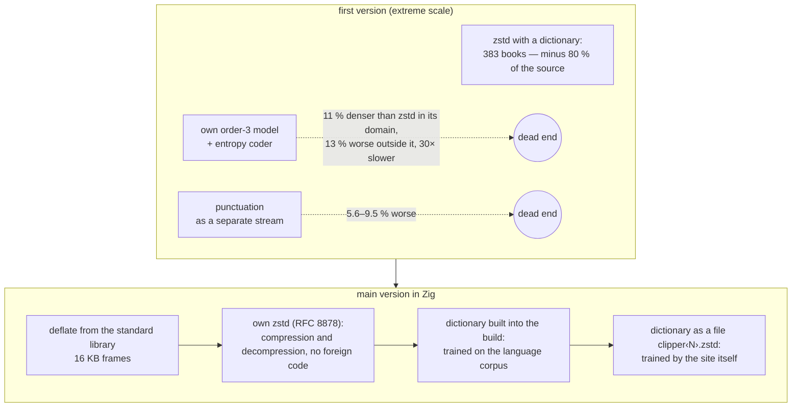
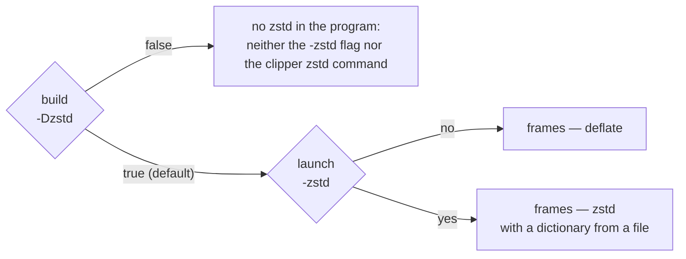

# Compressing book text: from deflate to our own zstd with a dictionary

Book text is the larger part of the catalog. This document tells how the idea of compressing it
changed during the project: which hypotheses were tested, which turned out to be dead ends, and why
zstd with a dictionary is a **separate option** rather than a mandatory part of the server. What the
dictionaries were trained on and how they were measured is in [CORPUS_RND.md](CORPUS_RND.md).

Русская версия: [COMPRESSION_RU_RND.md](COMPRESSION_RU_RND.md).

## 1. The fork

A reading page must not decompress the whole book. So the text is cut into **frames** of a fixed
size (16 KB by default), and each is compressed on its own. A reading page is at most 32 KB and is
cut at paragraph boundaries: it spans one or two frames, i.e. costs at most two decompressions.

The question is *what* to compress a frame with. A small frame gives little material to find
repeats in, and a general-purpose algorithm compresses it poorly. Hence the whole story.

## 2. How the idea evolved

### 2.1. First version: zstd as a given

The first version used zstd with a dictionary and got a snapshot of 383 real books 80 % smaller than
the source. Two hypotheses were tested there — both dead ends, both recorded with numbers:

- **own order-3 statistical model** with an entropy coder: 11 % denser than zstd on 4 KB frames in
  its domain, 13 % worse outside it and 30 times slower to decompress. For a server that decompresses
  on every request this is a dead end;
- **punctuation as a separate stream**: 5.6–9.5 % worse.

### 2.2. Main version: deflate from the standard library

The frame of the main version is no C and no third-party libraries. In Zig 0.14 zstd has only
decompression and no dictionaries, while deflate is complete. So deflate came first: a 16 KB frame,
stored as is if the compressed one is not smaller. It worked, but noticeably worse than the first version.

### 2.3. Our own zstd

The zstd encoder and decoder are written from scratch per RFC 8878 (`src/zstd.zig`):

| part | what |
|---|---|
| bit streams | forward and backward |
| FSE | frequency normalization, own and predefined distributions |
| literal Huffman | lengths ≤ 11 bits, 1 and 4 streams |
| match finding | hash chains, lazy matching in a "dictionary + frame" window |
| decompression | raw/RLE/compressed blocks, all FSE modes, repeat offsets, raw content dictionary |

Frames follow the standard: without a dictionary `std` decompresses them too (checked in tests).
Corrupted frames do not crash decompression and do not go past the buffer.

### 2.4. Dictionary in the build → dictionary as a file

At first the dictionary was trained by a build step on the corpus of the build language (`-Dlang`)
and compiled into the program (~64 KB). Measurement showed the key point: **a dictionary helps the
more, the more the training text resembles the compressed text**. Book 0 with a dictionary from books
1–2 — 82 % of deflate; with a dictionary from the classics — 93 %.

Conclusion: the site itself should train the dictionary — on its own library. The built-in dictionary
and the build step were removed; the dictionary became a file.

## 3. zstd is a separate option

| where | what |
|---|---|
| `zig build -Dzstd=false` | no zstd in the program at all |
| `clipper zstd N [-r ROOTDIR] [FOLDER…]` | train a dictionary for N KB frames (4–32) and write `clipper<N>.zstd`; without folders — on the texts of your own library, with folders — on the books in them |
| `clipper -p 3000 -zstd` | the dictionary the current snapshot was built with, otherwise the largest `clipper<N>.zstd` |
| `clipper -p 3000 -zstd 16` | `clipper16.zstd` from the current folder or the program's folder |
| `clipper -p 3000 -zstd PATH.zstd` | this file |

Why an option rather than a rule:

- the snapshot is **derived**: the compression method and the dictionary fingerprint are recorded in
  its header; if they do not match, the snapshot is rebuilt from the sources and nothing is lost;
- the gain depends on the library: on technical texts it is smaller than on fiction;
- compression is slower than deflate (2–4 ms per frame versus a fraction of a millisecond), while
  decompression is faster; for a site that is mostly read this pays off, but is not always needed.

## 4. Dictionary generation

`src/zdict.zig`: frequent fragments of the corpus (k-grams) are selected by gain and concatenated;
the most valuable go to the end of the dictionary, closest to the data. A `.zstd` file is external
input: the `CLIPZDIC` magic, version, frame size, dictionary length and fingerprint are checked; a
corrupted file gives a clear error (hostile tests).

## 5. The results in numbers

| comparison (16 KB frames) | zstd relative to deflate |
|---|---|
| no dictionary | ≈ 100 % (same as deflate) |
| dictionary from books 1–2 → book 0 | 82 % ru, 85 % en |
| dictionary from the corpus → book 0 | 93 % ru, 94 % en |
| dictionary from the corpus → held-out prose | 87–89 % |
| dictionary from the corpus → Tyutchev's poems | 93 % |

Decompression: 0.15–0.18 ms per frame (deflate — 0.2–0.3 ms); compression: 2–3 ms. How these numbers
were obtained — [CORPUS_RND.md](CORPUS_RND.md); in the book — [0x07-data-frames.md](src/books/0x07-data-frames.md).

## 6. Not done

- zstd is not the default: the snapshot is still compressed with deflate.
- The dictionary window is re-hashed for every frame — compression can be made faster.
- Compatibility of dictionary frames with the reference `zstd -D` has not been verified.
