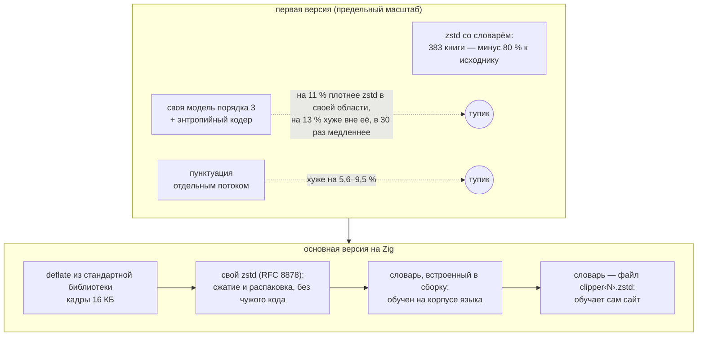
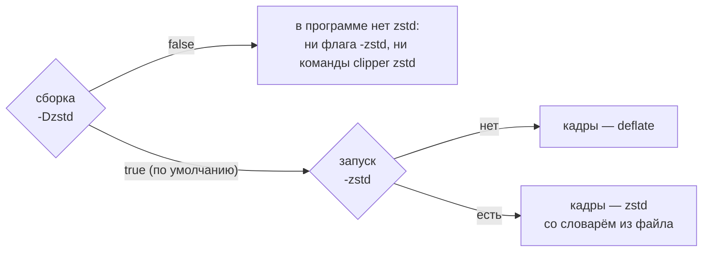

# Сжатие текста книг: от deflate к своему zstd со словарём

Текст книг — большая часть каталога. Документ рассказывает, как в проекте менялась идея его сжатия:
какие гипотезы проверялись, какие оказались тупиками и почему zstd со словарём — **отдельная
опция**, а не обязательная часть сервера. На чём обучались словари и как мерили — в
[CORPUS_RU_RND.md](CORPUS_RU_RND.md).

English version: [COMPRESSION_RND.md](COMPRESSION_RND.md).

## 1. Развилка

Страница чтения не должна распаковывать всю книгу. Поэтому текст режется на **кадры** фиксированного
размера (по умолчанию 16 КБ), и каждый сжимается сам по себе. Страница чтения — не больше 32 КБ и
режется по границам абзацев: она занимает один-два кадра, то есть стоит не больше двух распаковок.

Вопрос — *чем* сжимать кадр. Маленький кадр — мало материала для поиска повторов, и общий алгоритм
сжимает его плохо. Отсюда вся история.

## 2. Как развивалась идея

### 2.1. Первая версия: zstd как данность

Первая версия использовала zstd со словарём и получала снимок на 383 настоящих книгах на 80 % меньше
исходника. Там же проверены две гипотезы — обе тупики, обе записаны с цифрами:

- **своя статистическая модель порядка 3** с энтропийным кодером: на 11 % плотнее zstd на кадрах 4 КБ
  в своей области, на 13 % хуже вне её и в 30 раз медленнее при распаковке. Для сервера, который
  распаковывает на каждом запросе, это тупик;
- **пунктуация отдельным потоком**: хуже на 5,6–9,5 %.

### 2.2. Основная версия: deflate из стандартной библиотеки

Рамка основной версии — ни C, ни сторонних библиотек. В Zig 0.14 у zstd есть только распаковка и без
словарей, а deflate есть полностью. Поэтому сначала — deflate: кадр 16 КБ, если сжатый не меньше
исходного — хранится как есть. Это работало, но было заметно хуже первой версии.

### 2.3. Свой zstd

Кодер и декодер zstd написаны заново по RFC 8878 (`src/zstd.zig`):

| часть | что |
|---|---|
| битовые потоки | прямой и обратный |
| FSE | нормализация частот, свои и стандартные распределения |
| Хаффман литералов | длины ≤ 11 бит, 1 и 4 потока |
| поиск повторов | хеш-цепочки, ленивое сравнение в окне «словарь + кадр» |
| распаковка | блоки raw/RLE/compressed, все режимы FSE, повтор смещений, словарь raw content |

Кадры — по стандарту: без словаря их распаковывает и `std` (сверка в тестах). Испорченные кадры не
роняют распаковку и не выходят за буфер.

### 2.4. Словарь в сборке → словарь как файл

Сначала словарь обучался шагом сборки на корпусе языка (`-Dlang`) и вшивался в программу (~64 КБ).
Замер показал главное: **словарь помогает тем сильнее, чем больше обучающий текст похож на сжимаемый**.
Книга 0 со словарём из книг 1–2 — 82 % от deflate, со словарём из классики — 93 %.

Вывод: словарь должен обучать сам сайт — на своей библиотеке. Встроенный словарь и шаг сборки убраны;
словарь стал файлом.

## 3. zstd — отдельная опция

| где | что |
|---|---|
| `zig build -Dzstd=false` | zstd нет в программе вовсе |
| `clipper zstd N [-r ROOTDIR] [ПАПКА…]` | обучить словарь для кадров N КБ (4–32) и записать `clipper<N>.zstd`; без папок — на текстах своей библиотеки, с папками — на книгах в них |
| `clipper -p 3000 -zstd` | словарь, с которым собран текущий снимок, иначе наибольший `clipper<N>.zstd` |
| `clipper -p 3000 -zstd 16` | `clipper16.zstd` из текущей папки или папки программы |
| `clipper -p 3000 -zstd ПУТЬ.zstd` | этот файл |

Почему опция, а не правило:

- снимок **производный**: способ сжатия и отпечаток словаря записаны в его заголовке; не совпали —
  снимок пересобирается из исходников, ничего не теряется;
- выигрыш зависит от библиотеки: на технических текстах он меньше, чем на художественных;
- сжатие медленнее deflate (2–4 мс на кадр против долей миллисекунды), а распаковка — быстрее; для
  сайта, который в основном читают, это выгодно, но не всегда нужно.

## 4. Генерация словаря

`src/zdict.zig`: частые фрагменты корпуса (k-граммы) отбираются по выгоде и склеиваются; самые ценные —
в конец словаря, ближе к данным. Файл `.zstd` — внешний ввод: магия `CLIPZDIC`, версия, размер кадра,
длина и отпечаток словаря проверяются; испорченный файл — понятная ошибка (враждебные тесты).

## 5. Итог в цифрах

| сравнение (кадры 16 КБ) | zstd от deflate |
|---|---|
| без словаря | ≈ 100 % (как deflate) |
| словарь из книг 1–2 → книга 0 | 82 % ru, 85 % en |
| словарь из корпуса → книга 0 | 93 % ru, 94 % en |
| словарь из корпуса → отложенная проза | 87–89 % |
| словарь из корпуса → стихи Тютчева | 93 % |

Распаковка: 0,15–0,18 мс на кадр (deflate — 0,2–0,3 мс); сжатие: 2–3 мс. Как получены эти цифры —
[CORPUS_RU_RND.md](CORPUS_RU_RND.md); в книге — [0x07-data-frames.md](src/books/ru/0x07-data-frames.md).

## 6. Не сделано

- zstd не по умолчанию: снимок по-прежнему сжимается deflate.
- Окно словаря хешируется заново для каждого кадра — сжатие можно ускорить.
- Совместимость кадров со словарём с эталонным `zstd -D` не проверена.
