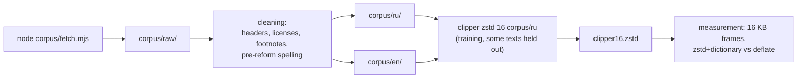
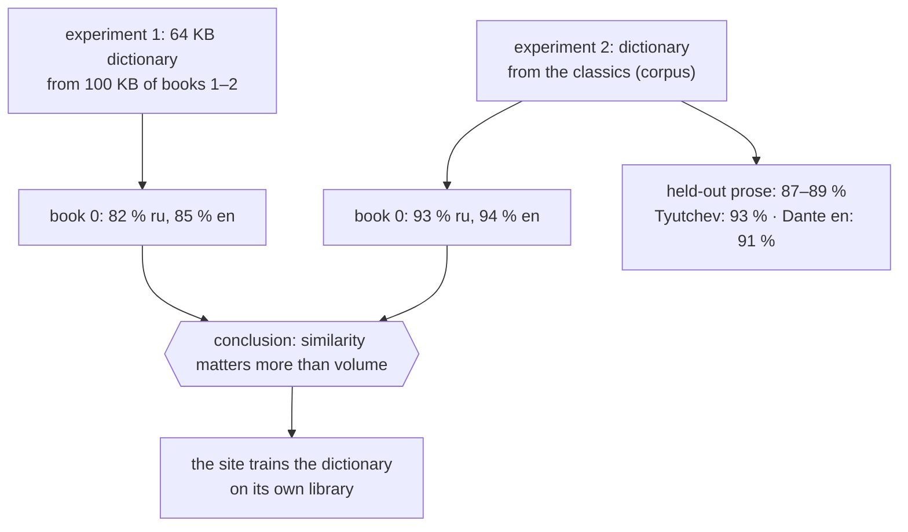

# Corpus and dictionaries: how the zstd dictionaries were researched and measured

How the dictionaries themselves work and how they got into the program is in
[COMPRESSION_RND.md](COMPRESSION_RND.md). This document covers what they were trained on, where the
texts come from and how the numbers were obtained.

Русская версия: [CORPUS_RU_RND.md](CORPUS_RU_RND.md).

## 1. The research question

How much does a zstd dictionary improve compression of 16 KB frames, and what does it depend on:
the language, the genre, the size of the training text?



## 2. The corpus

Public domain only — both in Russia (author's life + 70 years) and in the USA (published before
1930). The texts are not in the repository (`.gitignore`); they are reproduced by

```bash
node corpus/fetch.mjs
```

The script downloads gently (Wikisource — one request every 2 s, Gutenberg — one file at a time)
into `corpus/raw/` and cleans into `corpus/ru/` and `corpus/en/`: for Gutenberg everything outside
`*** START OF` … `*** END OF` is cut, for Wikisource — headers, navigation, footnotes and table of
contents lines; pre-reform Russian spelling is converted to modern (ѣ → е, і → и, ѳ → ф, the hard
sign at the end of words is dropped). `clipper zstd` converts the texts to windows-1251 — the same
way the snapshot is stored.

### Russian — ru.wikisource.org (19 MB, 11 MB in windows-1251)

| file | work | translation | why free |
|---|---|---|---|
| tolstoy-voina-i-mir | L. Tolstoy, "War and Peace" | — | † 1910 |
| tolstoy-anna-karenina | L. Tolstoy, "Anna Karenina" | — | † 1910 |
| dostoevsky-prestuplenie | F. Dostoevsky, "Crime and Punishment" | — | † 1881 |
| dostoevsky-karamazovy | F. Dostoevsky, "The Brothers Karamazov" | — | † 1881 |
| nietzsche-zaratustra | F. Nietzsche, "Thus Spoke Zarathustra" | Yu. Antonovsky | translation of 1898 |
| dante-min | Dante, "The Divine Comedy" | D. Min | † 1885 |
| shakespeare-gamlet-sokolovsky | Shakespeare, "Hamlet" | A. Sokolovsky | † 1915 |
| shakespeare-otello-weinberg | Shakespeare, "Othello" | P. Weinberg | † 1908 |
| shakespeare-lir-sokolovsky | Shakespeare, "King Lear" | A. Sokolovsky | † 1915 |
| tyutchev-stihi | F. Tyutchev, poems | — | † 1873 |

### English — gutenberg.org (14.5 MB)

| file | # | work | translation | why free |
|---|---|---|---|---|
| tolstoy-war-and-peace | 2600 | War and Peace | L. and A. Maude | published 1922–1923 |
| tolstoy-anna-karenina | 1399 | Anna Karenina | C. Garnett | published 1901 |
| dostoevsky-crime | 2554 | Crime and Punishment | C. Garnett | published 1914 |
| dostoevsky-karamazov | 28054 | The Brothers Karamazov | C. Garnett | published 1912 |
| nietzsche-zarathustra | 1998 | Thus Spake Zarathustra | T. Common | published 1909 |
| dante-divine-comedy | 1004 | The Divine Comedy | H. W. Longfellow | † 1882 |
| shakespeare-complete | 100 | Complete Works | — | † 1616 |

Tyutchev is not in the English corpus: Gutenberg has no free translations.

## 3. Measurement method

1. The text is cut into 16 KB frames — as in the snapshot.
2. Each frame is compressed separately: deflate from the standard library and our zstd with a dictionary.
3. The result is the ratio of the total zstd size to deflate (below 100 % — better than deflate).
4. Some texts are **held out** from training: the dictionary has not seen them, so measuring on them is fair.
5. Time is measured on one machine (Windows 11, ReleaseSafe), decompression and compression of one frame.

Checks without which the numbers were not trusted: every compressed frame is decompressed back and
compared with the source; frames without a dictionary are also decompressed by `std`.

## 4. Experiments and results



| dictionary | compressed text | zstd relative to deflate |
|---|---|---|
| none | book 0 (ru) | ≈ 100 % (47 % of the source, same as deflate) |
| 100 KB of books 1–2 | book 0 | 82 % ru · 85 % en |
| corpus | book 0 (technical text) | 93 % ru · 94 % en |
| corpus | "The Brothers Karamazov" (held out) | 89 % ru · 87 % en |
| corpus | Tyutchev's poems (held out) | 93 % |
| corpus | Dante, Longfellow's translation (held out) | 91 % |

Speed: decompression 0.15–0.18 ms per frame (deflate — 0.2–0.3 ms), compression 2–3 ms.

### Conclusions

- **Similarity matters more than volume.** 100 KB of similar text gave more than tens of megabytes of classics.
- **A dictionary built from literature helps fiction more than technical text.**
- **Language decides.** Text in another language compresses with the dictionary almost as without it.
- Therefore the dictionary is a file the site trains itself (`clipper zstd 16`), and the corpus
  remains a tool for experiments: `clipper zstd 16 corpus/ru`.

## 5. How to reproduce

```bash
node corpus/fetch.mjs
zig build
zig-out/bin/clipper zstd 16 corpus/ru
zig-out/bin/clipper -p 3000 -zstd 16
```

## 6. Limitations

The measurements were taken on one machine and on texts from the 19th and early 20th centuries; they
were not repeated on modern prose, scientific papers or forums. There was no reference `zstd` on the
machine — compatibility of dictionary frames with it has not been verified.
