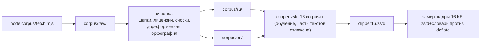
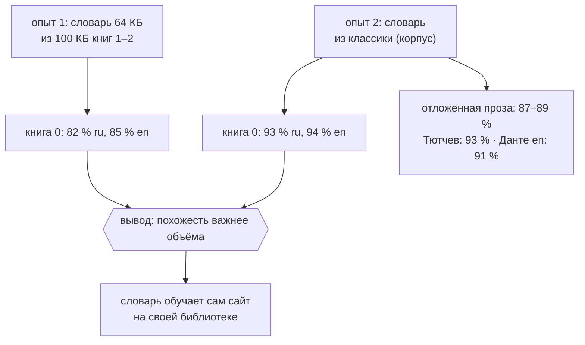

# Корпус и словари: как исследовались словари zstd и как мерили

Как устроены сами словари и как они попали в программу — в [COMPRESSION_RU_RND.md](COMPRESSION_RU_RND.md).
Здесь — на чём их обучали, откуда тексты и как получены цифры.

English version: [CORPUS_RND.md](CORPUS_RND.md).

## 1. Вопрос исследования

Насколько словарь zstd улучшает сжатие кадров 16 КБ и от чего это зависит: от языка, жанра, размера
обучающего текста?



## 2. Корпус

Только общественное достояние — и в России (жизнь автора + 70 лет), и в США (издано до 1930 года).
Тексты в репозиторий не попадают (`.gitignore`); их воспроизводит

```bash
node corpus/fetch.mjs
```

Скрипт скачивает файлы бережно (Викитека — один запрос в 2 с, Gutenberg — по одному файлу) в
`corpus/raw/` и очищает в `corpus/ru/` и `corpus/en/`: у Gutenberg вырезается всё вне
`*** START OF` … `*** END OF`, у Викитеки — шапка, навигация, сноски и строки оглавлений;
дореформенная орфография приводится к новой (ѣ → е, і → и, ѳ → ф, твёрдый знак на конце слова
убирается). `clipper zstd` перекодирует тексты в windows-1251 — так же, как хранится снимок.

### Русский — ru.wikisource.org (19 МБ, 11 МБ в windows-1251)

| файл | произведение | перевод | почему свободно |
|---|---|---|---|
| tolstoy-voina-i-mir | Л. Толстой, «Война и мир» | — | † 1910 |
| tolstoy-anna-karenina | Л. Толстой, «Анна Каренина» | — | † 1910 |
| dostoevsky-prestuplenie | Ф. Достоевский, «Преступление и наказание» | — | † 1881 |
| dostoevsky-karamazovy | Ф. Достоевский, «Братья Карамазовы» | — | † 1881 |
| nietzsche-zaratustra | Ф. Ницше, «Так говорил Заратустра» | Ю. Антоновский | перевод 1898 |
| dante-min | Данте, «Божественная комедия» | Д. Мин | † 1885 |
| shakespeare-gamlet-sokolovsky | Шекспир, «Гамлет» | А. Соколовский | † 1915 |
| shakespeare-otello-weinberg | Шекспир, «Отелло» | П. Вейнберг | † 1908 |
| shakespeare-lir-sokolovsky | Шекспир, «Король Лир» | А. Соколовский | † 1915 |
| tyutchev-stihi | Ф. Тютчев, стихотворения | — | † 1873 |

### Английский — gutenberg.org (14,5 МБ)

| файл | № | произведение | перевод | почему свободно |
|---|---|---|---|---|
| tolstoy-war-and-peace | 2600 | War and Peace | L. и A. Maude | издано 1922–1923 |
| tolstoy-anna-karenina | 1399 | Anna Karenina | C. Garnett | издано 1901 |
| dostoevsky-crime | 2554 | Crime and Punishment | C. Garnett | издано 1914 |
| dostoevsky-karamazov | 28054 | The Brothers Karamazov | C. Garnett | издано 1912 |
| nietzsche-zarathustra | 1998 | Thus Spake Zarathustra | T. Common | издано 1909 |
| dante-divine-comedy | 1004 | The Divine Comedy | H. W. Longfellow | † 1882 |
| shakespeare-complete | 100 | Complete Works | — | † 1616 |

Тютчева в английском корпусе нет: свободных переводов на Gutenberg нет.

## 3. Методика замера

1. Текст режется на кадры 16 КБ — как в снимке.
2. Каждый кадр сжимается отдельно: deflate из стандартной библиотеки и свой zstd со словарём.
3. Результат — отношение суммарного размера zstd к deflate (меньше 100 % — лучше deflate).
4. Часть текстов **отложена** из обучения: словарь не видел их, и замер на них честный.
5. Время — на одной машине (Windows 11, ReleaseSafe), распаковка и сжатие одного кадра.

Проверки, без которых цифрам не верили: каждый сжатый кадр распаковывается обратно и сравнивается
с исходным; кадры без словаря распаковывает и `std`.

## 4. Опыты и результаты



| словарь | сжимаемый текст | zstd от deflate |
|---|---|---|
| нет | книга 0 (ru) | ≈ 100 % (47 % от исходника, как deflate) |
| 100 КБ книг 1–2 | книга 0 | 82 % ru · 85 % en |
| корпус | книга 0 (технический текст) | 93 % ru · 94 % en |
| корпус | «Братья Карамазовы» (отложены) | 89 % ru · 87 % en |
| корпус | стихи Тютчева (отложены) | 93 % |
| корпус | Данте в пер. Лонгфелло (отложен) | 91 % |

Скорость: распаковка 0,15–0,18 мс на кадр (deflate — 0,2–0,3 мс), сжатие 2–3 мс.

### Выводы

- **Похожесть важнее объёма.** 100 КБ близкого текста дали больше, чем десятки мегабайт классики.
- **Художественному тексту словарь из литературы помогает сильнее, чем техническому.**
- **Язык решает.** Текст на другом языке со словарём сжимается почти как без него.
- Поэтому словарь — файл, который сайт обучает сам (`clipper zstd 16`), а корпус остаётся
  инструментом опытов: `clipper zstd 16 corpus/ru`.

## 5. Как повторить

```bash
node corpus/fetch.mjs
zig build
zig-out/bin/clipper zstd 16 corpus/ru
zig-out/bin/clipper -p 3000 -zstd 16
```

## 6. Ограничения

Замеры сделаны на одной машине и на текстах XIX — начала XX века; на современной прозе, научных
статьях и форумах они не повторялись. Эталонного `zstd` на машине не было — совместимость кадров со
словарём с ним не проверена.
