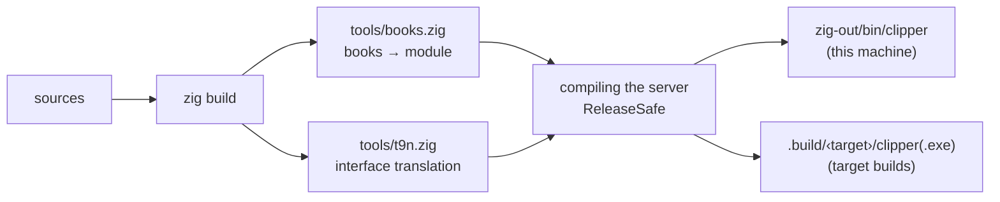
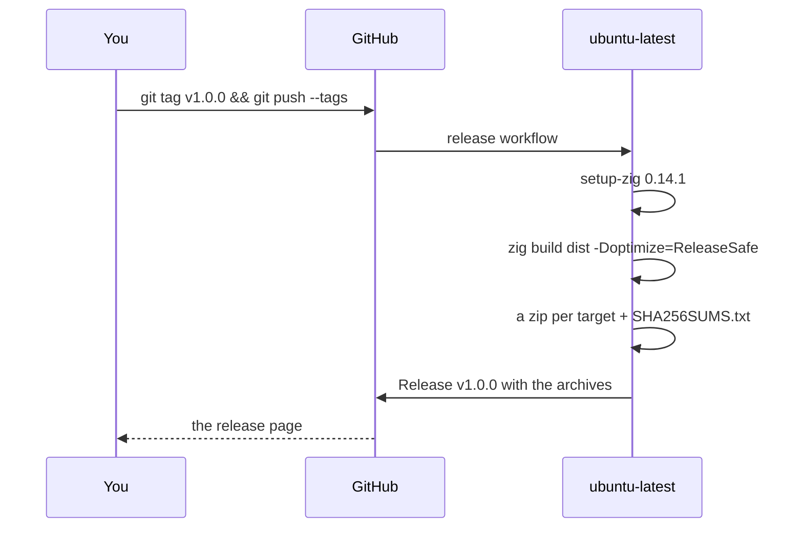

# DevOps: building, releases, a note on Zig and GitHub

How Clipper is built — on your own machine and in GitHub Actions — and how a tag turns into a release
with ready-made zip archives.

Русская версия: [DEVOPS_RU_RND.md](DEVOPS_RU_RND.md).

## 1. Building in a nutshell

Clipper is a single executable. Everything it needs is built from source with one command: no C
library, no package manager, no external dependencies. The Zig compiler is itself a cross-compiler,
so builds for Windows XP, Windows 10+ and Linux can be made from any machine.



Build-step programs (`tools/*.zig`) are compiled for the build machine and run during the build: they
turn the books' Markdown and the translation catalogs into code. This way the server receives data
already prepared in windows-1251.

## 2. Commands

| command | what it does |
|---|---|
| `zig build` | a server for this machine (`zig-out/bin/`) and all target builds (`.build/`) |
| `zig build host` | only the server for this machine |
| `zig build dist` | only the target builds |
| `zig build test` | unit and end-to-end tests |
| `zig build -Dtarget=x86_64-linux` | a Linux server |
| `zig build -Doptimize=Debug` | a debug build (ReleaseSafe by default) |

### Target builds

| folder | system | architecture | language | books |
|---|---|---|---|---|
| `nt51-i686-ru-all` | Windows XP+ | x86 | ru | 0, 1, 2 |
| `nt51-x86_64-ru-all` | Windows XP+ (x64) | x86_64 | ru | 0, 1, 2 |
| `nt-i686-en-all` | Windows 10+ | x86 | en | 0, 1, 2 |
| `nt-x86_64-en-nobook` | Windows 10+ | x86_64 | en | none |
| `linux-x86_64-en-all` | Linux | x86_64 | en | 0, 1, 2 |

`nt51` is the version number of Windows XP (5.1), `nt` means modern Windows, `linux` is Linux without a C
library (a static file that runs on any x86_64 distribution). The list of targets is
defined in `build.zig` (the `dist` step); adding a target means adding a line there, and CI picks it
up by itself.

## 3. CI and releases

Two workflows in `.github/workflows/`:

| file | when | what it does |
|---|---|---|
| `test.yml` | push to `main`, pull request, manual | `zig build test` on `windows-latest` — unit and end-to-end tests |
| `release.yml` | a `v*` tag, manual | target builds, zips, a release |

Tests run on Windows, where the server is verified; the release build runs on Linux. Badges of both workflows are at the top of the README.

### Release



| event | result |
|---|---|
| pushing a `v*` tag | a release with `clipper-<tag>-<target>.zip` archives and `SHA256SUMS.txt` |
| manual run (Actions → release → Run workflow) | the same archives as a run artifact, no release; the name carries the short commit hash |

Each archive holds a `clipper-<version>-<target>/` folder with the server (`clipper.exe` for Windows,
`clipper` for Linux), `LICENSE`,
`LICENSE-books`, `README.md` and `README_RU.md`.

All targets are built on a single Linux runner: cross-compilation is built into Zig, and a Linux
runner is faster and cheaper than a Windows one. Tests are not repeated in this workflow: `test.yml` runs them.

### Publishing a release

```bash
git tag v1.0.0
git push origin v1.0.0
```

Checking an archive after download:

```bash
sha256sum -c SHA256SUMS.txt
```

## 4. A note on Zig

- **The version is pinned: 0.14.1.** Before 1.0 the language changes from version to version (I/O
  was rewritten in 0.15), and the XP build is verified only on 0.14.1. Why — see
  [1x16-versions-xp.md](src/books/1x16-versions-xp.md).
- **Where to get it.** https://ziglang.org/download/ — an archive you just unpack; no installation
  needed. Locally the compiler can live in `.zig/0.14.1/` — that folder is in `.gitignore`.
- **`build.zig`** — the build is described in Zig itself: steps, options (`-D…`), targets, build-step
  programs. There is no separate Makefile or CMake. Details — [1x13-build.md](src/books/1x13-build.md).
- **Cache.** `.zig-cache/` in the project and the user's global cache; a repeated build reuses what is
  ready. The cache can be deleted at any time.
- **Modes.** `Debug` — checks and debugging; `ReleaseSafe` — optimized with bounds and overflow
  checks (releases are built this way); `ReleaseFast` and `ReleaseSmall` — without checks.

## 5. A note on GitHub

- **Actions** runs workflows from `.github/workflows/*.yml` on events (push, tag, manual). Runs are
  visible in the repository's Actions tab.
- **Releases** is a version page with files, created from a tag. The right to create it comes from
  `permissions: contents: write` in the workflow and the built-in `GITHUB_TOKEN` — no secrets of your
  own are needed.
- **Run artifacts** are files attached to a particular run; they are kept for a limited time (90 days
  by default), unlike release files.
- **Actions used:**

| action | purpose |
|---|---|
| `actions/checkout@v4` | the sources (bytes without line-ending conversion — `.gitattributes`) |
| `mlugg/setup-zig@v2` | the Zig compiler of the required version, with caching |
| `actions/upload-artifact@v4` | archives as a run artifact |
| `softprops/action-gh-release@v2` | a release from a tag and file upload |

## 6. What is not automated

- The network scenario runs (`test/hostile`, `test/workers`, `test/fed` on node) are not run in CI — locally only.
- The Linux build is part of the release but is not verified in production: the network probe, load test and worker races were run on Windows only.
- The executable bit of `clipper` in the Linux archive is set in CI; if your unzip tool drops it — `chmod +x clipper`.
- Archives are not signed — there are only checksums.
