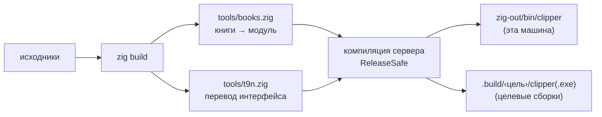
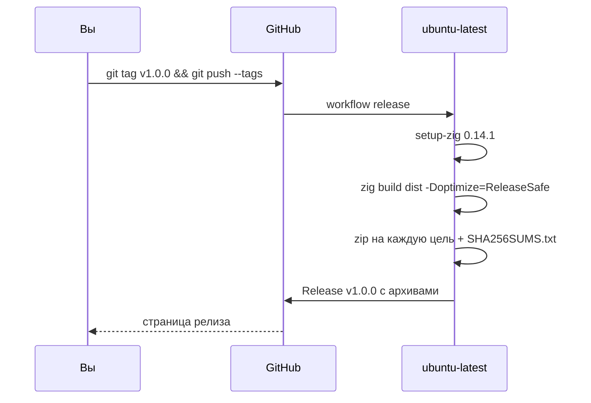

# DevOps: сборка, релизы, справка по Zig и GitHub

Как Клиппер собирается — на своей машине и в GitHub Actions — и как из тега получается релиз с
готовыми zip-архивами.

English version: [DEVOPS_RND.md](DEVOPS_RND.md).

## 1. Сборка в двух словах

Клиппер — один исполняемый файл. Всё, что ему нужно, собирается из исходников одной командой: ни
библиотеки C, ни пакетного менеджера, ни внешних зависимостей. Компилятор Zig сам является
кросс-компилятором, поэтому сборки под Windows XP, Windows 10+ и Linux делаются с любой машины.



Шаги-программы (`tools/*.zig`) собираются под машину сборки и запускаются во время сборки: они
превращают Markdown книг и каталоги перевода в код. Так в сервер попадают уже готовые данные в
windows-1251.

## 2. Команды

| команда | что делает |
|---|---|
| `zig build` | сервер для этой машины (`zig-out/bin/`) и все целевые сборки (`.build/`) |
| `zig build host` | только сервер для этой машины |
| `zig build dist` | только целевые сборки |
| `zig build test` | модульные и сквозные тесты |
| `zig build -Dtarget=x86_64-linux` | сервер под Linux |
| `zig build -Doptimize=Debug` | отладочная сборка (по умолчанию ReleaseSafe) |

### Целевые сборки

| папка | система | архитектура | язык | книги |
|---|---|---|---|---|
| `nt51-i686-ru-all` | Windows XP+ | x86 | ru | 0, 1, 2 |
| `nt51-x86_64-ru-all` | Windows XP+ (x64) | x86_64 | ru | 0, 1, 2 |
| `nt-i686-en-all` | Windows 10+ | x86 | en | 0, 1, 2 |
| `nt-x86_64-en-nobook` | Windows 10+ | x86_64 | en | нет |
| `linux-x86_64-en-all` | Linux | x86_64 | en | 0, 1, 2 |

`nt51` — номер версии Windows XP (5.1), `nt` — современные Windows, `linux` — Linux без библиотеки C
(статический файл, работает на любом дистрибутиве x86_64). Список целей задан в `build.zig`
(шаг `dist`); добавить цель — значит добавить строку туда, и CI подхватит её сам.

## 3. CI и релизы

Два сценария в `.github/workflows/`:

| файл | когда | что делает |
|---|---|---|
| `test.yml` | пуш в `main`, pull request, вручную | `zig build test` на `windows-latest` — модульные и сквозные тесты |
| `release.yml` | тег `v*`, вручную | целевые сборки, zip, релиз |

Тесты идут на Windows — там сервер проверен; сборка релиза — на Linux. Бейджи обоих сценариев — в шапке README.

### Релиз



| событие | что получается |
|---|---|
| пуш тега `v*` | релиз с архивами `clipper-<тег>-<цель>.zip` и `SHA256SUMS.txt` |
| запуск вручную (Actions → release → Run workflow) | те же архивы как артефакт прогона, без релиза; в имени — короткий хеш коммита |

В каждом архиве — папка `clipper-<версия>-<цель>/` с сервером (`clipper.exe` для Windows, `clipper`
для Linux), `LICENSE`, `LICENSE-books`,
`README.md` и `README_RU.md`.

Все цели собираются на одном раннере Linux: кросс-компиляция в Zig встроена, и раннер Linux
быстрее и дешевле Windows-раннера. Тесты в этом сценарии не повторяются: их гоняет `test.yml`.

### Выпустить релиз

```bash
git tag v1.0.0
git push origin v1.0.0
```

Проверить архив после скачивания:

```bash
sha256sum -c SHA256SUMS.txt
```

## 4. Справка: Zig

- **Версия закреплена: 0.14.1.** Язык до 1.0 меняется от версии к версии (в 0.15 переписан ввод-вывод),
  а сборка под XP проверена только на 0.14.1. Почему — в
  [1x16-versions-xp.md](src/books/ru/1x16-versions-xp.md).
- **Где взять.** https://ziglang.org/download/ — архив, который достаточно распаковать; установка не
  нужна. Локально компилятор можно держать в `.zig/0.14.1/` — эта папка в `.gitignore`.
- **`build.zig`** — сборка описана на самом Zig: шаги, опции (`-D…`), цели, шаги-программы. Отдельного
  Makefile или CMake нет. Подробно — [1x13-build.md](src/books/ru/1x13-build.md).
- **Кэш.** `.zig-cache/` в проекте и глобальный кэш пользователя; повторная сборка берёт готовое.
  Кэш можно удалить в любой момент.
- **Режимы.** `Debug` — проверки и отладка; `ReleaseSafe` — оптимизация с проверками границ и
  переполнений (так собираются релизы); `ReleaseFast` и `ReleaseSmall` — без проверок.

## 5. Справка: GitHub

- **Actions** — запуск сценариев из `.github/workflows/*.yml` по событиям (пуш, тег, вручную). Прогоны
  видны во вкладке Actions репозитория.
- **Releases** — страница версии с файлами; создаётся по тегу. Права на создание дают
  `permissions: contents: write` в сценарии и встроенный `GITHUB_TOKEN` — свои секреты не нужны.
- **Артефакты прогона** — файлы, приложенные к конкретному прогону; хранятся ограниченное время
  (по умолчанию 90 дней), в отличие от файлов релиза.
- **Используемые действия:**

| действие | зачем |
|---|---|
| `actions/checkout@v4` | исходники (байты без перевода строк — `.gitattributes`) |
| `mlugg/setup-zig@v2` | компилятор Zig нужной версии с кэшем |
| `actions/upload-artifact@v4` | архивы как артефакт прогона |
| `softprops/action-gh-release@v2` | релиз по тегу и загрузка файлов |

## 6. Что не автоматизировано

- Тест-обход сетевых сценариев (`test/hostile`, `test/workers`, `test/fed` на node) в CI не запускается — только локально.
- Linux-сборка входит в релиз, но в работе не проверена: зонд, замер и гонки воркеров шли только на Windows.
- Бит запуска у `clipper` в архиве Linux ставится в CI; если распаковщик его не сохранил — `chmod +x clipper`.
- Архивы не подписываются — есть только контрольные суммы.
