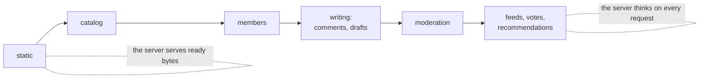
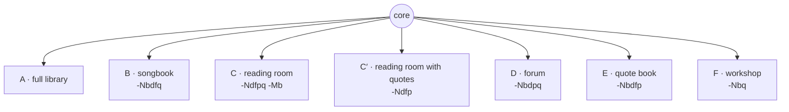
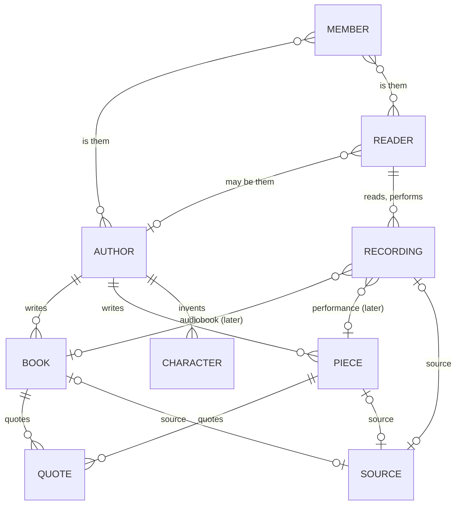
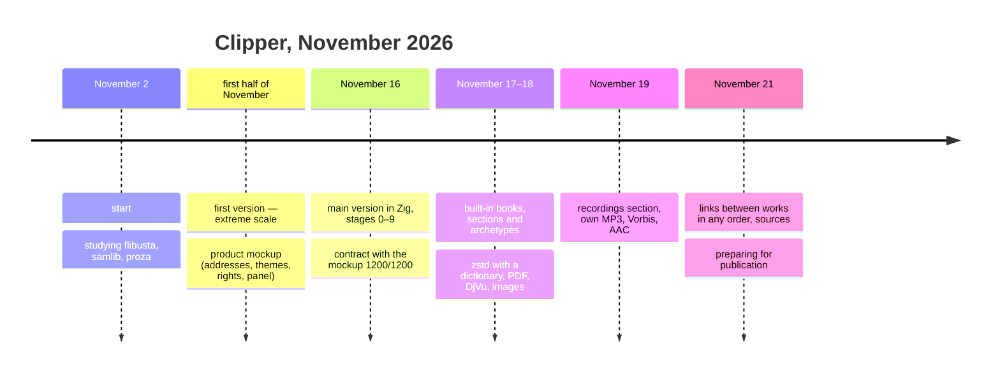

# Digital library: domain and UX/UI research

This document is about *what* was being built: what an online library with a community should be,
which questions were asked before the first line of code, and which answers live sites gave. *How*
it is built is in the book "Inside Clipper" ([src/books/](src/books/0x00-title-intro.md)); the
technologies of the era are in [Y2K_RND.md](Y2K_RND.md).

Русская версия: [DIGITALLIBRARY_RU_RND.md](DIGITALLIBRARY_RU_RND.md).

The project started on November 2, 2026.

## 1. The frame

Clipper is an engine, not a collection. It contains not a single book by anyone else: a fresh site
holds only the books about itself, and everything else is written by people. Hence the first frame
of the research: look at libraries as *mechanisms* — addresses, pages, rights, the visitor's path —
not at their holdings.

The second frame is the axis around which everything else is built:

The further left you stop, the dumber and faster the server. Every site feature was judged by one
question: which step does it lift the server to? Details — [0x05-axis-dumb-smart.md](src/books/0x05-axis-dumb-smart.md).

## 2. Target questions

Questions the research had to answer. Each is closed by a decision, a test or an honest "not verified".

| # | question | answer in the project |
|---|---|---|
| 1 | What does a visitor do most often, and what should it cost the server? | Reading. Guest pages are built once and served from cache: ~70k requests/s on one thread |
| 2 | What should the address of a book, author or quote be, so it survives renaming and can be dictated over the phone? | A letter + a number: `/b/5`, `/u/-5`; the sign of the number tells related things apart ([0x03](src/books/0x03-research-flibusta.md)) |
| 3 | What must a library do without signing in? | Read, search, download, post on anonymous boards |
| 4 | Where does the library end and the community begin? | Five letter sections `p b d f q` (+ `v`), each switched on and closed by a launch flag |
| 5 | Which book formats to accept and which to serve? | Accept many (txt, fb2, epub, pdf, djvu), store one canonical form, serve txt/fb2/epub — [EBOOKS_RND.md](EBOOKS_RND.md) |
| 6 | Does the site need JavaScript? | No: everything works with forms and links; the only script is the quote context menu |
| 7 | How to build a site for one community rather than for everyone? | Archetypes: songbook, reading room, quote book, forum, workshop — one core with different flags |
| 8 | How to moderate without turning the server "smart"? | Rights as bits, staff = `/u/0` in powers, no premoderation and no feeds ([0x12](src/books/0x12-server-moderation.md)) |
| 9 | How to connect sites of one circle without a central server? | Federation with one-time tickets ([0x15](src/books/0x15-network-federation.md)) |
| 10 | Where does a work begin: in the text, the recording, the source? | Links in any order: an audiobook without a book, reader = author, a source (mrakopedia, arxiv, habr) |

## 3. Sites studied

They were looked at the way any visitor sees them: pages, addresses, response headers. Nothing more.

### flibusta.is — how a library works

- Drupal 6, UTF-8, home page ~38 KB, book page ~29 KB, one bundled CSS and one script.
- Conclusion: a site that held the load for years is built on an ordinary engine. Resilience comes
  from the decisions around the engine: addresses, open data (dumps, OPDS), many "doors" (mirrors,
  e-readers).
- Taken: the "letter/number" address scheme, a header with tabs, a column of blocks on the right, a
  row of letters above lists, the forum as a "Forum / Topics / Posts / Last" table.

Details — [0x03-research-flibusta.md](src/books/0x03-research-flibusta.md).

### samlib.ru — self-publishing

- A dense page, grey header bars, everything as a list; size and date next to every text.
- Conclusion: an author needs not a "profile" but a table-of-contents page of their texts, visible at once.
- Taken: the `samlib` theme — the home page as one long list; poems and songs with sizes and dates.

### proza.ru / stihi.ru — a literary community

- A header with a logo and address, a rubric menu on the left, teasers with the beginning of the
  text, a footer with the address.
- Conclusion: for poems, genre rubrics and the first line matter, not a cover.
- Taken: the `proza` theme — rubrics only from enabled sections (poems, free verse, bard songs),
  teasers with the beginning of the text; the site address (`-s`) in the logo and footer.

### nepomn.ru — research for the design

nepomn.ru was studied not as a library but as a sample of visual language: how to make an
"official", strict site with HTML 4 and tables.

- A grey frame, white cells, a left menu with bullets, a plate with the page title.
- Tables showing the first line of a text and sorting by clicking a header (DOM 1, ES3).
- Separate templates for the full and mobile versions (`src/tpl/nepomn/full.html`, `mobile.html`,
  `left.html`, `top.html`).

It is the only theme whose layout is assembled from several fragments: it showed that a template
must be data, not code.

### Comparison

| trait | flibusta | samlib | proza | nepomn | Clipper |
|---|---|---|---|---|---|
| entity address | number | author path | date+number | — | letter+number |
| page without JS | yes | yes | yes | yes | yes |
| encoding | UTF-8 | windows-1251 | windows-1251 | — | windows-1251 |
| open data | dumps, OPDS | — | — | — | txt/fb2/epub, embedding, badges |
| community | forum, blogs | comments | reviews | — | forum, boards, quotes, drafts |

## 4. Sections and archetypes

A site is assembled from enabled sections. Launch flags are the ceiling; the panel can only narrow:

| flag | meaning | guest | member | moderator |
|---|---|---|---|---|
| (none) | everything open | reads | reads and writes | reads and writes |
| `-M` | only moderators write | reads | reads | writes |
| `-R` | read-only | reads | reads | reads |
| `-G` | open to guests (a list) | reads | — | — |
| `-N` | the section does not exist | 404 | 404 | 404 |

7 archetypes × 4 themes × 2 versions (full and mobile) = 56 variants of the home page and menu.
Pages inside sections are shared. A crawl test (`test/sections.zig`) checks that neither the menu,
the home page nor search link to anything disabled or closed to guests.

## 5. The model of a work

- An author (`/c/N`) and a member (`/u/N`) are different entities: an author may not be on the site,
  and a member may be bound to an author and manage their texts.
- A recording (`/v/N`) need not have a text: an audiobook can be uploaded without a book, a poem
  reading without the poem, and linked later in any order.
- A source is an address or a name of where the work comes from: mrakopedia, arxiv, habr.

## 6. UX principles tested in practice

1. **The address is the interface.** The whole site scheme fits in the `/help` table — eleven letters.
2. **A form and a link instead of an application.** If a feature cannot be a form, it probably should not exist.
3. **A theme is clothing, not structure.** Four themes change the layout, not the addresses or rights.
4. **What is closed is not seen.** A guest does not see closed sections in the menu or search; a direct address leads to sign-in.
5. **Number zero is special.** `/b/0` is the book about the site, `/u/0` is the built-in administrator for setup, localhost only.

A visitor's tour of all features — [0x16-site-ux.md](src/books/0x16-site-ux.md).

## 7. History of the research

Three attempts, one experiment: the first version answered "is it possible" (a million books, 2 GB
of memory), the mockup — "what should the site be for people", the main version — "how much simpler
does the server become if the scale is narrowed to one community". The answer is in
[0x04-method-rnd.md](src/books/0x04-method-rnd.md).
