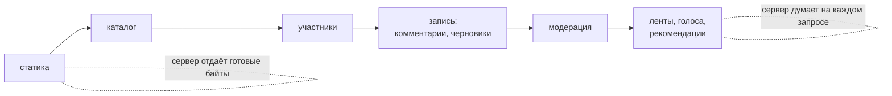
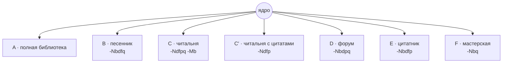
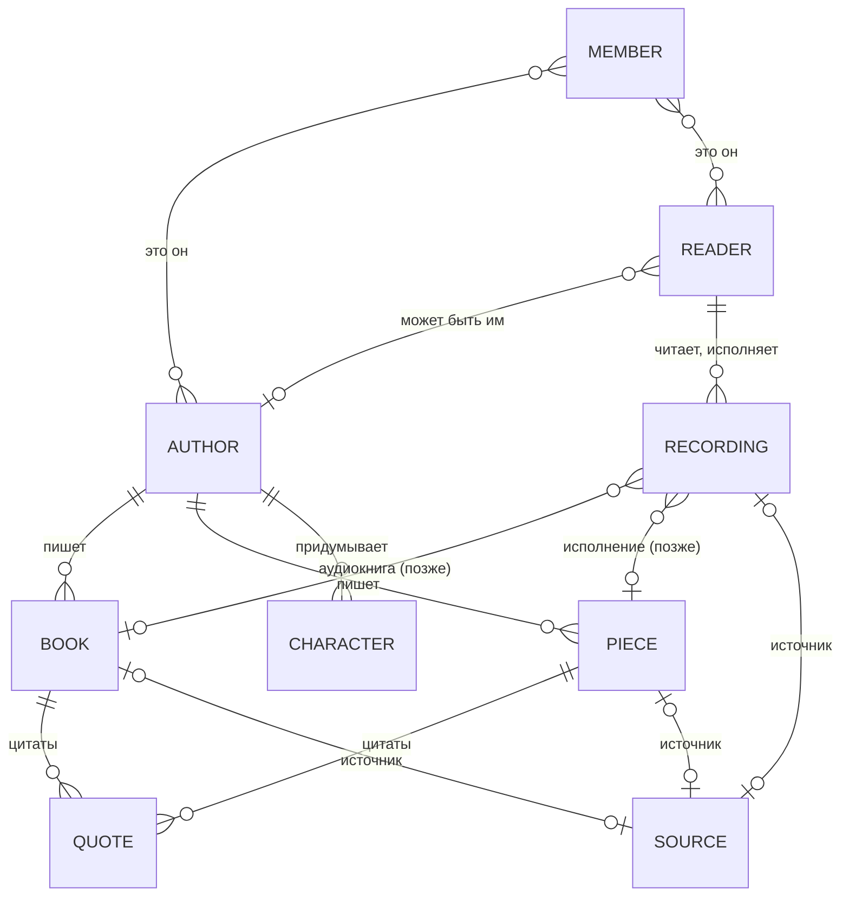
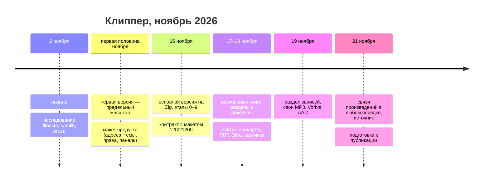

# Цифровая библиотека: исследование предметной области и UX/UI

Документ о том, *что* строилось: какой должна быть онлайн-библиотека с сообществом, какие вопросы
задавались до первой строки кода и какие ответы дали живые сайты. *Как* это сделано — в книге
«Изнанка Клиппера» ([src/books/ru/](src/books/ru/0x00-title-intro.md)); технологии эпохи —
в [Y2K_RU_RND.md](Y2K_RU_RND.md).

English version: [DIGITALLIBRARY_RND.md](DIGITALLIBRARY_RND.md).

Проект начат 2 ноября 2026 года.

## 1. Рамка

Клиппер — движок, а не собрание. В нём нет ни одной чужой книги: свежий сайт содержит только книги о
самом себе, остальное пишут люди. Отсюда первая рамка исследования: смотреть на библиотеки как на
*устройство* — адреса, страницы, права, путь посетителя, — а не на их фонд.

Вторая рамка — ось, вокруг которой построено всё остальное:

Чем левее остановиться, тем тупее и быстрее сервер. Каждая возможность сайта оценивалась вопросом:
на какую ступень она поднимает сервер? Подробно — [0x05-axis-dumb-smart.md](src/books/ru/0x05-axis-dumb-smart.md).

## 2. Целевые вопросы

Вопросы, на которые исследование обязано было ответить. Каждый закрыт решением, тестом или честной
пометкой «не проверено».

| # | вопрос | ответ в проекте |
|---|---|---|
| 1 | Что посетитель делает чаще всего и сколько это должно стоить серверу? | Читает. Гостевые страницы собираются один раз и отдаются из кэша: ~70 тыс. запросов/с на одном потоке |
| 2 | Каким должен быть адрес книги, автора, цитаты, чтобы пережить переименование и диктоваться по телефону? | Буква + номер: `/b/5`, `/u/-5`; знак номера различает родственное ([0x03](src/books/ru/0x03-research-flibusta.md)) |
| 3 | Что библиотека обязана уметь без входа? | Читать, искать, скачивать, писать на анонимных досках |
| 4 | Где кончается библиотека и начинается сообщество? | Пять разделов-букв `p b d f q` (+ `v`), каждый включается и закрывается флагом запуска |
| 5 | Какие форматы книг принимать и в каких отдавать? | Принимать много (txt, fb2, epub, pdf, djvu), хранить одно каноническое, отдавать txt/fb2/epub — [EBOOKS_RU_RND.md](EBOOKS_RU_RND.md) |
| 6 | Нужен ли сайту JavaScript? | Нет: всё работает формами и ссылками; единственный скрипт — контекстное меню цитат |
| 7 | Как сделать сайт для одного сообщества, а не для всех сразу? | Архетипы: песенник, читальня, цитатник, форум, мастерская — одно и то же ядро с разными флагами |
| 8 | Как модерировать, не превращая сервер в «умный»? | Права-биты, сотрудник = `/u/0` по полномочиям, премодерации и лент нет ([0x12](src/books/ru/0x12-server-moderation.md)) |
| 9 | Как связать сайты одного круга без центрального сервера? | Федерация по одноразовым билетам ([0x15](src/books/ru/0x15-network-federation.md)) |
| 10 | Где у произведения начало: в тексте, в записи, в источнике? | Связи в любом порядке: аудиокнига без книги, чтец = автор, источник (mrakopedia, arxiv, habr) |

## 3. Исследованные сайты

Смотрели так, как видит любой посетитель: страницы, адреса, заголовки ответов. Ничего сверх этого.

### flibusta.is — устройство библиотеки

- Drupal 6, UTF-8, главная ~38 КБ, страница книги ~29 КБ, один склеенный CSS и один скрипт.
- Вывод: годами державший нагрузку сайт сделан на обычном движке. Устойчивость — из решений вокруг
  движка: адреса, открытые данные (дампы, OPDS), много «дверей» (зеркала, читалки).
- Взято: схема адресов «буква/номер», шапка с вкладками, колонка блоков справа, строка букв над
  списками, форум как таблица «Форум / Темы / Сообщения / Последнее».

Подробно — [0x03-research-flibusta.md](src/books/ru/0x03-research-flibusta.md).

### samlib.ru — самиздат

- Плотная страница, серые полосы-заголовки, всё списком; размеры и даты у каждого текста.
- Вывод: автору нужен не «профиль», а страница-оглавление его текстов, которую видно целиком.
- Взято: тема `samlib` — главная одним длинным списком; стихи и песни с размерами и датами.

### proza.ru / stihi.ru — литературное сообщество

- Шапка с логотипом и адресом, слева меню рубрик, анонсы с началом текста, подвал с адресом.
- Вывод: для стихов важны рубрики жанров и первая строка, а не обложка.
- Взято: тема `proza` — рубрики только из включённых разделов (стихи, верлибр, авторская песня),
  анонсы с началом текста; адрес сайта (`-s`) в логотипе и подвале.

### nepomn.ru — исследование для дизайна

nepomn.ru смотрели не как библиотеку, а как образец визуального языка: как сделать «официальный»,
строгий сайт средствами HTML 4 и таблиц.

- Серая рамка, белые ячейки, меню слева с маркерами, табличка с названием страницы.
- Таблицы с первой строкой текста и сортировкой по щелчку на заголовке (DOM 1, ES3).
- Отдельные шаблоны для полной и мобильной версии (`src/tpl/nepomn/full.html`, `mobile.html`,
  `left.html`, `top.html`).

Это единственная тема, у которой раскладка собрана из нескольких фрагментов: она и показала, что
шаблон должен быть данными, а не кодом.

### Итог сравнения

| признак | flibusta | samlib | proza | nepomn | Клиппер |
|---|---|---|---|---|---|
| адрес сущности | номер | путь автора | дата+номер | — | буква+номер |
| страница без JS | да | да | да | да | да |
| кодировка | UTF-8 | windows-1251 | windows-1251 | — | windows-1251 |
| открытые данные | дампы, OPDS | — | — | — | txt/fb2/epub, встраивание, бейджи |
| сообщество | форум, блоги | комментарии | рецензии | — | форум, доски, цитаты, черновики |

## 4. Разделы и архетипы

Сайт собирается из включённых разделов. Флаги запуска — потолок, панель может только сузить:

| флаг | смысл | гость | участник | модератор |
|---|---|---|---|---|
| (нет) | всё открыто | читает | читает и пишет | читает и пишет |
| `-M` | пишут только модераторы | читает | читает | пишет |
| `-R` | только чтение | читает | читает | читает |
| `-G` | открыто гостям (список) | читает | — | — |
| `-N` | раздела нет | 404 | 404 | 404 |

7 архетипов × 4 темы × 2 версии (полная и мобильная) = 56 вариантов главной и меню. Страницы внутри
разделов общие. Тест-обход (`test/sections.zig`) проверяет, что ни в меню, ни на главной, ни в
поиске нет ссылок на выключенное и закрытое для гостя.

## 5. Модель произведения

- Автор (`/c/N`) и участник (`/u/N`) — разные сущности: автор может не быть на сайте, участник может
  быть привязан к автору и распоряжаться его текстами.
- Запись (`/v/N`) не обязана иметь текст: аудиокнигу можно выложить без книги, чтение стиха — без
  стиха, и связать позже в любом порядке.
- Источник — адрес или название, откуда произведение: mrakopedia, arxiv, habr.

## 6. UX-принципы, проверенные на практике

1. **Адрес — это интерфейс.** Вся схема сайта помещается в таблицу `/help` — одиннадцать букв.
2. **Форма и ссылка вместо приложения.** Если функцию нельзя сделать формой, её, скорее всего, не нужно делать.
3. **Тема — это одежда, а не устройство.** Четыре темы меняют раскладку, но не адреса и не права.
4. **Закрытого не видно.** Гость не видит закрытых разделов ни в меню, ни в поиске; прямой адрес ведёт ко входу.
5. **Нулевой номер особый.** `/b/0` — книга о сайте, `/u/0` — встроенный администратор для настройки, только с localhost.

Посетительский обзор всех возможностей — [0x16-site-ux.md](src/books/ru/0x16-site-ux.md).

## 7. История исследования

Три попытки — один эксперимент: первая версия ответила «можно ли» (миллион книг, 2 ГБ памяти),
макет — «каким должен быть сайт для людей», основная версия — «насколько проще станет сервер, если
сузить масштаб до одного сообщества». Ответ — в [0x04-method-rnd.md](src/books/ru/0x04-method-rnd.md).
