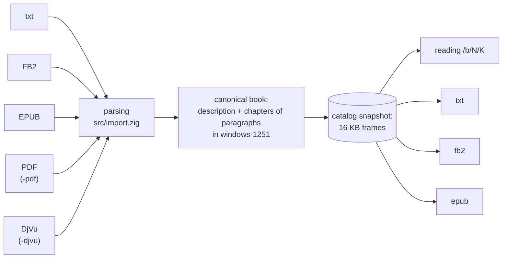
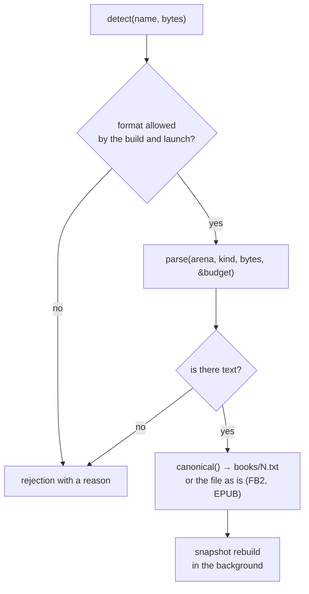

# E-books: format research and code design

How Clipper accepts books in five formats, stores them in one and serves them in three — and why
every parser is written from scratch, without third-party libraries.

Русская версия: [EBOOKS_RU_RND.md](EBOOKS_RU_RND.md).

## 1. The frame

- Pure Zig 0.14.1, no C and no third-party libraries. From the standard library — only what it
  reliably has: inflate/deflate, zlib, cryptography.
- Every book file is **hostile input**: no recursion, no allocations larger than the file, every byte
  access checked; the limit is 384 MB per book after decompression.
- There is no text recognition (OCR): only the text layer is used.

## 2. One canonical representation

Whatever is uploaded, the book is reduced to one form: title, author, series, year, annotation and
chapters of paragraphs. All downloads are built from the same form — so parsing errors show up
immediately when reading instead of surfacing in one of the export formats. `clipper convert FILE`
prints the canonical form of any file — that is how you check the result before uploading.

## 3. Formats: what was studied and how it is done

| format | structure | how it is read | limitations |
|---|---|---|---|
| txt | text | chapters are `## Title` lines; UTF-8 or windows-1251 | — |
| FB2 | XML | own parser tolerant of garbage; images from `<binary>` | — |
| EPUB | ZIP → OPF → XHTML | reading order from the OPF; a chapter is a document and every h1–h3 heading; cover from `meta cover` or `cover-image` | DRM is not opened |
| PDF | objects, streams | objects found by scanning the file (no xref needed); Flate, LZW, ASCII85, ASCIIHex, RunLength streams; glyphs via ToUnicode, otherwise by glyph names; lines assembled into paragraphs by coordinates; running heads and page numbers removed; chapters from the top level of the outline | experimental; no OCR; password — rejected |
| DjVu | IFF, TXTz/TXTa chunks | own BZZ (ZP coder and the inverse Burrows–Wheeler transform); lines from zones, positions from word rectangles; scan skew is taken into account | experimental; the outline is not read; indirect is not accepted |

Shared by PDF and DjVu: if 60 % of a page's lines do not reach the right margin, it is poetry, and
lines are not joined.

Details on the storage encoding — [0x13-format-encoding.md](src/books/0x13-format-encoding.md).

## 4. Images in books

Only from FB2 and EPUB. All decoders are our own:

| format | what it handles | checked against |
|---|---|---|
| PNG | all color types and depths, palette, tRNS, Adam7; writing with per-row filter choice | WIC, bit-exact |
| JPEG | baseline and progressive, subsampling, restarts; writing baseline 4:2:0 | WIC, PSNR 50–68 dB |
| GIF | 87a/89a, first frame, LZW, transparency | WIC, bit-exact |
| WebP | VP8 (lossy) and VP8L (lossless), ALPH, VP8X | WIC, bit-exact (up to 2 units on alpha edges) |
| SVG | own XML, CSS from `<style>`, paths, shapes, `use`, transforms, gradients, strokes | Chromium, PSNR 28–54 dB on 41 files |

An image is fitted into 800×600 without upscaling; without transparency — JPEG q80, with
transparency — PNG. The image store (`img/b/`) is shared across snapshot generations: the name is a
fingerprint of the source and the rules.

## 5. Designing the parser code

Principles the parsers follow:

1. **A budget instead of trust.** Every parse gets a `Budget` — how many bytes it may decompress. A
   zip bomb ends in a clear error, not in running out of memory.
2. **A separate arena per parse.** The request buffer is small; parsing runs in its own arena and is
   freed at once.
3. **A rejection comes with a reason.** A scan without text, a password-protected PDF, a font without
   a character map, an EPUB with DRM — every reason is shown to the visitor.
4. **The build decides what is in the program.** `-Dpdf=false`, `-Ddjvu=false` — the parser is not
   there at all; launching with `-pdf`, `-djvu` — the format is accepted. Experimental code does not
   burden those who do not need it.
5. **Checked on real files.** PDFs from Edge and Chrome are extracted verbatim (9826 words of 9826);
   an EPUB exported by the site comes back verbatim; 200 real FB2s build and download; DjVu — two
   books from Wikimedia Commons (1893 and 1923).
6. **Hostile tests.** `test/hostile.zig` runs corrupted files under a counting allocator: no panics,
   no leaks.

## 6. Export

| format | how it is built |
|---|---|
| txt | UTF-8 or windows-1251 (`?cs=`) |
| fb2 | XML from the canonical form |
| epub | own ZIP (deflate from std), OPF, NCX, XHTML per chapter |

The site neither stores nor serves PDF and DjVu: only text is taken from them. Exports carry no images.

## 7. Sound as a related format

Recordings in `/v` follow the same "many in, one stored" scheme: MP3, Ogg Vorbis and M4A (AAC) are
decoded by our own code and re-encoded to MP3 at 128 kbit/s. Checked against the browser's decoder:
126–132 dB.

## 8. Not verified

DjVu with an outline; PDFs from Word, LaTeX, InDesign and scanners with an OCR layer; EPUBs from
other programs; progressive JPEG 4:2:0 and 4:2:2 on real files. The full list —
[0x18-open-questions.md](src/books/0x18-open-questions.md).
