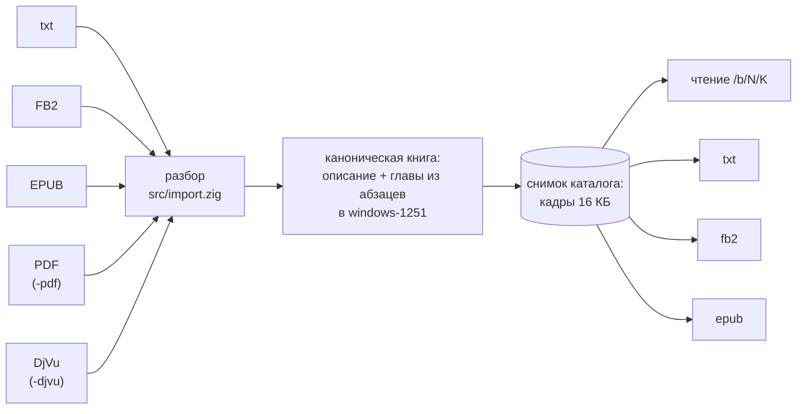
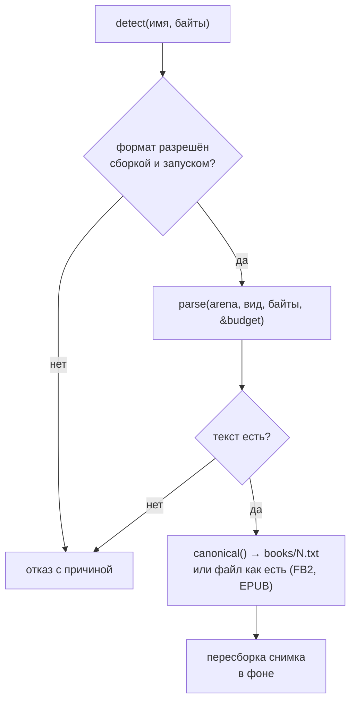

# Электронные книги: исследование форматов и проектирование кода

Как Клиппер принимает книги в пяти форматах, хранит их в одном и отдаёт в трёх — и почему каждый
разборщик написан заново, без сторонних библиотек.

English version: [EBOOKS_RND.md](EBOOKS_RND.md).

## 1. Рамка

- Чистый Zig 0.14.1, без C и без чужих библиотек. Из стандартной библиотеки — только то, что в ней
  есть надёжно: inflate/deflate, zlib, криптография.
- Любой файл книги — **враждебный ввод**: ни рекурсии, ни выделений больше размера файла, все
  обращения к байтам проверены; предел — 384 МБ на книгу после распаковки.
- Распознавания текста (OCR) нет: берётся только текстовый слой.

## 2. Одно каноническое представление

Что бы ни прислали, книга приводится к одному виду: название, автор, серия, год, аннотация и главы из
абзацев. Из этого же вида собираются все скачивания — значит, ошибки разбора видны сразу при чтении,
а не всплывают в одном из форматов выгрузки. `clipper convert ФАЙЛ` печатает канонический вид любого
файла — так проверяют, что получится, до загрузки.

## 3. Форматы: что исследовалось и как сделано

| формат | устройство | как читается | ограничения |
|---|---|---|---|
| txt | текст | главы — строки `## Название`; UTF-8 или windows-1251 | — |
| FB2 | XML | свой разбор, терпимый к мусору; картинки из `<binary>` | — |
| EPUB | ZIP → OPF → XHTML | порядок чтения из OPF; глава — документ и каждый заголовок h1–h3; обложка из `meta cover` или `cover-image` | DRM не открывается |
| PDF | объекты, потоки | объекты — просмотром файла (xref не нужен); потоки Flate, LZW, ASCII85, ASCIIHex, RunLength; знаки — по ToUnicode, иначе по именам; строки — в абзацы по координатам; колонтитулы и номера страниц убираются; главы — верхний уровень оглавления | экспериментально; нет OCR; пароль — отказ |
| DjVu | IFF, куски TXTz/TXTa | свой BZZ (кодер ZP и обратное преобразование Барроуза — Уилера); строки — из зон, место — по прямоугольникам слов; перекос скана учитывается | экспериментально; оглавление не читается; indirect не принимается |

Общее для PDF и DjVu: если 60 % строк страницы не доходят до правого поля — это стихи, строки не
склеиваются.

Подробно о кодировке хранения — [0x13-format-encoding.md](src/books/ru/0x13-format-encoding.md).

## 4. Картинки в книгах

Только из FB2 и EPUB. Все разборщики свои:

| формат | что умеет | сверка |
|---|---|---|
| PNG | все виды цвета и глубины, палитра, tRNS, Adam7; запись с выбором фильтра | с WIC бит в бит |
| JPEG | baseline и progressive, прореживание, рестарты; запись baseline 4:2:0 | WIC, PSNR 50–68 дБ |
| GIF | 87a/89a, первый кадр, LZW, прозрачность | WIC бит в бит |
| WebP | VP8 (с потерями) и VP8L (без), ALPH, VP8X | WIC бит в бит (до 2 единиц на краях альфы) |
| SVG | свой XML, CSS из `<style>`, пути, фигуры, `use`, трансформации, градиенты, обводка | Chromium, PSNR 28–54 дБ на 41 файле |

Картинка вписывается в 800×600 без увеличения; без прозрачности — JPEG q80, с прозрачностью — PNG.
Хранилище картинок (`img/b/`) общее для поколений снимка: имя — отпечаток исходника и правил.

## 5. Проектирование кода разборщика

Принципы, которые держат разборщики:

1. **Бюджет вместо доверия.** Каждый разбор получает `Budget` — сколько байтов он вправе распаковать.
   Zip-бомба кончается понятной ошибкой, а не нехваткой памяти.
2. **Своя арена на разбор.** Буфер запроса мал; разбор идёт в отдельной арене и освобождается целиком.
3. **Отказ — с причиной.** Скан без текста, PDF с паролем, шрифт без таблицы знаков, EPUB с DRM —
   каждая причина называется посетителю.
4. **Сборка решает, что есть в программе.** `-Dpdf=false`, `-Ddjvu=false` — разборщика нет вовсе;
   запуск с `-pdf`, `-djvu` — формат принимается. Так экспериментальное не нагружает тех, кому не нужно.
5. **Проверка на настоящих файлах.** PDF из Edge и Chrome извлекается дословно (9826 слов из 9826);
   EPUB, выгруженный сайтом, возвращается дословно; 200 настоящих FB2 собираются и скачиваются;
   DjVu — две книги с Викисклада (1893 и 1923 годов).
6. **Враждебные тесты.** `test/hostile.zig` гоняет испорченные файлы под считающим распределителем:
   ни паник, ни утечек.

## 6. Выгрузка

| формат | как собирается |
|---|---|
| txt | UTF-8 или windows-1251 (`?cs=`) |
| fb2 | XML из канонического вида |
| epub | свой ZIP (deflate из std), OPF, NCX, XHTML по главам |

PDF и DjVu сайт не хранит и не отдаёт: из них берётся только текст. Выгрузки — без картинок.

## 7. Звук как родственный формат

Записи `/v` устроены по той же схеме «много на входе — одно в хранении»: MP3, Ogg Vorbis и M4A (AAC)
разбираются своим кодом и перекодируются в MP3 128 кбит/с. Сверка — с декодером браузера: 126–132 дБ.

## 8. Не проверено

DjVu с оглавлением; PDF из Word, LaTeX, InDesign и сканеров с OCR-слоем; EPUB сторонних программ;
progressive JPEG 4:2:0 и 4:2:2 на настоящих файлах. Список целиком — [0x18-open-questions.md](src/books/ru/0x18-open-questions.md).
