# Clipper

[](https://github.com/slnknrr-dev/clipper-site-in-zig/actions/workflows/test.yml)
[](https://github.com/slnknrr-dev/clipper-site-in-zig/releases)
[](LICENSE)
[](LICENSE-books)
[](https://ziglang.org/download/#release-0.14.1)

**An online library with a community, in a single executable.** Books, poems and songs with chords,
drafts and articles, forums and anonymous boards, quotes, audiobooks and authors' performances — in
pure Zig, with no C, no third-party libraries and no database. Pages are built the way they were in
2003: HTML 4.01, tables, forms, no JavaScript application. Runs on everything from Windows XP to Linux.

> A clipper is a fast sailing ship. What matters most in a ship is not speed but that it stays afloat.

<table>
<tr>
<td>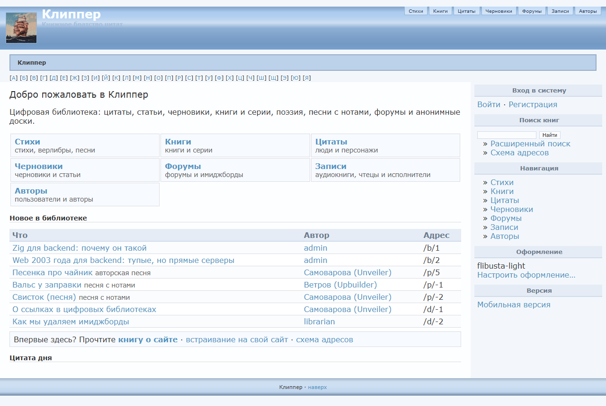</td>
<td>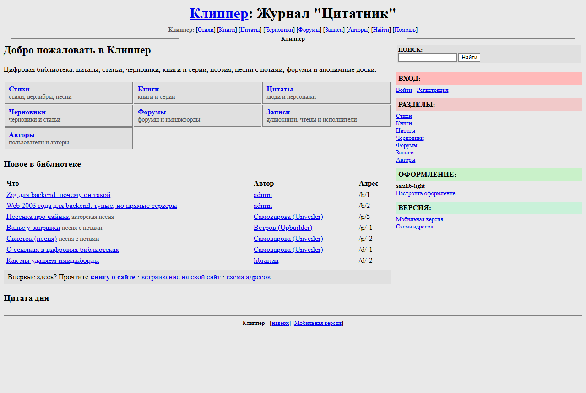</td>
</tr>
<tr>
<td align="center">flibusta theme</td>
<td align="center">samlib theme</td>
</tr>
<tr>
<td>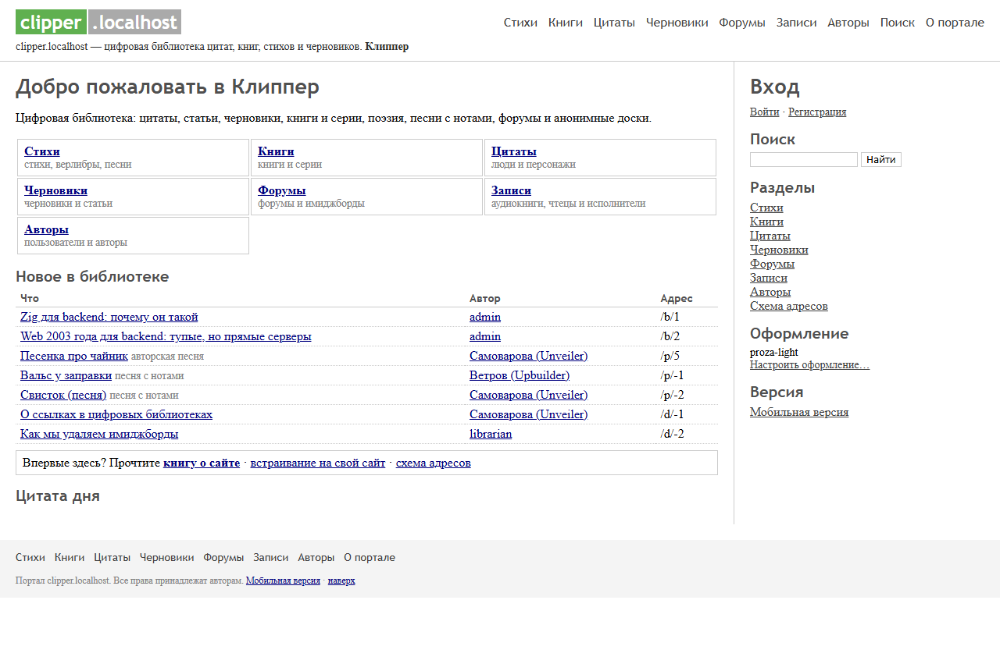</td>
<td>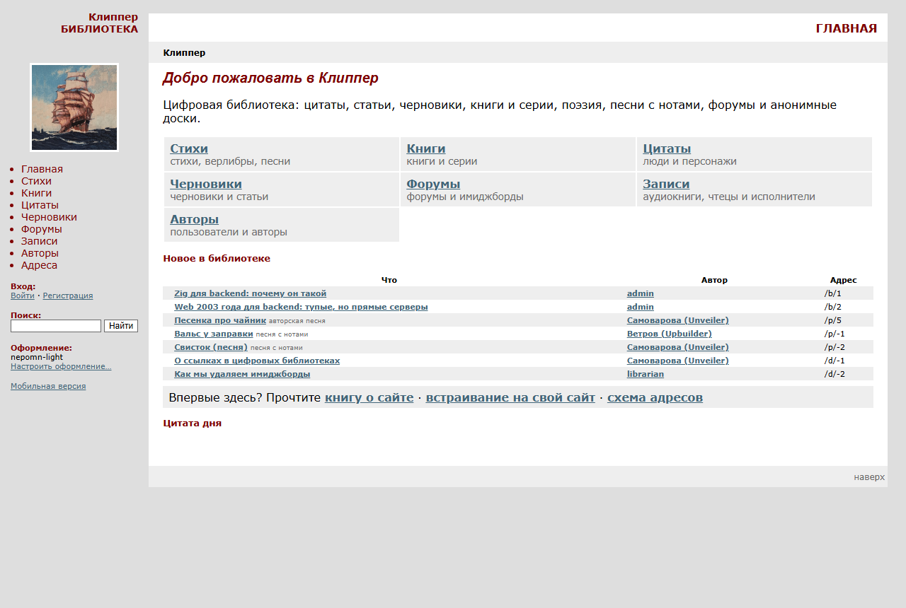</td>
</tr>
<tr>
<td align="center">proza theme</td>
<td align="center">nepomn theme</td>
</tr>
<tr>
<td>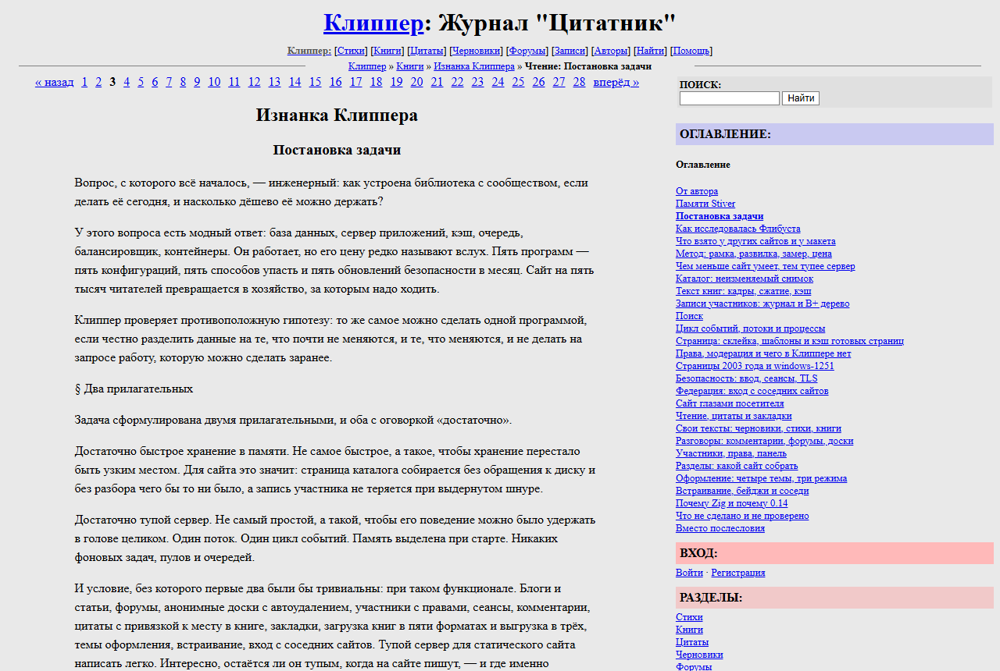</td>
<td>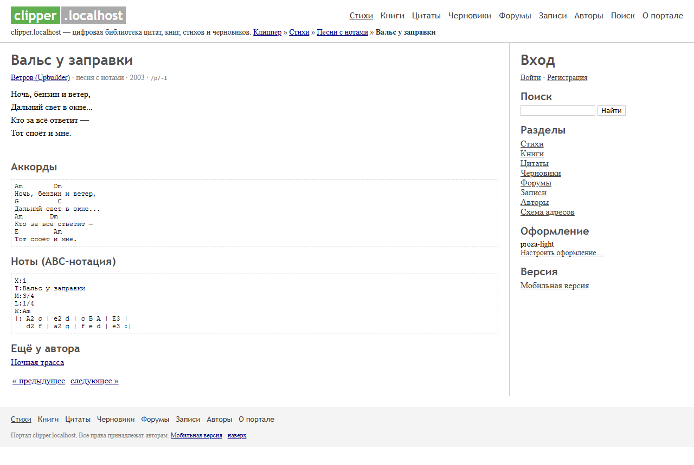</td>
</tr>
<tr>
<td align="center">reading a book</td>
<td align="center">a song with chords and notes</td>
</tr>
</table>

One program — four themes, light, dark and "by the clock" modes, a mobile version. Download from [Releases](https://github.com/slnknrr-dev/clipper-site-in-zig/releases); details — [Quick start](#quick-start).

Русская версия: [README_RU.md](README_RU.md).

| | |
|---|---|
| language | Zig 0.14.1, no libc |
| targets | Windows XP+ (x86, x86_64), Windows 10+, Linux x86_64 |
| storage | in-memory catalog snapshot + record journal (or a B+ tree) |
| network | own HTTP/1.1, own TLS 1.3 (research, see [TLS_RND.md](TLS_RND.md)), federation between sites |
| speed | ~70k guest pages/s on one thread; ~195k/s with `-w 8` |
| licenses | code — [MIT](LICENSE), built-in books — [CC BY-SA 4.0](LICENSE-books) |

---

## Who it is for

- **A home library and knowledge base.** Books, articles, notes, poems, songs with chords, quotes —
  with search, bookmarks and sources (mrakopedia, arxiv, habr…). Everything lives in one folder that
  is easy to copy and keep.
- **Offline reading.** The site never goes to the internet: a country house, a ship, a school without
  a network, a trip. Read from any device on the local network — even an old phone or laptop.
- **A community.** A literary circle, a bards' club, self-publishing: site archetypes of its own —
  songbook, reading room, quote book, forum, workshop.
- **A second life for an old PC.** This is the case where the computer from the closet becomes a
  server: Clipper builds for Windows XP and needs nothing but itself. Put NGINX next to it and you get
  a home server with a storage site.
- **Researchers and students.** Inside are our own zstd, TLS 1.3, B+ tree and parsers for PDF, DjVu,
  EPUB, MP3, Vorbis, AAC, JPEG, WebP, SVG. Every decision is discussed in the books built into the
  server itself.

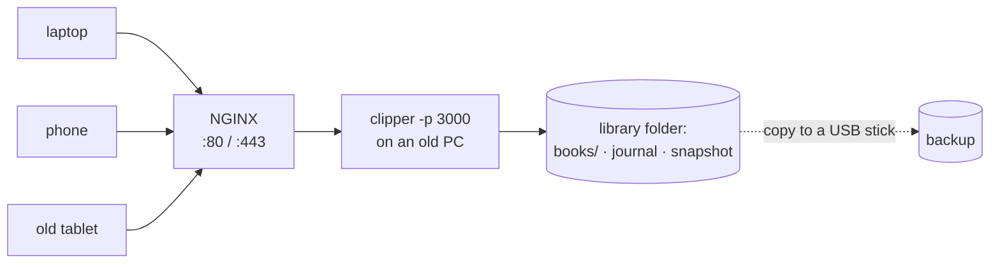

## Quick start

### A ready-made build

Download the archive for your system from the [Releases](https://github.com/slnknrr-dev/clipper-site-in-zig/releases) page, unpack it and run:

| archive | system | language | books |
|---|---|---|---|
| `clipper-<version>-nt51-i686-ru-all.zip` | Windows XP and newer, 32-bit | ru | all three |
| `clipper-<version>-nt51-x86_64-ru-all.zip` | Windows XP and newer, 64-bit | ru | all three |
| `clipper-<version>-nt-i686-en-all.zip` | Windows 10+, 32-bit | en | all three |
| `clipper-<version>-nt-x86_64-en-nobook.zip` | Windows 10+, 64-bit | en | none |
| `clipper-<version>-linux-x86_64-en-all.zip` | Linux x86_64 | en | all three |

```bash
clipper -p 3000 -pwd PASSWORD
```

Checksums are in `SHA256SUMS.txt` next to the archives. How releases are made — [DEVOPS_RND.md](DEVOPS_RND.md).

### From source

You need [Zig 0.14.1](https://ziglang.org/download/#release-0.14.1) — exactly this version (why — see
[1x16-versions-xp.md](src/books/1x16-versions-xp.md)).

```bash
git clone https://github.com/slnknrr-dev/clipper-site-in-zig
cd clipper-site-in-zig
zig build -Dlang=en
zig-out/bin/clipper -p 3000 -pwd PASSWORD
```

Open `http://localhost:3000/`. The book about the site itself is at `/b/0`. You can sign in as the
administrator `/u/0` from the same machine: login `admin`, password from `-pwd`. Then create your own
administrator — a member with rights — and work as them.

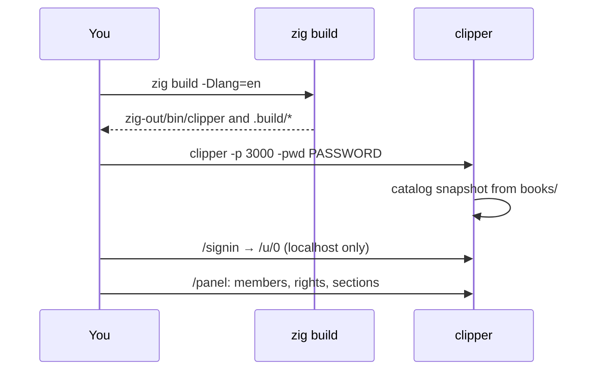

## Building

| command | result |
|---|---|
| `zig build` | a server for this machine in `zig-out/bin/` and target builds in `.build/` |
| `zig build dist` | target builds only: `nt-i686-en-all`, `nt-x86_64-en-nobook`, `nt51-i686-ru-all`, `nt51-x86_64-ru-all`, `linux-x86_64-en-all` |
| `zig build -Dtarget=x86_64-linux` | Linux |
| `zig build test` | unit and end-to-end tests, hostile input |
| `zig build fixture -- FOLDER` | a test library folder with members and records |

In CI (GitHub Actions) a `v*` tag builds all targets and publishes the zip archives as a release — see [DEVOPS_RND.md](DEVOPS_RND.md).

`nt51` — Windows XP and newer, `nt` — Windows 10+; `-all` — all three built-in books, `-nobook` — no books.

| build option | meaning | default |
|---|---|---|
| `-Dlang=ru\|en` | language of the interface and built-in books | `ru` |
| `-Dbook0` | book 0 "Inside Clipper" (`/b/0`) | `true` |
| `-Dbooks` | books 1 "Zig for the backend" and 2 "The 2003 Web for the backend" | `false` |
| `-Dzstd` | our own zstd with a dictionary ([COMPRESSION_RND.md](COMPRESSION_RND.md)) | `true` |
| `-Dpdf`, `-Ddjvu` | PDF and DjVu parsing | `true` |
| `-Dvoice`, `-Dogg`, `-Dm4a` | recordings section, accepting .ogg and .m4a | `true`, `true`, `false` |

## Running

```
clipper -p PORT [-r FOLDER] [-t flibusta|samlib|proza|nepomn] [-M|-R|-G|-N letters]
        [-pwd PASSWORD | -phc PHC] [-w N] [-btree] [-zstd [N|FILE]]
        [--tls-cert FILE --tls-key FILE] [-fed [...]]
```

| flag | meaning |
|---|---|
| `-p PORT` | port (required) |
| `-r FOLDER` | library folder; defaults to the current one |
| `-t THEME` | default theme: flibusta, samlib, proza, nepomn |
| `-c #rrggbb`, `-b #rrggbb` | main and brand color |
| `-n NAME`, `-s ADDRESS` | site name and its address in the design |
| `-M`, `-R`, `-G`, `-N` + `pbdfqv` | section: moderators write only / read-only / open to guests / off |
| `-l`, `-pwd`, `-phc` | login and password of `/u/0` (`clipper hash` produces an argon2id PHC string) |
| `-w N` | worker processes (1–64) |
| `-btree` | records in a B+ tree instead of the journal |
| `-zstd` | book frames compressed with our zstd and a dictionary |
| `-pdf`, `-djvu` | accept PDF and DjVu (experimental) |
| `--tls-cert`, `--tls-key` | https (own TLS 1.3; ECDSA P-256 or Ed25519) |
| `-fed` | federation with other Clipper sites |

### Examples

| case | command |
|---|---|
| full library | `clipper -p 3000 -pwd PASSWORD` |
| songbook: poems and songs only | `clipper -p 3000 -Nbdfqv` |
| reading room: only moderators upload | `clipper -p 3000 -Ndfpq -Mb` |
| quote book: books hidden, quotes visible | `clipper -p 3000 -Nbdfp` |
| club forum | `clipper -p 3000 -Nbdpqv -t nepomn` |
| read-only archive | `clipper -p 3000 -Rpbdfqv` |
| only poems open to guests | `clipper -p 3000 -Gp` |
| own theme and color | `clipper -p 3000 -t proza -c "#2e5e8c" -n "Home library"` |
| multi-core machine | `clipper -p 3000 -w 4` |
| dictionary from your own library | `clipper zstd 16 && clipper -p 3000 -zstd 16` |
| check a book before uploading | `clipper convert book.pdf` |

## A home server: an old PC + NGINX

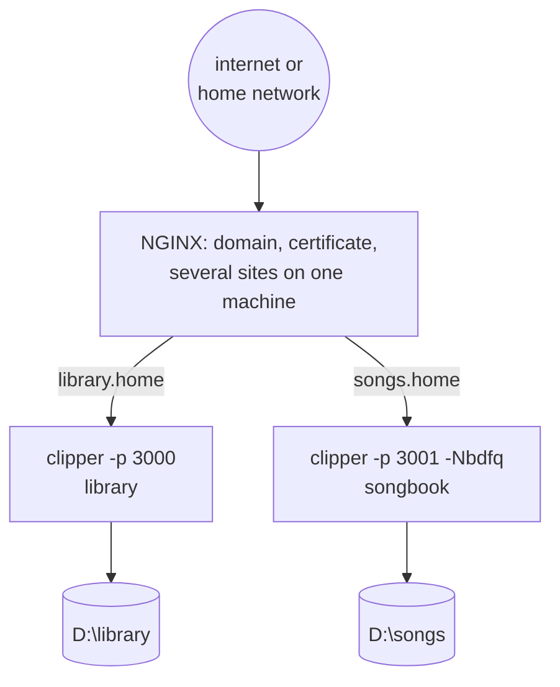

```nginx
server {
    listen 80;
    server_name library.home;

    client_max_body_size 200m;          # audiobooks — up to 200 MB

    location / {
        proxy_pass http://127.0.0.1:3000;
        proxy_set_header Host $host;
        proxy_set_header X-Forwarded-For $proxy_add_x_forwarded_for;
        proxy_http_version 1.1;
        proxy_set_header Connection "";
    }
}
```

> **`/u/0` and the proxy.** `/u/0` is allowed only from this machine. Behind NGINX on the same
> computer every connection comes from `127.0.0.1`, so Clipper treats a request as external if it
> carries a proxy header (`X-Forwarded-For`, `X-Real-IP`, `Forwarded`, `Via`): `/u/0` cannot be signed
> into through the proxy. The `proxy_set_header X-Forwarded-For` line in the config above is
> required. Set the site up by opening `http://localhost:3000/` on the server itself, then create
> your own administrator.

> **HTTPS.** Clipper's own TLS 1.3 is research: there is no third-party audit, and RSA keys are not
> supported. On a home network and on the internet, leave HTTPS to NGINX (Let's Encrypt, a proven
> TLS library), and close Clipper's port (`3000`) to the outside with a firewall: the server listens
> on all interfaces, and otherwise it can be reached directly, bypassing NGINX. Details — [TLS_RND.md](TLS_RND.md).

The backup is the library folder: books, the record journal, images and recordings. The catalog
snapshot is derived and rebuilds itself.

## How it works

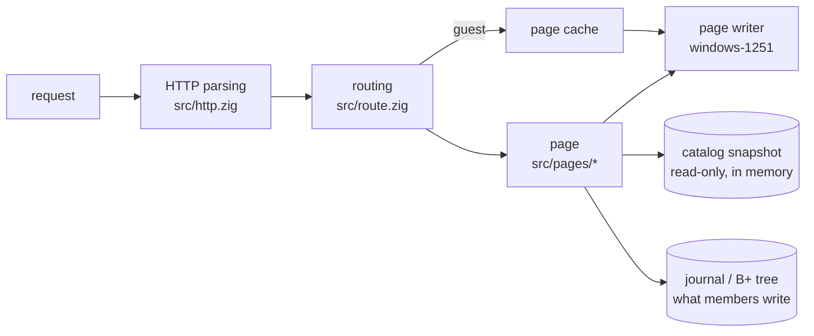

Data is split into what is read and what is written. The former is prepared in advance (the
snapshot), the latter is written in the simplest way that survives a crash (the journal). Details are
in book 0.

## Documentation and research

The project has been developed since November 2, 2026 as research: every decision is recorded with
the rejected paths, the dead ends and what would be better under other conditions.

| document | about |
|---|---|
| [DIGITALLIBRARY_RND.md](DIGITALLIBRARY_RND.md) | the domain and UX/UI: flibusta, samlib, proza, nepomn; target questions; archetypes |
| [Y2K_RND.md](Y2K_RND.md) | technologies up to 2003 as a constraint; UI/UX and reuse |
| [EBOOKS_RND.md](EBOOKS_RND.md) | book and image formats, designing the parsers |
| [COMPRESSION_RND.md](COMPRESSION_RND.md) | from deflate to our own zstd with a dictionary |
| [CORPUS_RND.md](CORPUS_RND.md) | the corpus, dictionary training and measurements |
| [DEVOPS_RND.md](DEVOPS_RND.md) | building, CI and releases; a note on Zig and GitHub |
| [TLS_RND.md](TLS_RND.md) | HTTPS in Zig, our own TLS 1.3 and the NGINX scenario |
| [BACKEND_CV.md](BACKEND_CV.md) | why Zig, C for reverse proxies, and how I choose solutions |
| [BACKLOG.md](BACKLOG.md) | backlog and engineering log: what is not done or verified, the reference by section |

### Built-in books

The books are written in Markdown and compiled into the server — you can read them right here:

| book | on the site | source |
|---|---|---|
| 0 · "Inside Clipper" — a study of how the site works | `/b/0` | [src/books/0x00-title-intro.md](src/books/0x00-title-intro.md) |
| 1 · "Zig for the backend: why it is the way it is" | `/b/1` | [src/books/1x00-title-intro.md](src/books/1x00-title-intro.md) |
| 2 · "The 2003 Web for the backend" | `/b/2` | [src/books/2x00-title-intro.md](src/books/2x00-title-intro.md) |

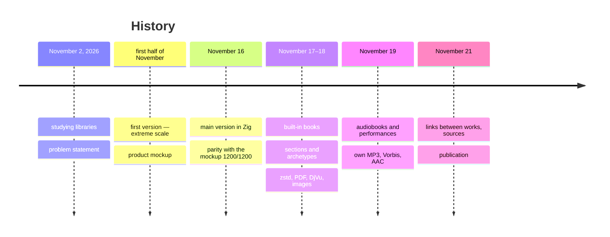

## Support the project

Clipper is a one-author project. It already does more than a home library needs, but it has a long
"not done and not verified" list: Linux in production, real Windows XP, journal compaction, OPDS for
e-readers.

A ship stays afloat as long as someone looks after it. If the idea resonates — a library on an old
PC, a site with nothing extra, knowledge that outlives any service — help it sail on:

- ⭐ star the repository — that is how the people who need it will find it;
- 🧭 tell how you use it: an issue with your case is worth more than any plan;
- 🛠 pick an item from [0x18-open-questions.md](src/books/0x18-open-questions.md) — and do it;
- ☕ [support it with a donation](https://slnknrr-dev.github.io/funding#?github=clipper-site-in-zig&locale=EN&source=README.md) — every donation turns into hours of work on the items in this list.

**[☕ Support Clipper](https://slnknrr-dev.github.io/funding#?github=clipper-site-in-zig&locale=EN&source=README.md)**

## Licenses

- Code — [MIT](LICENSE).
- Built-in books (`src/books/`) — [CC BY-SA 4.0](LICENSE-books).
- The corpus is not part of the repository: the texts are in the public domain and are reproduced by `corpus/fetch.mjs`.

Author: Yury Slinkin, 2026.
