# Клиппер

[](https://github.com/slnknrr-dev/clipper-site-in-zig/actions/workflows/test.yml)
[](https://github.com/slnknrr-dev/clipper-site-in-zig/releases)
[](LICENSE)
[](LICENSE-books)
[](https://ziglang.org/download/#release-0.14.1)

**Онлайн-библиотека с сообществом в одном исполняемом файле.** Книги, стихи и песни с аккордами,
черновики и статьи, форумы и анонимные доски, цитаты, аудиокниги и авторское исполнение — на чистом
Zig, без C, без сторонних библиотек и без базы данных. Страницы — как в 2003 году: HTML 4.01, таблицы,
формы, никакого JavaScript-приложения. Работает от Windows XP до Linux.

English version: [README.md](README.md).

> Clipper — быстрый парусный корабль. Главное в корабле — не скорость, а то, что он держится на воде.

<table>
<tr>
<td>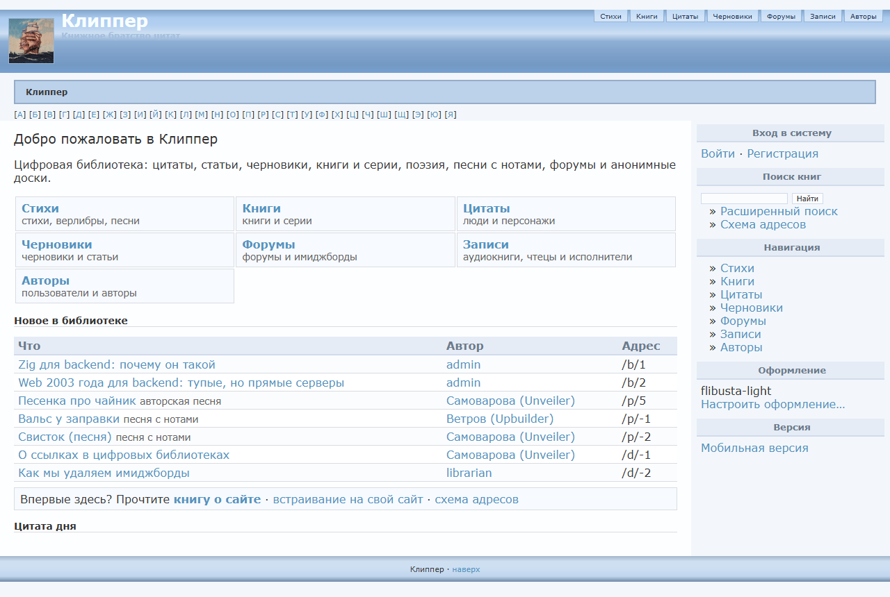</td>
<td>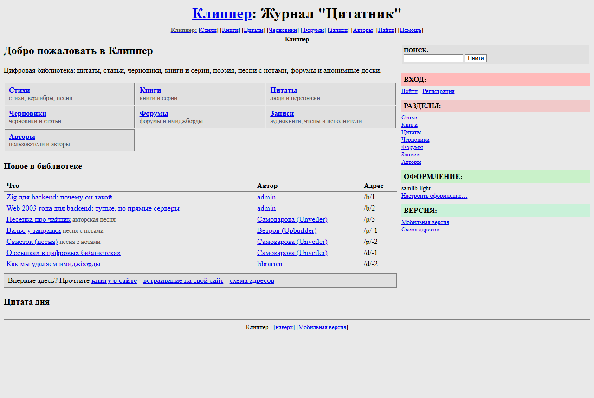</td>
</tr>
<tr>
<td align="center">тема flibusta</td>
<td align="center">тема samlib</td>
</tr>
<tr>
<td>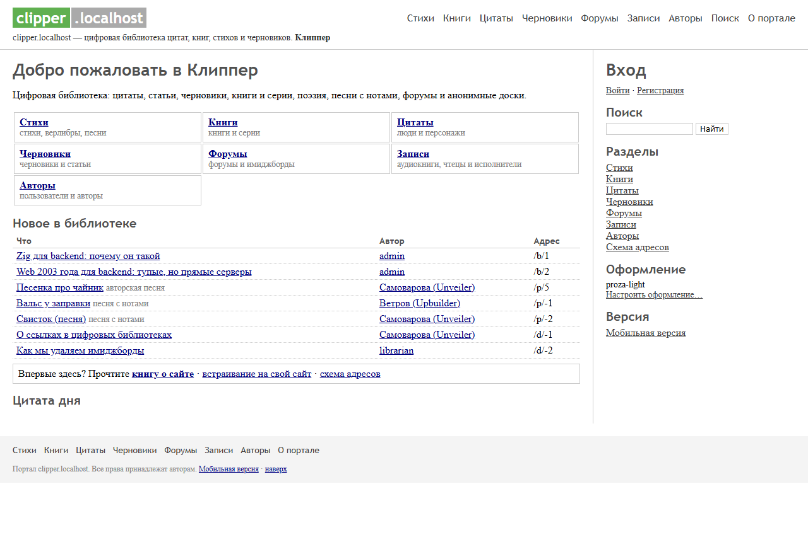</td>
<td>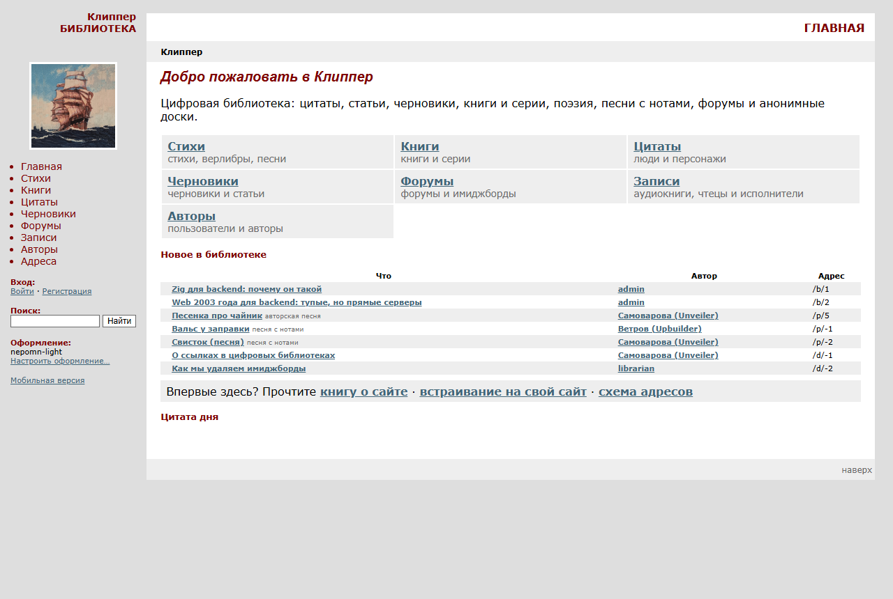</td>
</tr>
<tr>
<td align="center">тема proza</td>
<td align="center">тема nepomn</td>
</tr>
<tr>
<td>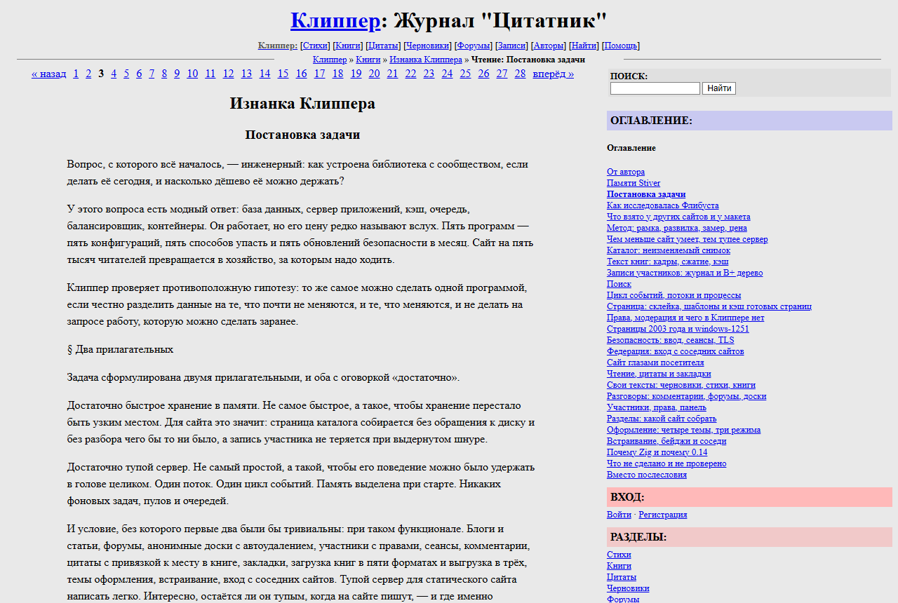</td>
<td>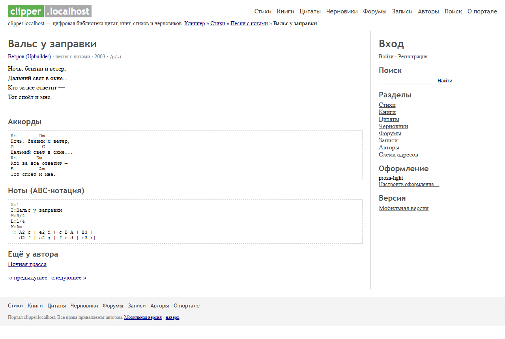</td>
</tr>
<tr>
<td align="center">чтение книги</td>
<td align="center">песня с аккордами и нотами</td>
</tr>
</table>

Одна программа — четыре темы, светлый, тёмный и «по часам» режимы, мобильная версия. Скачать — в [Releases](https://github.com/slnknrr-dev/clipper-site-in-zig/releases), подробно — [«Быстрый старт»](#быстрый-старт).

| | |
|---|---|
| язык | Zig 0.14.1, без libc |
| цели | Windows XP+ (x86, x86_64), Windows 10+, Linux x86_64 |
| хранение | снимок каталога в памяти + журнал записей (или B+ дерево) |
| сеть | свой HTTP/1.1, свой TLS 1.3 (исследование, см. [TLS_RU_RND.md](TLS_RU_RND.md)), федерация сайтов |
| скорость | ~70 тыс. гостевых страниц/с на одном потоке; ~195 тыс./с с `-w 8` |
| лицензии | код — [MIT](LICENSE), встроенные книги — [CC BY-SA 4.0](LICENSE-books) |


---

## Кому это пригодится

- **Домашняя библиотека и база знаний.** Книги, статьи, конспекты, стихи, песни с аккордами,
  цитаты — с поиском, закладками и источниками (mrakopedia, arxiv, habr…). Всё в одной папке,
  которую легко копировать и хранить.
- **Офлайн-литература.** Сайт не ходит в интернет: дача, корабль, школа без сети, поездка. Читать
  можно с любого устройства в локальной сети — даже со старого телефона или ноутбука.
- **Сообщество.** Литературный кружок, бардовский клуб, самиздат: свои архетипы сайта — песенник,
  читальня, цитатник, форум, мастерская.
- **Вторая жизнь старого ПК.** Это тот случай, когда компьютер из шкафа становится сервером: Клиппер
  собирается под Windows XP и не требует ничего, кроме себя. Поставьте рядом NGINX — и получится
  домашний сервер с сайтом-хранилищем.
- **Исследователям и студентам.** Внутри — свои zstd, TLS 1.3, B+ дерево, разбор PDF, DjVu, EPUB,
  MP3, Vorbis, AAC, JPEG, WebP, SVG. Каждое решение разобрано в книгах, встроенных в сам сервер.

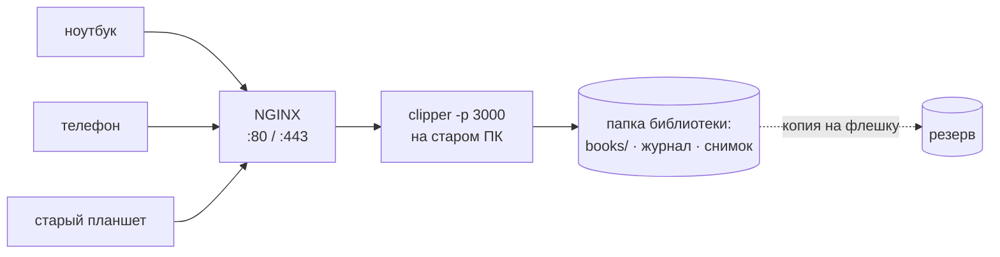

## Быстрый старт

### Готовая сборка

Скачайте архив своей системы со страницы [Releases](https://github.com/slnknrr-dev/clipper-site-in-zig/releases), распакуйте и запустите:

| архив | система | язык | книги |
|---|---|---|---|
| `clipper-<версия>-nt51-i686-ru-all.zip` | Windows XP и новее, 32 бита | ru | все три |
| `clipper-<версия>-nt51-x86_64-ru-all.zip` | Windows XP и новее, 64 бита | ru | все три |
| `clipper-<версия>-nt-i686-en-all.zip` | Windows 10+, 32 бита | en | все три |
| `clipper-<версия>-nt-x86_64-en-nobook.zip` | Windows 10+, 64 бита | en | без книг |
| `clipper-<версия>-linux-x86_64-en-all.zip` | Linux x86_64 | en | все три |

```bash
clipper -p 3000 -pwd ПАРОЛЬ
```

Контрольные суммы — `SHA256SUMS.txt` рядом с архивами. Как делаются релизы — [DEVOPS_RU_RND.md](DEVOPS_RU_RND.md).

### Из исходников

Нужен [Zig 0.14.1](https://ziglang.org/download/#release-0.14.1) — именно эта версия (почему — в
[1x16-versions-xp.md](src/books/ru/1x16-versions-xp.md)).

```bash
git clone https://github.com/slnknrr-dev/clipper-site-in-zig
cd clipper-site-in-zig
zig build
zig-out/bin/clipper -p 3000 -pwd ПАРОЛЬ
```

Откройте `http://localhost:3000/`. Книга о самом сайте — `/b/0`. Войти администратором `/u/0` можно
с этой же машины: логин `admin`, пароль из `-pwd`. Дальше заведите своего администратора — участника
с правами — и работайте от его имени.

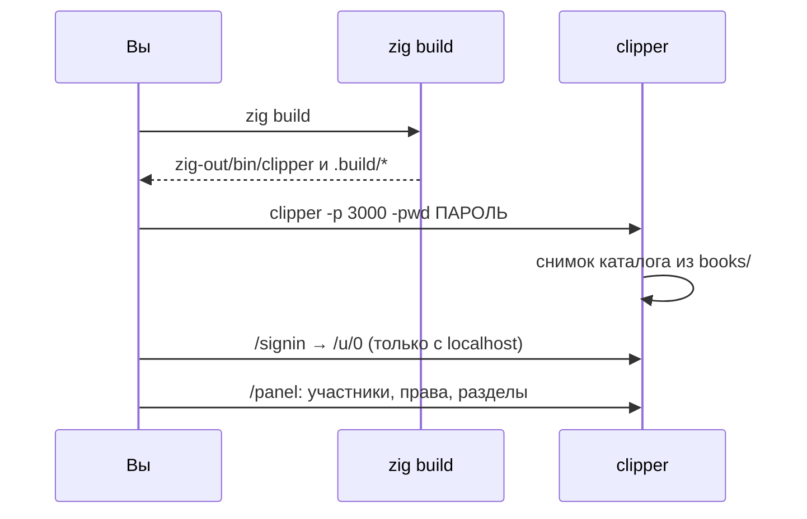

## Сборка

| команда | что получится |
|---|---|
| `zig build` | сервер для этой машины в `zig-out/bin/` и целевые сборки в `.build/` |
| `zig build dist` | только целевые: `nt-i686-en-all`, `nt-x86_64-en-nobook`, `nt51-i686-ru-all`, `nt51-x86_64-ru-all`, `linux-x86_64-en-all` |
| `zig build -Dtarget=x86_64-linux` | Linux |
| `zig build test` | модульные и сквозные тесты, враждебный ввод |
| `zig build fixture -- ПАПКА` | тестовая папка библиотеки с участниками и записями |

В CI (GitHub Actions) тег `v*` собирает все целевые сборки и выкладывает zip-архивы в релиз — подробно в [DEVOPS_RU_RND.md](DEVOPS_RU_RND.md).

`nt51` — Windows XP и новее, `nt` — Windows 10+; `-all` — все три встроенные книги, `-nobook` — без книг.

| параметр сборки | смысл | по умолчанию |
|---|---|---|
| `-Dlang=ru\|en` | язык интерфейса и встроенных книг | `ru` |
| `-Dbook0` | книга 0 «Изнанка Клиппера» (`/b/0`) | `true` |
| `-Dbooks` | книги 1 «Zig для backend» и 2 «Web 2003 года» | `false` |
| `-Dzstd` | свой zstd со словарём ([COMPRESSION_RU_RND.md](COMPRESSION_RU_RND.md)) | `true` |
| `-Dpdf`, `-Ddjvu` | разбор PDF и DjVu | `true` |
| `-Dvoice`, `-Dogg`, `-Dm4a` | раздел записей, приём .ogg и .m4a | `true`, `true`, `false` |

## Запуск

```
clipper -p PORT [-r ПАПКА] [-t flibusta|samlib|proza|nepomn] [-M|-R|-G|-N буквы]
        [-pwd ПАРОЛЬ | -phc PHC] [-w N] [-btree] [-zstd [N|ФАЙЛ]]
        [--tls-cert ФАЙЛ --tls-key ФАЙЛ] [-fed [...]]
```

| флаг | смысл |
|---|---|
| `-p PORT` | порт (обязателен) |
| `-r ПАПКА` | папка библиотеки; по умолчанию текущая |
| `-t ТЕМА` | тема по умолчанию: flibusta, samlib, proza, nepomn |
| `-c #rrggbb`, `-b #rrggbb` | главный и фирменный цвет |
| `-n НАЗВАНИЕ`, `-s АДРЕС` | название сайта и его адрес в оформлении |
| `-M`, `-R`, `-G`, `-N` + `pbdfqv` | раздел: пишут только модераторы / только чтение / открыт гостям / выключен |
| `-l`, `-pwd`, `-phc` | логин и пароль `/u/0` (`clipper hash` даёт строку PHC argon2id) |
| `-w N` | процессов-воркеров (1–64) |
| `-btree` | записи в B+ дереве вместо журнала |
| `-zstd` | кадры книг — своим zstd со словарём |
| `-pdf`, `-djvu` | принимать PDF и DjVu (экспериментально) |
| `--tls-cert`, `--tls-key` | https (свой TLS 1.3; ECDSA P-256 или Ed25519) |
| `-fed` | федерация с другими сайтами Клиппера |

### Примеры

| кейс | команда |
|---|---|
| полная библиотека | `clipper -p 3000 -pwd ПАРОЛЬ` |
| песенник: только стихи и песни | `clipper -p 3000 -Nbdfqv` |
| читальня: выкладывают только модераторы | `clipper -p 3000 -Ndfpq -Mb` |
| цитатник: книги скрыты, видны цитаты | `clipper -p 3000 -Nbdfp` |
| форум клуба | `clipper -p 3000 -Nbdpqv -t nepomn` |
| архив только для чтения | `clipper -p 3000 -Rpbdfqv` |
| сайт открыт гостям только стихами | `clipper -p 3000 -Gp` |
| своя тема и цвет | `clipper -p 3000 -t proza -c "#2e5e8c" -n "Домашняя библиотека"` |
| многоядерная машина | `clipper -p 3000 -w 4` |
| словарь из своей библиотеки | `clipper zstd 16 && clipper -p 3000 -zstd 16` |
| проверить книгу до загрузки | `clipper convert книга.pdf` |

## Домашний сервер: старый ПК + NGINX

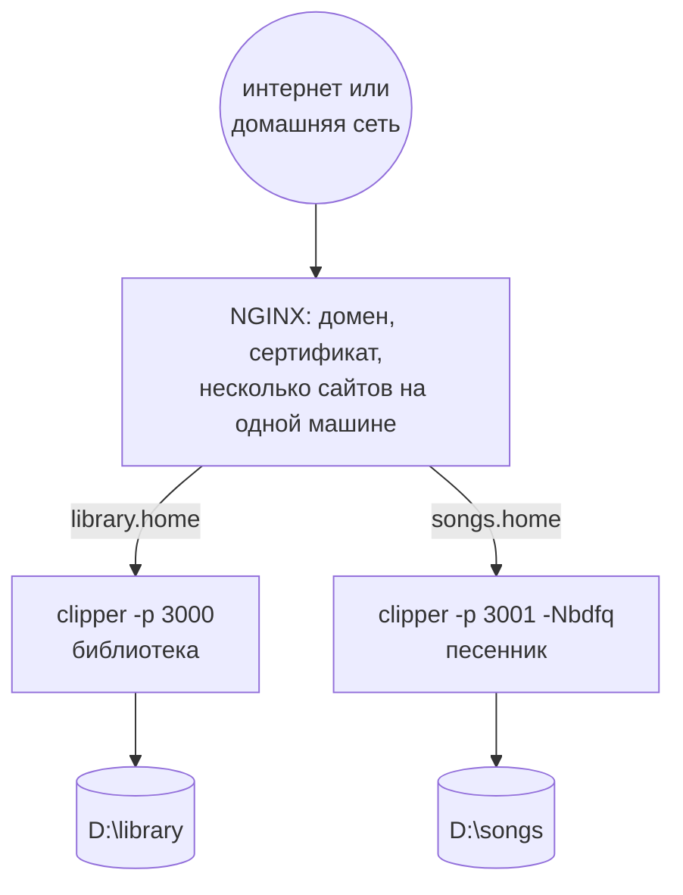

```nginx
server {
    listen 80;
    server_name library.home;

    client_max_body_size 200m;          # аудиокниги — до 200 МБ

    location / {
        proxy_pass http://127.0.0.1:3000;
        proxy_set_header Host $host;
        proxy_set_header X-Forwarded-For $proxy_add_x_forwarded_for;
        proxy_http_version 1.1;
        proxy_set_header Connection "";
    }
}
```

> **Вход `/u/0` и прокси.** `/u/0` пускает только с этой машины. За NGINX на том же компьютере все
> соединения идут с `127.0.0.1`, поэтому Клиппер считает запрос внешним, если в нём есть заголовок
> прокси (`X-Forwarded-For`, `X-Real-IP`, `Forwarded`, `Via`): через прокси в `/u/0` не войти. Строка
> `proxy_set_header X-Forwarded-For` в конфиге выше обязательна. Настраивайте сайт, открыв
> `http://localhost:3000/` прямо на сервере, затем заведите своего администратора.

> **HTTPS.** Свой TLS 1.3 в Клиппере — исследование: стороннего аудита нет, RSA-ключи не
> поддерживаются. В домашней сети и в интернете HTTPS лучше отдать NGINX (Let's Encrypt, проверенная
> библиотека TLS), а порт Клиппера (`3000`) закрыть брандмауэром снаружи: сервер слушает все
> интерфейсы, и без этого к нему можно прийти напрямую, мимо NGINX. Подробно — [TLS_RU_RND.md](TLS_RU_RND.md).

Резервная копия — это папка библиотеки: книги, журнал записей, картинки и записи. Снимок каталога
производный и пересобирается сам.

## Как устроено

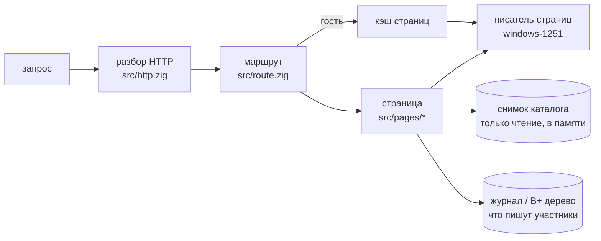

Данные делятся на те, что читают, и те, что пишут. Первые готовятся заранее (снимок), вторые
записываются самым простым способом, который переживает сбой (журнал). Подробно — в книге 0.

## Документация и исследования

Проект ведётся с 2 ноября 2026 года как исследование: у каждого решения записаны отвергнутые пути,
тупики и то, что было бы лучше при других условиях.

| документ | о чём |
|---|---|
| [DIGITALLIBRARY_RU_RND.md](DIGITALLIBRARY_RU_RND.md) | предметная область и UX/UI: flibusta, samlib, proza, nepomn; целевые вопросы; архетипы |
| [Y2K_RU_RND.md](Y2K_RU_RND.md) | технологии до 2003 года как ограничение; UI/UX и переиспользование |
| [EBOOKS_RU_RND.md](EBOOKS_RU_RND.md) | форматы книг и картинок, проектирование разборщиков |
| [COMPRESSION_RU_RND.md](COMPRESSION_RU_RND.md) | от deflate к своему zstd со словарём |
| [CORPUS_RU_RND.md](CORPUS_RU_RND.md) | корпус, обучение словарей и замеры |
| [DEVOPS_RU_RND.md](DEVOPS_RU_RND.md) | сборка, CI и релизы; справка по Zig и GitHub |
| [TLS_RU_RND.md](TLS_RU_RND.md) | HTTPS в Zig, свой TLS 1.3 и сценарий с NGINX |
| [BACKLOG_RU.md](BACKLOG_RU.md) | бэклог и инженерный журнал: что не сделано и не проверено, устройство по разделам |
| [BACKEND_RU_CV.md](BACKEND_RU_CV.md) | почему Zig, C для reverse proxy и как я подбираю решения |

### Встроенные книги

Книги написаны в Markdown и вшиваются в сервер при сборке — их можно читать прямо здесь:

| книга | на сайте | исходник |
|---|---|---|
| 0 · «Изнанка Клиппера» — исследование устройства сайта | `/b/0` | [src/books/ru/0x00-title-intro.md](src/books/ru/0x00-title-intro.md) |
| 1 · «Zig для backend: почему он такой» | `/b/1` | [src/books/ru/1x00-title-intro.md](src/books/ru/1x00-title-intro.md) |
| 2 · «Web 2003 года для backend» | `/b/2` | [src/books/ru/2x00-title-intro.md](src/books/ru/2x00-title-intro.md) |

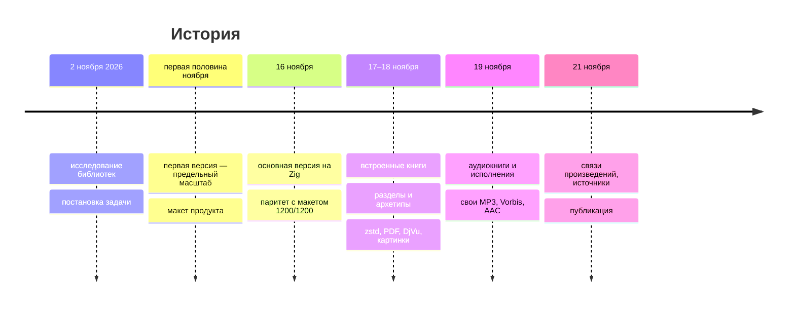

## Поддержать проект

Клиппер — проект одного автора. Он уже умеет больше, чем нужно домашней библиотеке, но у него
длинный список «не сделано и не проверено»: Linux в работе, настоящая Windows XP, уплотнение журнала,
OPDS для читалок, английские книги.

Корабль держится на воде, пока о нём заботятся. Если идея близка — библиотека на старом ПК, сайт
без лишнего, знание, которое переживёт любой сервис, — помогите ему идти дальше:

- ⭐ поставьте звезду — так проект найдут те, кому он нужен;
- 🧭 расскажите, как вы его используете: issue с вашим кейсом ценнее любого плана;
- 🛠 возьмите пункт из [0x18-open-questions.md](src/books/ru/0x18-open-questions.md) — и сделайте его;
- ☕ [поддержите донатом](https://slnknrr-dev.github.io/funding#?github=clipper-site-in-zig&locale=RU&source=README.md) — каждый донат превращается в часы работы над тем, что вы видите в этом списке.

**[☕ Поддержать Клиппер](https://slnknrr-dev.github.io/funding#?github=clipper-site-in-zig&locale=RU&source=README.md)**

## Лицензии

- Код — [MIT](LICENSE).
- Встроенные книги (`src/books/`) — [CC BY-SA 4.0](LICENSE-books).
- Корпус в репозиторий не входит: тексты — общественное достояние, их воспроизводит `corpus/fetch.mjs`.

Автор: Yury Slinkin, 2026.
