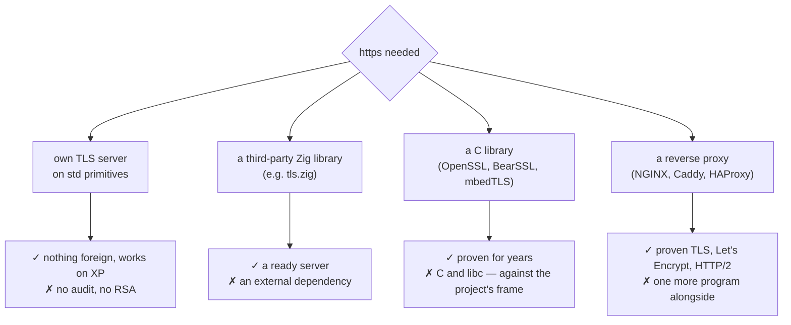
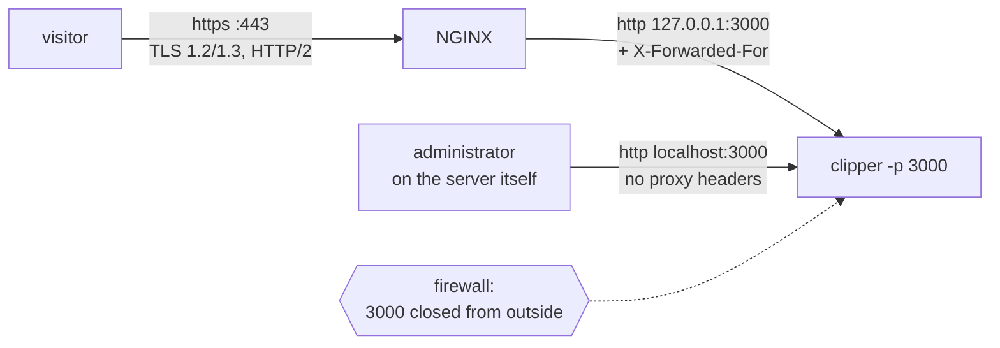

# TLS and HTTPS: what Zig has, what Clipper built, and how to run it behind NGINX

How a Zig site answers over https, why Clipper wrote its own TLS 1.3 server, what that server lacks,
and why in production HTTPS is better left to NGINX.

Русская версия: [TLS_RU_RND.md](TLS_RU_RND.md).

## 1. HTTPS in Zig 0.14: what the standard library has

| what | in std 0.14.1 | what it means for Clipper |
|---|---|---|
| TLS client (`std.crypto.tls.Client`) | yes | outgoing https requests: federation (`/fed/verify`), `clipper fedcheck` |
| TLS server | **no** | answering over https requires writing a server or putting a proxy in front |
| HTTP server (`std.http.Server`) | yes, without TLS | not used: our own HTTP parsing is stricter and allocates nothing per request |
| primitives: X25519, AES-GCM, ChaCha20-Poly1305, HKDF, SHA-2, ECDSA P-256, Ed25519 | yes | our own TLS 1.3 server is built from them |
| RSA signing | **no** | Clipper does not accept certificates with an RSA key |
| the system's root certificate store | yes (`std.crypto.Certificate.Bundle`) | the client verifies neighboring sites' certificates |

The options for a Zig server that needs https:



The project's frame is "no C and no third-party libraries", so inside the program only path A is
possible. Path D does not break the frame: the proxy is a separate program, not part of Clipper.

## 2. What was built: our own TLS 1.3 server

| property | value |
|---|---|
| version | TLS 1.3 only |
| key exchange | X25519 |
| ciphers | TLS_AES_128_GCM_SHA256, TLS_CHACHA20_POLY1305_SHA256 |
| certificate signature | ECDSA P-256 or Ed25519 (RSA — the server refuses to start and explains why) |
| ALPN | `http/1.1` |
| missing | session resumption, 0-RTT, HTTP/2, client certificates |
| size | about 860 lines (`src/net/tls.zig`) |
| launch | `clipper -p 443 --tls-cert cert.pem --tls-key key.pem` |

Every missing feature is code that cannot be wrong. The session core works on bytes and knows nothing
about sockets, so it is tested without a network:

- key derivation is checked against the RFC 8448 reference vectors;
- a record is encrypted and decrypted in a test; a corrupted ClientHello does not crash parsing;
- from outside: `curl --tlsv1.3` and `openssl s_client -tls1_3` with ECDSA P-256 and Ed25519 keys and both ciphers.

Details — [0x14-security-tls.md](src/books/0x14-security-tls.md).

### Build specifics

| build | TLS server | TLS client (federation over https) |
|---|---|---|
| Windows 10+, Linux | yes | yes |
| Windows XP (`nt51-*`) | yes — our own code, no system TLS needed | **no**: the std client asks for the time via a Windows 8 function — federation over http only |

2003 browsers do not know TLS 1.3: they reach Clipper over http. This is a deliberate step out of the
era ([Y2K_RND.md](Y2K_RND.md)).

## 3. What our own TLS lacks

It is a cryptographic protocol written by someone who is not a cryptography specialist and has had no
third-party audit. Compatibility with curl and openssl proves that the protocol **works**, not that
it is **secure**: for example, that response timing does not leak the key.

| risk | status |
|---|---|
| implementation audit | none |
| timing attacks | not studied |
| RSA certificates | not supported |
| HTTP/2 | no |
| certificate renewal without a restart | no |

Conclusion: our own TLS is fine for development, an internal network and as research. On the open
internet — behind a proxy.

## 4. The scenario: Clipper behind NGINX



```nginx
server {
    listen 443 ssl http2;
    server_name library.example.org;

    ssl_certificate     /etc/letsencrypt/live/library.example.org/fullchain.pem;
    ssl_certificate_key /etc/letsencrypt/live/library.example.org/privkey.pem;

    client_max_body_size 200m;          # audiobooks — up to 200 MB

    location / {
        proxy_pass http://127.0.0.1:3000;
        proxy_set_header Host $host;
        proxy_set_header X-Forwarded-For $proxy_add_x_forwarded_for;
        proxy_http_version 1.1;
        proxy_set_header Connection "";
    }
}

server {
    listen 80;
    server_name library.example.org;
    return 301 https://$host$request_uri;
}
```

### Three rules

1. **The `X-Forwarded-For` header is required.** `/u/0` sign-in is allowed only from this machine,
   and behind NGINX every connection comes from `127.0.0.1`. Clipper treats a request as external if
   it carries any proxy header — `X-Forwarded-For`, `X-Real-IP`, `Forwarded`, `Via`: `/u/0` cannot be
   signed into, and a `/u/0` session opened locally does not work through the proxy. Without this line
   in the config the "this machine only" protection loses its meaning and only the password remains.
2. **Clipper's port is closed from outside.** The server listens on all interfaces; without a
   firewall rule it can be reached directly, bypassing NGINX and its TLS.
3. **Set up from the server itself.** Open `http://localhost:3000/` on that machine (or through an
   SSH tunnel), sign in as `/u/0`, create your own administrator member and then work as them through
   NGINX.

### What NGINX gives on top of our own TLS

| feature | own TLS | NGINX |
|---|---|---|
| Let's Encrypt certificates (RSA and ECDSA) | ECDSA/Ed25519 only, restart on renewal | yes, automatically |
| TLS 1.2 for older clients | no | yes |
| HTTP/2, HTTP/3 | no | yes |
| several sites on one machine | one site per port | by `server_name` |
| a proven implementation | no audit | years in production |

If you still want our own TLS directly, get a Let's Encrypt certificate with an ECDSA key
(`certbot --key-type ecdsa`) and restart Clipper after every renewal.

## 5. Deployment options

| scenario | how | when |
|---|---|---|
| home network without encryption | `clipper -p 3000` | a trusted network, old devices |
| own TLS directly | `clipper -p 443 --tls-cert … --tls-key …` | development, an internal network, Windows XP without a proxy |
| **NGINX + Clipper over http** | the config above | **the internet, the recommended option** |
| NGINX as a TCP proxy to our own TLS | `stream { … }` | if you specifically need our own TLS but on a shared port 443 |

## 6. What next

- An address binding flag (`-bind 127.0.0.1`) so as not to rely on a firewall — in [BACKLOG.md](BACKLOG.md).
- A third-party audit or a `testssl.sh` run for our own TLS.
- Certificate renewal without a restart.
