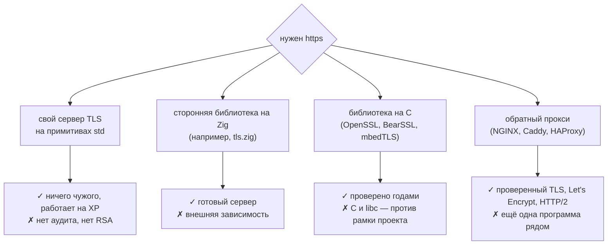
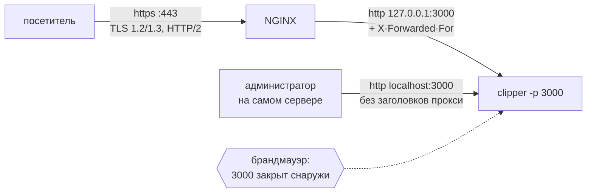

# TLS и HTTPS: что есть в Zig, что сделано в Клиппере и как ставить за NGINX

Как сайт на Zig отвечает по https, почему Клиппер написал свой сервер TLS 1.3, чего этому серверу
не хватает и почему в продакшене HTTPS стоит отдать NGINX.

English version: [TLS_RND.md](TLS_RND.md).

## 1. HTTPS в Zig 0.14: что есть в стандартной библиотеке

| что | в std 0.14.1 | что это значит для Клиппера |
|---|---|---|
| клиент TLS (`std.crypto.tls.Client`) | есть | исходящие https-запросы: федерация (`/fed/verify`), `clipper fedcheck` |
| сервер TLS | **нет** | отвечать по https своими силами невозможно — нужно писать сервер или ставить прокси |
| HTTP-сервер (`std.http.Server`) | есть, без TLS | не используется: свой разбор HTTP строже и не выделяет память на запрос |
| примитивы: X25519, AES-GCM, ChaCha20-Poly1305, HKDF, SHA-2, ECDSA P-256, Ed25519 | есть | из них собран свой сервер TLS 1.3 |
| подпись RSA | **нет** | сертификаты с ключом RSA Клиппер не принимает |
| хранилище корневых сертификатов системы | есть (`std.crypto.Certificate.Bundle`) | клиент проверяет сертификаты соседних сайтов |

Варианты для сервера на Zig, которому нужен https:



Рамка проекта — «ни C, ни сторонних библиотек», поэтому внутри программы возможен только путь A.
Путь D рамку не нарушает: прокси — отдельная программа, а не часть Клиппера.

## 2. Что сделано: свой сервер TLS 1.3

| свойство | значение |
|---|---|
| версия | только TLS 1.3 |
| обмен ключами | X25519 |
| шифры | TLS_AES_128_GCM_SHA256, TLS_CHACHA20_POLY1305_SHA256 |
| подпись сертификата | ECDSA P-256 или Ed25519 (RSA — сервер не стартует и объясняет почему) |
| ALPN | `http/1.1` |
| нет | возобновления сеансов, 0-RTT, HTTP/2, клиентских сертификатов |
| объём | около 860 строк (`src/net/tls.zig`) |
| запуск | `clipper -p 443 --tls-cert cert.pem --tls-key key.pem` |

Каждая отсутствующая возможность — код, в котором нельзя ошибиться. Ядро сеанса работает над байтами
и не знает о сокетах, поэтому проверяется без сети:

- выведение ключей сверено с эталонными векторами RFC 8448;
- запись шифруется и расшифровывается в тесте; испорченный ClientHello не роняет разбор;
- снаружи: `curl --tlsv1.3` и `openssl s_client -tls1_3` с ключами ECDSA P-256 и Ed25519, обоими шифрами.

Подробно — [0x14-security-tls.md](src/books/ru/0x14-security-tls.md).

### Особенности сборок

| сборка | сервер TLS | клиент TLS (федерация по https) |
|---|---|---|
| Windows 10+, Linux | есть | есть |
| Windows XP (`nt51-*`) | есть — свой код, системный TLS не нужен | **нет**: клиент std спрашивает время у функции из Windows 8 — федерация только по http |

Браузеры 2003 года TLS 1.3 не знают: они ходят к Клипперу по http. Это сознательный выход из эпохи
([Y2K_RU_RND.md](Y2K_RU_RND.md)).

## 3. Чего не хватает своему TLS

Это криптографический протокол, написанный не специалистом по криптографии и не проходивший
стороннего аудита. Совместимость с curl и openssl доказывает, что протокол **работает**, но не то, что
он **безопасен**: например, что время ответа не раскрывает ключ.

| риск | статус |
|---|---|
| аудит реализации | не было |
| атаки по времени | не исследовались |
| RSA-сертификаты | не поддерживаются |
| HTTP/2 | нет |
| обновление сертификата без перезапуска | нет |

Вывод: свой TLS годится для разработки, внутренней сети и как исследование. В открытом интернете — за
прокси.

## 4. Сценарий: Клиппер за NGINX



```nginx
server {
    listen 443 ssl http2;
    server_name library.example.org;

    ssl_certificate     /etc/letsencrypt/live/library.example.org/fullchain.pem;
    ssl_certificate_key /etc/letsencrypt/live/library.example.org/privkey.pem;

    client_max_body_size 200m;          # аудиокниги — до 200 МБ

    location / {
        proxy_pass http://127.0.0.1:3000;
        proxy_set_header Host $host;
        proxy_set_header X-Forwarded-For $proxy_add_x_forwarded_for;
        proxy_http_version 1.1;
        proxy_set_header Connection "";
    }
}

server {
    listen 80;
    server_name library.example.org;
    return 301 https://$host$request_uri;
}
```

### Три правила

1. **Заголовок `X-Forwarded-For` обязателен.** Вход `/u/0` разрешён только с этой машины, а за NGINX
   все соединения идут с `127.0.0.1`. Клиппер считает запрос внешним, если в нём есть любой из
   заголовков прокси — `X-Forwarded-For`, `X-Real-IP`, `Forwarded`, `Via`: войти в `/u/0` нельзя, а
   уже открытый локально сеанс `/u/0` через прокси не действует. Без этой строки в конфиге защита
   «только с этой машины» теряет смысл и остаётся один пароль.
2. **Порт Клиппера закрыт снаружи.** Сервер слушает все интерфейсы; без правила брандмауэра к нему
   можно прийти напрямую, мимо NGINX и его TLS.
3. **Настройка — с самого сервера.** Откройте `http://localhost:3000/` на этой машине (или через
   SSH-туннель), войдите в `/u/0`, заведите своего администратора-участника и работайте от его имени
   уже через NGINX.

### Что даёт NGINX сверх своего TLS

| возможность | свой TLS | NGINX |
|---|---|---|
| сертификаты Let's Encrypt (RSA и ECDSA) | только ECDSA/Ed25519, перезапуск при обновлении | да, автоматически |
| TLS 1.2 для старых клиентов | нет | да |
| HTTP/2, HTTP/3 | нет | да |
| несколько сайтов на одной машине | один сайт на порт | по `server_name` |
| проверенная реализация | нет аудита | годы в продакшене |

Если всё же нужен свой TLS напрямую — возьмите у Let's Encrypt сертификат с ключом ECDSA
(`certbot --key-type ecdsa`) и перезапускайте Клиппер после каждого обновления.

## 5. Варианты развёртывания

| сценарий | как | когда |
|---|---|---|
| домашняя сеть без шифрования | `clipper -p 3000` | доверенная сеть, старые устройства |
| свой TLS напрямую | `clipper -p 443 --tls-cert … --tls-key …` | разработка, внутренняя сеть, Windows XP без прокси |
| **NGINX + Клиппер по http** | конфиг выше | **интернет, рекомендуемый вариант** |
| NGINX как TCP-прокси до своего TLS | `stream { … }` | если нужен именно свой TLS, но на общем порту 443 |

## 6. Что дальше

- Флаг привязки к адресу (`-bind 127.0.0.1`), чтобы не полагаться на брандмауэр — в [BACKLOG_RU.md](BACKLOG_RU.md).
- Сторонний аудит или прогон `testssl.sh` для своего TLS.
- Обновление сертификата без перезапуска.
