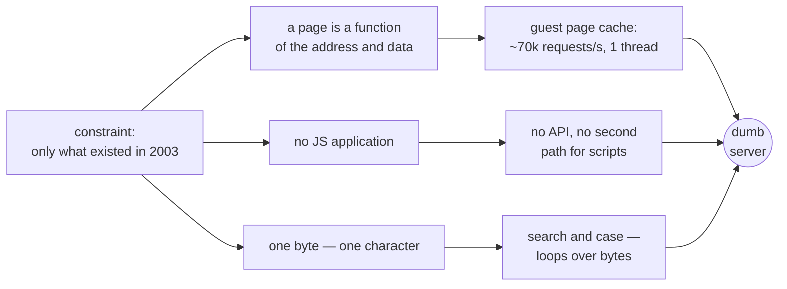
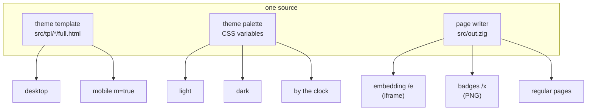

# Y2K: technologies up to and including 2003 as a design constraint

Clipper is deliberately built the way sites were built in 2003: HTML 4.01, tables, level-2 CSS,
forms instead of scripts, windows-1251, MP3 at 128 kbit/s. This document explains why this is not
nostalgia but an engineering constraint, and how it shaped the UI/UX and code reuse.

Русская версия: [Y2K_RU_RND.md](Y2K_RU_RND.md).

The full study of the era is book 2, "The 2003 Web for the backend" ([src/books/2x00-title-intro.md](src/books/2x00-title-intro.md)),
compiled into the server with `-Dbooks=true` and served at `/b/2`.

## 1. Why limit yourself to 2003

The constraint works as a filter: if a feature cannot be made with a form and a link, it probably
should not exist. It also makes the site usable on any device — from Lynx to a phone — and over any
connection.

## 2. What was studied

| area | what existed in 2003 | what Clipper took | chapter |
|---|---|---|---|
| browsers | IE6 on most machines, IE5, Netscape 4–7, Mozilla, Opera 6–7, Safari 1.0, Lynx | everything essential works without scripts and styles | [2x01](src/books/2x01-era-browsers.md) |
| markup | HTML 4.01 Transitional, tables for layout | Transitional, theme layouts in tables | [2x02](src/books/2x02-standards-html.md) |
| styles | CSS1 everywhere, CSS2 partly | style is an enhancement; header gradients are 1 px BMPs drawn by the server | [2x03](src/books/2x03-standards-css.md) |
| protocol | HTTP/1.1: keep-alive, Range, conditional requests | Range, ETag, 304, strict parsing | [2x04](src/books/2x04-http-protocol.md) |
| forms | the only way to talk to the server | every action is a form; POST → 303 | [2x05](src/books/2x05-forms.md) |
| scripts | ES3, DOM 1, "works without the script" | one script: the quote context menu (since IE5) | [2x06](src/books/2x06-javascript.md) |
| encodings | windows-1251, KOI8-R, UTF-8 for a few | windows-1251 inside, UTF-8 at the boundaries | [2x07](src/books/2x07-encodings.md) |
| images | GIF, JPEG, PNG without alpha in IE | PNG/JPEG, BMP gradients, PNG badges, iframe embedding | [2x08](src/books/2x08-images-embed.md) |
| mobile | WAP/WML, i-mode, "lite" versions | `m=true`: one column, menu as a list | [2x09](src/books/2x09-mobile.md) |
| servers | CGI, mod_perl, PHP, static files | a "dumb direct server": ready bytes | [2x10](src/books/2x10-server-dumb.md) |
| speed | modem, 3–5 KB/s | 5–30 KB pages, styles in a separate cached file | [2x11](src/books/2x11-performance.md) |
| unambiguity | the address describes everything | theme and version are address parameters, not cookies | [2x12](src/books/2x12-unambiguity.md) |
| sound | MP3 128 kbit/s, ID3v1 | any input is re-encoded to MPEG-1 Layer III CBR 128, ID3v1 | [0x16](src/books/0x16-site-ux.md) |
| OS | Windows XP | target builds for XP (x86 and x86_64) without a C library | [1x16](src/books/1x16-versions-xp.md) |

## 3. Designing UI/UX within the constraint

- **Layout with tables, decoration with styles.** Without styles a page stays readable; with styles
  it gets a theme. The markup of a theme is the same for the light, dark and "by the clock" modes:
  colors come from a separate `/css/theme-mode.css`.
- **Theme and mobile version live in the address** (`t=samlib-dark`, `m=true`). The page writer adds
  them to every link itself: an address opened with the `{U}` mark and closed with `{E}`. They cannot
  be forgotten.
- **A context menu that nothing depends on.** Below the book text there is a form that does the same
  as the quote and bookmark menu.
- **Sortable tables (the nepomn theme)** — DOM 1 and ES3; without the script the table simply does not sort.
- **Sound.** `<audio>` for new browsers, a link to the MP3 inside it for old ones.

## 4. Reuse

The era's constraint gave reuse almost for free:

- One page function serves the site, embedding on other sites (`/e`) and the cache.
- One palette is recomputed from the main color (`-c`) for all themes.
- One form handler serves a 2003 browser and a modern one.

## 5. Where Clipper honestly leaves 2003

| what | from | why |
|---|---|---|
| TLS 1.3 | 2018 | security; old browsers use http |
| form protection (CSRF) | after 2005 | without it a site with writing is vulnerable |
| Argon2id | 2015 | the era's hashes have long been broken |
| CSS variables, `prefers-color-scheme` | 2016–2019 | one markup for all modes |
| `meta viewport` | 2007 | modern phones |
| `<audio>` | 2010 | a player right on the page |

Details — [2x13-limits-today.md](src/books/2x13-limits-today.md).

## 6. The price of the constraint

- A single-byte encoding keeps the site within windows-1251 languages: Georgian, Chinese and so on are not supported.
- Table layouts are worse for screen readers.
- Nothing updates by itself: new content appears after reloading the page.

This price is accepted deliberately; what would be better under other conditions is discussed in
[0x13-format-encoding.md](src/books/0x13-format-encoding.md).
