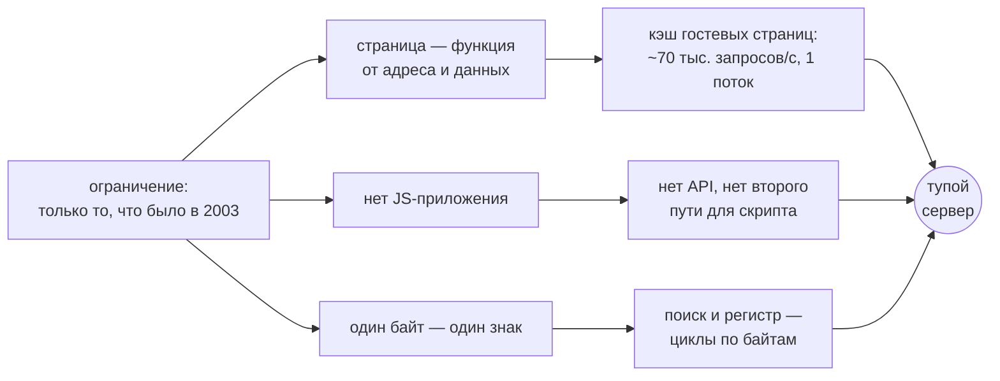
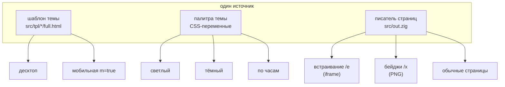

# Y2K: технологии до 2003 года включительно как проектное ограничение

Клиппер нарочно сделан так, как делали сайты в 2003 году: HTML 4.01, таблицы, CSS второго уровня,
формы вместо скриптов, windows-1251, MP3 128 кбит/с. Этот документ объясняет, почему это не
ностальгия, а инженерное ограничение, и как оно повлияло на UI/UX и на переиспользование кода.

English version: [Y2K_RND.md](Y2K_RND.md).

Полный разбор эпохи — книга 2 «Web 2003 года для backend» ([src/books/ru/2x00-title-intro.md](src/books/ru/2x00-title-intro.md)),
встраивается в сервер с `-Dbooks=true` и открывается по `/b/2`.

## 1. Зачем ограничивать себя 2003 годом

Ограничение работает как фильтр: если функцию нельзя сделать формой и ссылкой, её, скорее всего, не
нужно делать. Оно же делает сайт доступным на любом устройстве — от Lynx до телефона — и с любого
канала.

## 2. Что исследовалось

| область | что было в 2003 | что взял Клиппер | глава |
|---|---|---|---|
| браузеры | IE6 на большинстве машин, IE5, Netscape 4–7, Mozilla, Opera 6–7, Safari 1.0, Lynx | всё главное работает без скриптов и стилей | [2x01](src/books/ru/2x01-era-browsers.md) |
| разметка | HTML 4.01 Transitional, таблицы для раскладки | Transitional, раскладка тем — таблицами | [2x02](src/books/ru/2x02-standards-html.md) |
| стили | CSS1 везде, CSS2 частично | стиль — улучшение; градиенты шапок — BMP 1 px, который рисует сервер | [2x03](src/books/ru/2x03-standards-css.md) |
| протокол | HTTP/1.1: keep-alive, Range, условные запросы | Range, ETag, 304, строгий разбор | [2x04](src/books/ru/2x04-http-protocol.md) |
| формы | единственный способ сказать серверу | всё действие — форма; POST → 303 | [2x05](src/books/ru/2x05-forms.md) |
| скрипты | ES3, DOM 1, «работает без скрипта» | один скрипт: контекстное меню цитат (с IE5) | [2x06](src/books/ru/2x06-javascript.md) |
| кодировки | windows-1251, KOI8-R, UTF-8 у немногих | windows-1251 внутри, UTF-8 на границах | [2x07](src/books/ru/2x07-encodings.md) |
| картинки | GIF, JPEG, PNG без альфы в IE | PNG/JPEG, BMP-градиенты, PNG-бейджи, iframe-встраивание | [2x08](src/books/ru/2x08-images-embed.md) |
| мобильные | WAP/WML, i-mode, «облегчённые» версии | `m=true`: одна колонка, меню списком | [2x09](src/books/ru/2x09-mobile.md) |
| серверы | CGI, mod_perl, PHP, статика | «тупой прямой сервер»: готовые байты | [2x10](src/books/ru/2x10-server-dumb.md) |
| скорость | модем 3–5 КБ/с | страница 5–30 КБ, стили отдельным файлом в кэше | [2x11](src/books/ru/2x11-performance.md) |
| однозначность | адрес описывает всё | тема и версия — параметры адреса, не cookie | [2x12](src/books/ru/2x12-unambiguity.md) |
| звук | MP3 128 кбит/с, ID3v1 | любой вход перекодируется в MPEG-1 Layer III CBR 128, ID3v1 | [0x16](src/books/ru/0x16-site-ux.md) |
| ОС | Windows XP | целевые сборки для XP (x86 и x86_64) без библиотеки C | [1x16](src/books/ru/1x16-versions-xp.md) |

## 3. Проектирование UI/UX внутри ограничения

- **Раскладка — таблицей, оформление — стилем.** Без стилей страница остаётся читаемой; со стилями
  получает тему. Разметка одной темы одинакова для светлого, тёмного и «по часам» режима: цвета —
  отдельным файлом `/css/тема-режим.css`.
- **Тема и мобильная версия — в адресе** (`t=samlib-dark`, `m=true`). Писатель страниц сам дописывает
  их в каждую ссылку: адрес, начатый меткой `{U}` и закрытый `{E}`. Забыть невозможно.
- **Контекстное меню без зависимости от него.** Под текстом книги есть форма, которая делает то же,
  что меню цитат и закладок.
- **Таблицы с сортировкой (тема nepomn)** — DOM 1 и ES3; без скрипта таблица просто не сортируется.
- **Звук.** `<audio>` для новых браузеров, ссылка на MP3 внутри него — для старых.

## 4. Переиспользование

Ограничение эпохи дало переиспользование почти даром:

- Одна страница-функция обслуживает сайт, встраивание на чужие сайты (`/e`) и кэш.
- Одна палитра пересчитывается от главного цвета (`-c`) для всех тем.
- Один разбор формы — для браузера 2003 года и для современного.

## 5. Где Клиппер честно выходит из 2003 года

| что | откуда | зачем |
|---|---|---|
| TLS 1.3 | 2018 | безопасность; старые браузеры ходят по http |
| защита форм (CSRF) | после 2005 | без неё сайт с записью уязвим |
| Argon2id | 2015 | хеши эпохи давно ломаются |
| CSS-переменные, `prefers-color-scheme` | 2016–2019 | одна разметка на все режимы |
| `meta viewport` | 2007 | современные телефоны |
| `<audio>` | 2010 | проигрыватель прямо на странице |

Подробно — [2x13-limits-today.md](src/books/ru/2x13-limits-today.md).

## 6. Цена ограничения

- Однобайтовая кодировка держит сайт в языках windows-1251: грузинский, китайский и т. п. не поддерживаются.
- Раскладка таблицами хуже для программ чтения с экрана.
- Ничего не обновляется само: новое видно после перезагрузки страницы.

Это цена, принятая сознательно; что было бы лучше при других условиях, разобрано в
[0x13-format-encoding.md](src/books/ru/0x13-format-encoding.md).
